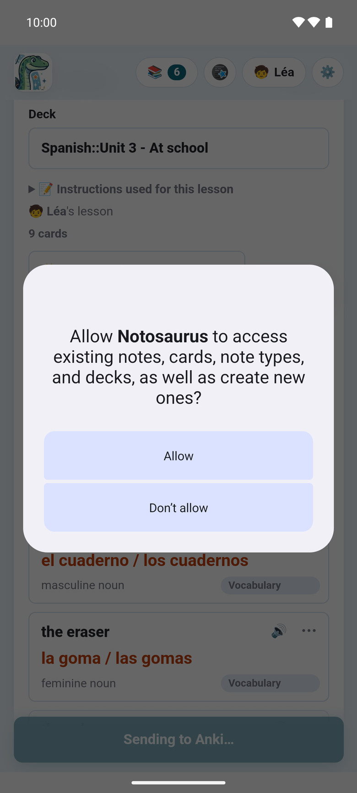
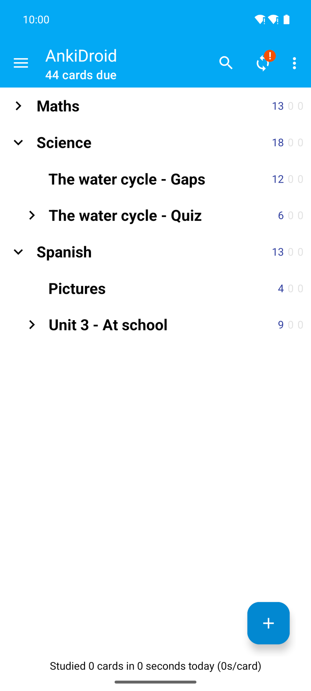
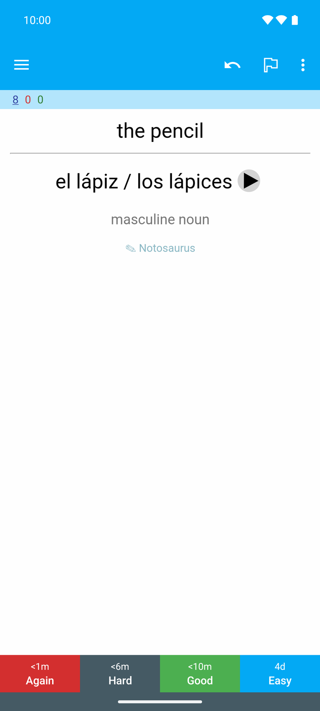

On this phone, the cards go into **AnkiDroid**, Anki's free app for Android: no `.apkg`, no
computer, no sync to wait for.

## The first time

1. **Install AnkiDroid** from Google Play, if it isn't there: the app opens its page when it is
   missing.
2. **Open AnkiDroid once**, so that it creates its collection.
3. At the first **📥 Add to Anki**, AnkiDroid asks whether Notosaurus may add cards to it
   (AnkiDroid's own dialog): allow it.

**📥 AnkiDroid**, in the app's settings, says where things stand: **✓ AnkiDroid is installed and
Notosaurus may add cards to it**, or a button to **Install AnkiDroid** or to **Allow**.

## Sending the cards

**📥 Add to Anki** writes the cards into AnkiDroid, in the lesson's deck, with their sounds and
pictures. As on the computer:

- **Sent again**, a lesson **updates** its cards instead of duplicating them, and their review
  history stays.
- **Cards deleted from the lesson** stay in AnkiDroid: after the send, the app lists them and
  offers to delete them (with their review history), never without asking.
- **Deleting a lesson** offers to delete its cards in AnkiDroid too.

AnkiDroid syncs the cards with AnkiWeb as usual, if it is logged in to an account: they then reach
Anki on a computer, or another phone.

## Opening AnkiDroid

**Open AnkiDroid**, at the top of the page and at its foot, opens it in one tap, to review the
cards just sent.

## Correcting a card from AnkiDroid

Under every answer in AnkiDroid, a small **✎ Notosaurus** opens the card in the app to correct it
(AnkiDroid first opens a short web page, whose button opens the app). The correction updates the
same note: its review history stays. A lesson made with the computer
([With your computer](../app-with-computer/)) opens on the computer, not in the app.

Up to **AnkiDroid 2.25.2**, first turn on **Settings → Advanced → Allow cards to launch other
apps** in AnkiDroid: without it, AnkiDroid blocks every link on a card ("Card blocked from
launching another app"). From AnkiDroid 2.25.3, links to a web page go through without it.

## A test's filtered deck

A test to prepare gathers cards of several lessons under one tag (see
[Preparing a test](../tests/)). In its sheet, **Open in AnkiDroid** opens the test's cards in
AnkiDroid's browser, whatever their decks; then **⋮ → Create filtered deck → Build** (over 100
cards, raise **Limit to** first). AnkiDroid lets no other app make a filtered deck itself.

Something goes wrong? See [Troubleshooting the app](../app-troubleshooting/).
