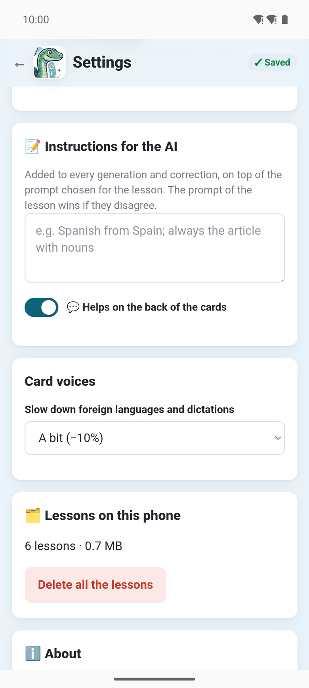

The **Settings** button (⚙️), at the top of the page, opens the app's own settings. They are saved as you go.

- **🔑 Subscription**: the free trial or the plan, the credits left this month and today, when they
  are renewed; **I already have a subscription**, **Manage the subscription (Google Play)**, and a
  **Licence key** field. See [The subscription](../app-subscription/).
- **📥 AnkiDroid**: whether AnkiDroid is installed and Notosaurus may add cards to it, with
  **Install AnkiDroid** or **Allow** when needed. See [The app and AnkiDroid](../app-ankidroid/).
- **📍 Where does Notosaurus work?**: **📱 On this phone** or **💻 On my computer**. See
  [With your computer](../app-with-computer/).
- **📝 Instructions for the AI**: the instructions for every child (“Spanish from Spain”), added
  to every lesson, and **💬 Helps on the back of the cards**. Each child's own are in their card,
  from the **Children** button (🧒) on the main page: see [Several children](../several-children/).
- **Card voices**: **Slow down foreign languages and dictations**, and a **Voice per language**,
  with **Listen**. See [Voices and audio](../voices/).
- **🗂️ Lessons on this phone**: how many there are and their size. **Delete all the lessons**
  removes them, with their sound; the cards already in AnkiDroid stay.
- **ℹ️ About**: the version, the licence, the source code, the
  [privacy policy](../app-privacy/) and the licences of the libraries used.
- **Advanced**: the relay address, for tests only. Leave it as it is.

At the bottom, **🌐** chooses the language of the page, and **📖 Help** opens this documentation.

With **💻 On my computer**, the settings show only the choice of mode, the language and
**ℹ️ About**: the rest is the computer's, in **Anki → Tools → Notosaurus → Settings**.
