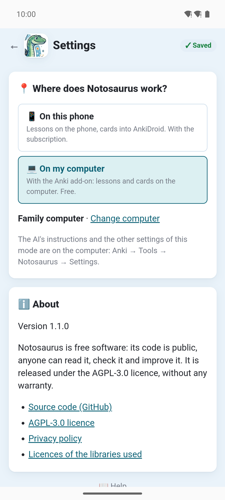
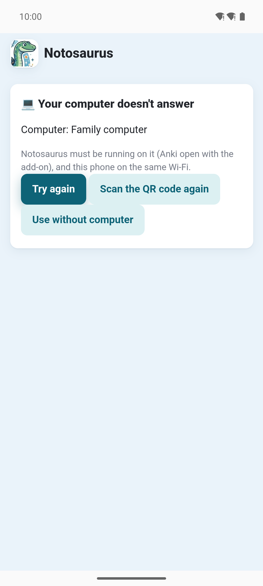

With Notosaurus on the computer (the [Anki add-on](../getting-started/)), the app can show the
computer's page instead of its own: the lessons, the AI and the cards are then the computer's,
with your own AI key, as in the phone's browser (see [On the phone](../phone/)). **Free**: no
subscription in this mode.

In the settings, **📍 Where does Notosaurus work?**:

- **📱 On this phone**: lessons on the phone, cards into AnkiDroid. With the subscription.
- **💻 On my computer**: with the Anki add-on, lessons and cards on the computer. Free.

## Connecting the computer

Anki must be open on the computer, with the add-on, and the phone on the same Wi-Fi.

1. On the computer: **Anki → Tools → Notosaurus → Open on the phone**: a QR code appears.
2. In the app: **📍 Where does Notosaurus work?** → **💻 On my computer** → scan the QR code.
   Google's code scanner opens: the app doesn't ask for the camera. Or **Type its address
   instead**, the one under the QR code.

The app checks the computer answers, keeps it, and shows its page. **Change computer** scans
another one.

## What is on the computer

In this mode, everything is the computer's: its lessons, its AI service and key, its children,
and the cards go into Anki on the computer, then to the phones through AnkiWeb (see
[Sending to Anki](../send-to-anki/)). The app's settings show only the choice of mode, the
language and **ℹ️ About**: **The AI's instructions and the other settings of this mode are on the
computer: Anki → Tools → Notosaurus → Settings.**

## When the computer doesn't answer

The app says **💻 Your computer doesn't answer**: Notosaurus must be running on it (Anki open with
the add-on), and this phone on the same Wi-Fi. Then:

- **Try again**;
- **Scan the QR code again**, for instance when the computer's address changed (after restarting
  the router);
- **Use without computer**: back to **📱 On this phone**.

## Two modes, two lists of lessons

Each mode keeps its own lessons: those made on the phone stay on the phone, those made with the
computer stay on the computer. Nothing is copied from one to the other.

Once a computer is connected, a long press on the app's icon offers **Without computer** and
**With my computer**, to open one or the other directly.
