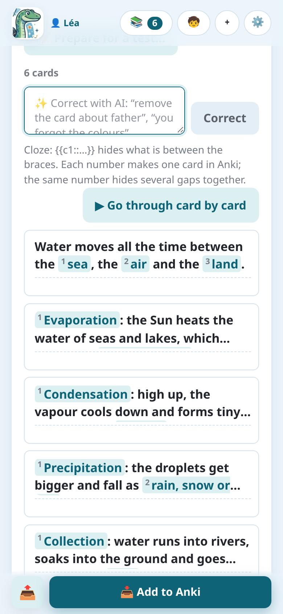
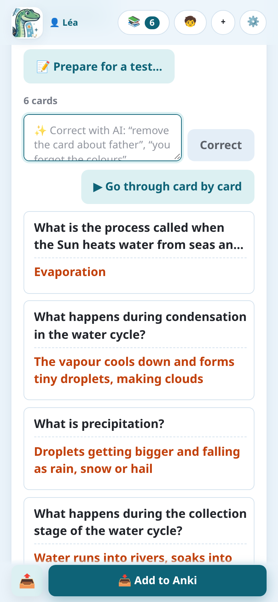
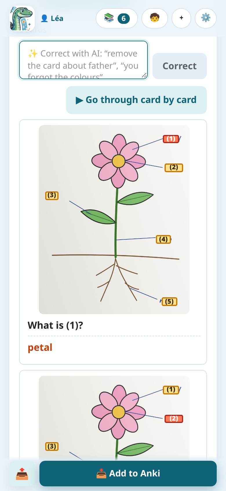
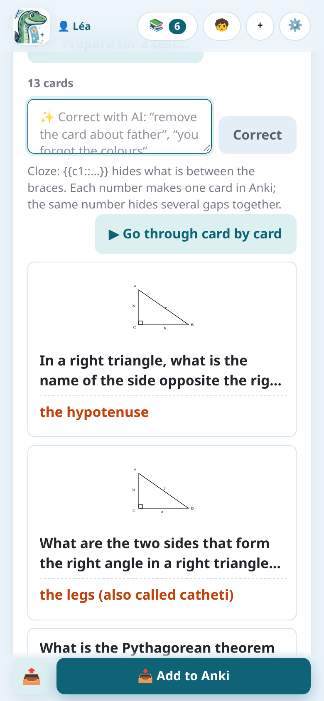
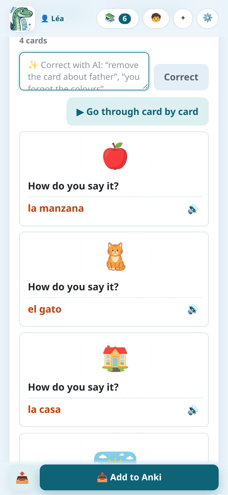
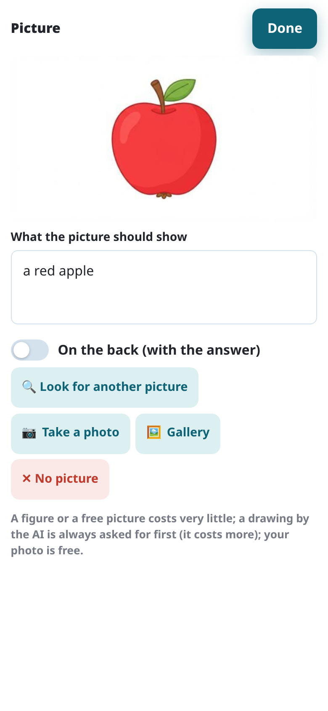

import { Tabs, TabItem } from '@astrojs/starlight/components';

The instructions decide which kind of cards the AI makes (see [Instructions](../instructions/)).
Each kind becomes its own **note type** in Anki, whose name starts with “Notosaurus”.

## Question and answer

The classic card: a **front** (the question, a word in your language) and a **back** (the
answer, the word in the language being learnt), with an optional **info** shown under the
answer. It's what the vocabulary, sentences and questions instructions make.

When the instructions ask for it, Anki adds the **reverse card** (back → front), has the
answer **typed** (compared letter by letter) or makes a **dictation** (hear the back, write it). See
[Instructions](../instructions/).

## Fill in the blanks

The **Fill in the blanks** instructions make sentences with gaps:

> The Sun heats the water of seas and lakes: this is `{{c1::evaporation}}`.

What is between `{{c1::` and `}}` is hidden. **Each number makes one card** in Anki; the same
number used twice hides two gaps together. In the review, the gaps are shown numbered: you can
change their text, add some or remove some by editing the braces.

A sentence with gaps can have a picture, on its question or with its answer, like any card, and be read aloud, whole: on the question as a dictation (the
words heard, written in its gaps), on the answer as its answer.

## Multiple choice and true or false

**Multiple choice** cards have a question, the **right answer** and **wrong answers** (three
plausible ones): change them in the review, or add one with **+ wrong answer**.
**True / false** makes statements, half of them false with one precise mistake.

In Anki, the question shows the options (A, B, C…, always in the same order) and the answer
marks the right one. It's plain HTML: it looks the same on every Anki app.

## Diagrams

With the **Diagram or map to complete** instructions, the AI finds each label of a diagram and hides
it behind a number. Each card asks “What is (2)?” and shows the answer on the diagram.

In the review:

- drag a **red mask** to move it, and its **round corner** to resize it, so that it hides the
  whole label;
- the **dashed frame** is the part of the photo that Anki shows: drag its blue corners to crop
  it.

Gemini and GPT place the masks most precisely. With Claude, check that the masks hide the
whole label on handwriting.

## Formulas

Formulas are written in **MathJax**, which Anki displays: `\( \frac{a+b}{2} \)`,
`\( x^2 \)`. Chemical equations are written the same way, as chemistry does:
`\( \ce{2H2 + O2 -> 2H2O} \)`. Simple calculations stay as plain text.

The review draws the formulas under the text exactly as Anki and AnkiDroid will display them
(the same MathJax): what Anki can't display shows up in red there too.

## Figures

For a figure with labels, measures or values (a right triangle with its hypotenuse, a curve, a
circuit, a molecule, a map), the AI **draws an exact figure** on the card, instead of an image
model that would draw text and measures badly. The figure never shows the
answer. In any subject, a notion a figure makes clearer gets one too, in particular when the
lesson's page shows a figure for it (sets with their intersection hatched, a number line, a
graph…): redrawn clean on the card.

Touch a card's figure, the card open, and its **Picture** page opens: change its description and
draw it again, or move it to the back when it belongs to the answer. The **Geometry (with figures)** instructions
make such cards, and so do **Automatic** and the formula instructions when it helps.

The figures are drawn with [Typst](https://typst.app), each kind with a package made for it:

- **maths**: geometry (and its shadows, eclipses), graphs of functions and points in a
  coordinate frame, number lines, fractions shown on a shape, sets and Venn diagrams,
  probability trees and graphs, solids in perspective, tables of values, clocks;
- **physics and chemistry**: electric circuits, molecules (developed formulas, Lewis
  structures, polarity), crystals, refraction and lenses, forces and chronophotographs, a
  magnet's or charges' field lines;
- **life sciences**: compared DNA and protein sequences, phylogenetic trees;
- **history and geography**: timelines, maps (see below);
- **and also**: statistics charts (bars, pie charts, curves of measures, histograms, scatter
  plots and their fitted line, box plots, age pyramids), box-and-arrow diagrams, Scratch
  scripts.

What can be computed is computed, never placed by eye: a curve from its function, a mark on its
segment, a clock's hands from the time, a refracted ray from the indices.
Under the figure, a line says what drew it (“📐 Drawn by gemini-… with Typst + ctz-euclide”, each
linked to its page). A figure you doubt: **🔍 Check the figure**, under the figure of the card open, has the AI look at it; if it
finds something wrong, it says what, and you choose **Keep it** or **📐 Redraw it** (then, if
needed, **📐 Redraw it carefully**).

### Maps for geography and history

The maps come from an atlas made for Notosaurus: the AI gives only names, never a boundary or a
position. They show:

- **countries, cities, regions**, rivers, reliefs, seas, straits and canals, named in the
  lesson's language;
- **countries or regions coloured by group**, with a legend: the alliances of 1914, the
  European Union's enlargements, the Cold War's blocs;
- **routes and flows**: Columbus's or Magellan's voyages, a sea route through Suez and Malacca,
  migrations as arrows, traced over the sea around the land;
- **the borders of a past year**, from 1815 to 1991: Europe at the Congress of Vienna,
  Austria-Hungary, Europe in 1942, the USSR and the two Germanies, a whole colonial empire with
  its colonies (borders from [OpenHistoricalMap](https://www.openhistoricalmap.org/), completed
  with [historical-basemaps](https://github.com/aourednik/historical-basemaps));
- **the polar regions seen from above the pole**: the Arctic and its sea routes, Antarctica.

## Pictures

The **Language: vocabulary in pictures** instructions put a picture of each word on the front,
found free or drawn by an image model.

<Tabs syncKey="mode">
<TabItem label="Android app">

The Notosaurus service draws the pictures: nothing to choose. A drawing costs credits, told
before it is made.

</TabItem>
<TabItem label="Computer">

A drawing costs from less than a cent to a few cents. Pictures are drawn by the AI service of
the cards when it can draw (Gemini, OpenAI, OpenRouter), otherwise by another one chosen in
**Settings → Pictures on cards** (Claude and local models can't draw). That section also
chooses the image model, or **No pictures**:

- **Recommended, from our tests** lists the image models we advise for the service, with what
  a picture costs; the ⭐ one is the default. We compared their drawings by eye: with OpenAI,
  GPT Image 2 (about 0.6 US cent a picture); with Gemini or OpenRouter, Gemini 3.1 Flash-Lite
  Image (about 3 US cents).
- The field also offers **every image model the service has**, new ones included: type to
  filter them.
- **🖼️ Test: draw a giraffe** draws one real picture with the chosen service and model, and
  shows it as a card would, with the time and the cost.

</TabItem>
</Tabs>

Touch a card's picture, the card open, and its **Picture** page opens full screen (a card without
one: ⋯ → **🖼️ Add a picture**); **Done** brings back the card:

- **What the picture should show**, in your own language: leave it empty and the AI decides from
  the card; or write what you want ("two overlapping sets, their union hatched", "a red apple");
- **📐 Draw the figure** (again) or, for a picture, **🔍 Find a picture** (**🔍 Look for another
  picture**) makes it from the description above, the cheapest first: a figure is drawn at once; for a picture, free ones are looked for (one fits, it goes on the card; several, you
  tap the one that fits, the ⭐ one is the AI's choice); none fits, Notosaurus asks before the AI
  draws one (**🎨 Draw**): it costs credits in the app, from under a cent to a few US cents on
  the computer;
- **📷 Take a photo** or **🖼️ Gallery**: put your own photo instead, taken now or chosen, for free;
- **✕ No picture**: remove it;
- **On the back (with the answer)**: when the picture gives the answer away.

A picture that doesn't seem to go with its card (a photo found, drawn, or your own): **🔍 Check
the picture**, under the picture of the card open, has the AI look at it with the card. It
answers "✓ The picture seems right.", or says what is wrong; **🖼️ Change the picture** then
opens its page, to look for another, have one drawn, or put your own.

### Free pictures, found rather than drawn

For a real thing (a person, a place, a monument, a work of art, an animal, a food), the AI
writes, with the card, a few English words to search for it ("Storming of the Bastille
painting", "dog"). Notosaurus then looks for a **free picture** before drawing one: a photo or a
painting in the public domain or under CC0 (**Wikimedia Commons**, **Openverse**; in the
Android app, **Pixabay** too), so there is nothing to credit on the cards. The cards' AI looks at
the pictures found and keeps the one that fits; when none does, the picture is drawn. It is
free (only the AI's choice costs: well under a cent) and exact: the real painting of the
storming of the Bastille, the real portrait of a president.

The pictures found come filtered for pupils (no mature content).

Every card keeps where its picture comes from: its panel says it (“Source: Wikimedia Commons ·
Public domain”, with a link to the picture's page; “Drawn by the AI”; “Your photo”). On the
computer, the Anki note keeps it too, in a hidden **Source** field: it is on no card, but goes
with the deck if you share it. For a figure, it also names the model and the Typst packages that drew it.
