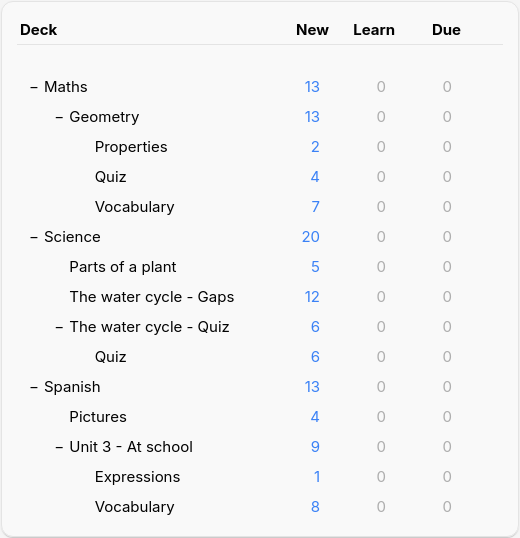
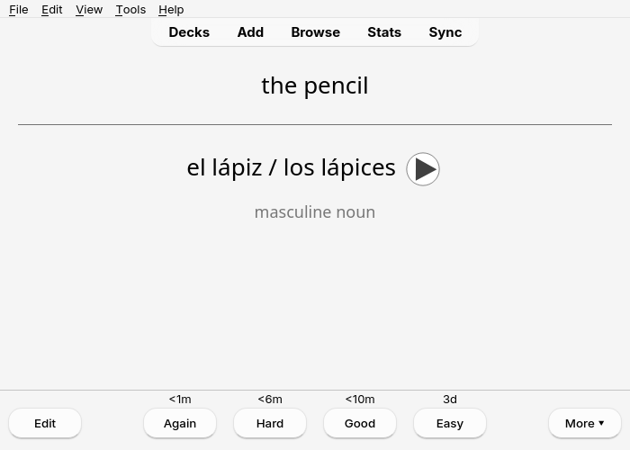
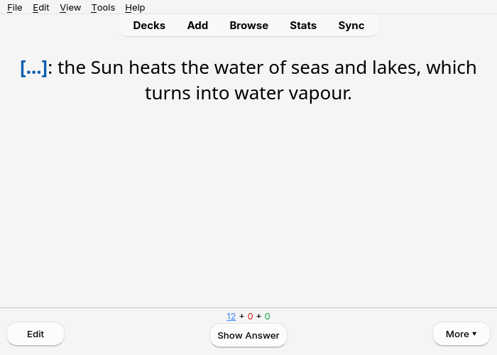
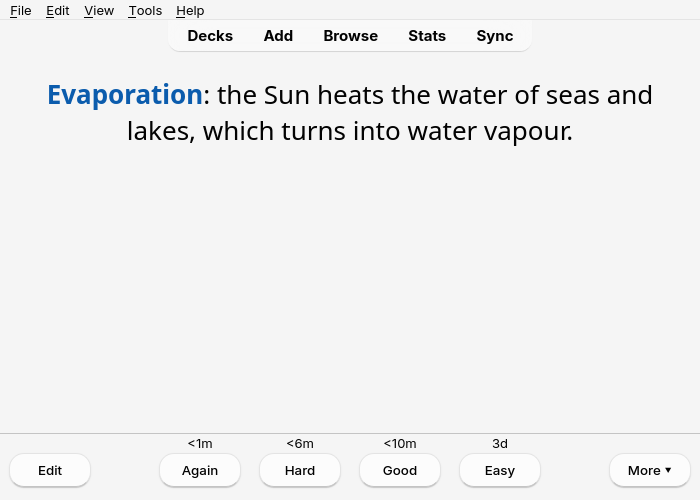
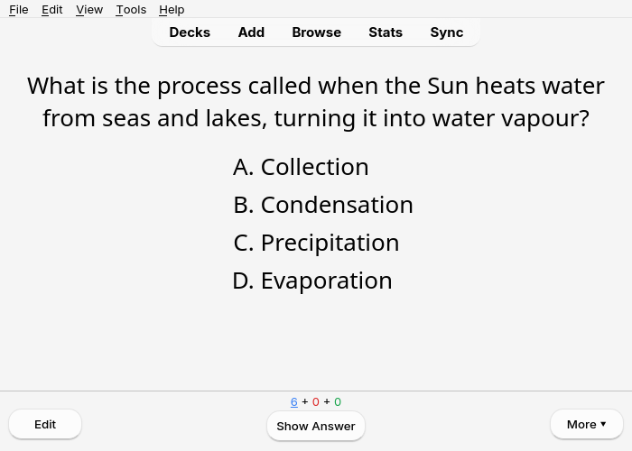
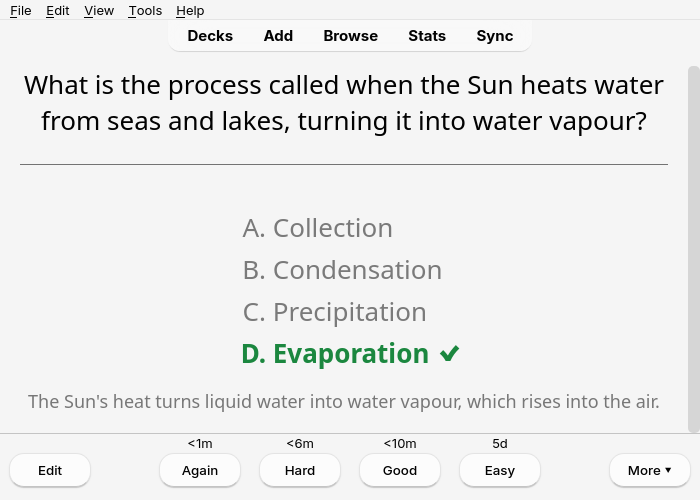
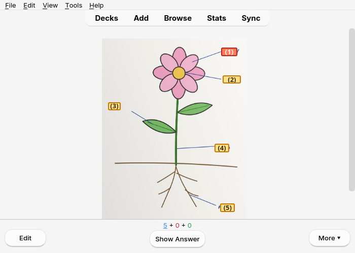
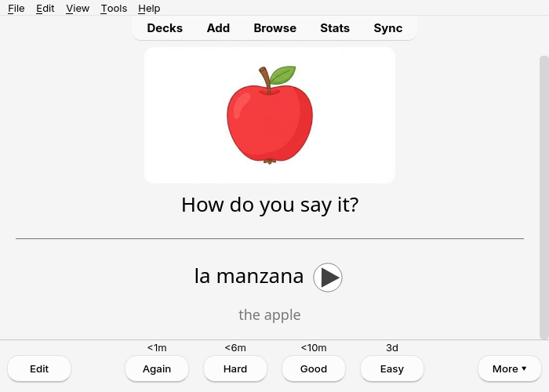
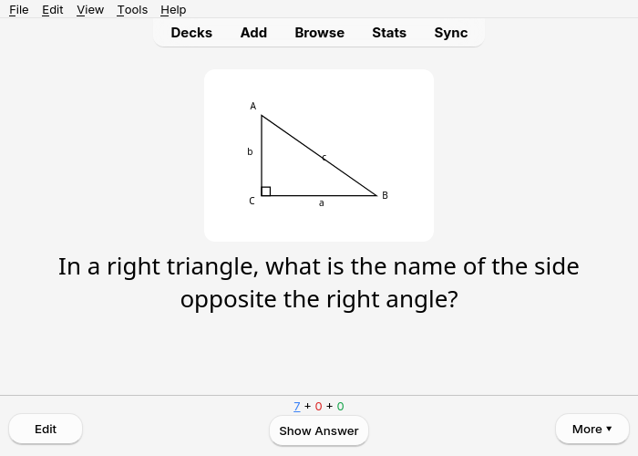

Whether they come from the app (into AnkiDroid) or from the computer (into Anki desktop), the cards
are the same: the same decks, the same card types, the same updates. How to send them: see
[The app and AnkiDroid](../app-ankidroid/) or [Sending to Anki](../send-to-anki/).

## The decks

Each lesson has its deck, for instance `Spanish::Unit 3 - At school`: `::` makes a deck inside
another one, so the lessons of a subject are grouped together. Cards with a section (Vocabulary,
Quiz…) go into a sub-deck of the lesson's deck.

To review a whole subject, click its deck: Anki takes the cards of all the decks inside it.

## Sending a lesson again

Once the lesson is sent, the button becomes **🔄 Update in Anki**. You can correct a lesson and
send it again as many times as you like: its cards are **updated** in Anki, **not duplicated**,
and the review history of each card is kept, even when you corrected its front. If you changed
the lesson's deck, its cards are **moved** there, with their history. Cards added since the last
send are added; cards deleted from the lesson stay in Anki: after the send, Notosaurus lists them
and offers to delete them (with their review history), never without asking. Deleting a whole
lesson in Notosaurus offers to delete its cards in Anki too, with their review history.

On the computer, changing a card option (the reverse card, the typed answer) on a lesson already
sent moves its cards to the matching note type, history kept.

In Anki, each lesson's notes carry a tag `notosaurus::<lesson>`: handy to find them in the
browser.

## Correcting a card from Anki

Under every answer, a small **✎ Notosaurus** opens the card in Notosaurus to correct it: in
the app on Android (AnkiDroid opens a short web page first, whose button opens the app), in the
page on the computer (Anki open, Notosaurus on its usual port).
Nothing is lost: the correction updates the same note, its review history stays. The link
only knows where the lesson lives: a lesson made on the computer opens there, one made in
the app opens in the app. AnkiWeb and AnkiMobile don't show it.

Up to AnkiDroid 2.25.2, first turn on **Settings → Advanced → Allow cards to launch other
apps**: without it, AnkiDroid blocks every link on a card ("Card blocked from launching another
app"). From AnkiDroid 2.25.3, links to a web page go through without it.

## What they look like

Here is what the [card types](../card-types/) look like during a review in Anki desktop.
AnkiDroid and AnkiMobile show the same cards.

**Question and answer**: a word with its audio (▶) and a note.

**Fill in the blanks**: the question hides the word, the answer shows it.

**Multiple choice**: the answer marks the right choice with ✔ and gives the explanation.

**Diagrams**: the photo of the lesson with numbered labels; one card per label to name.

**Pictures**: a drawing to name in the language being learned, with its audio.

**Figures**: the figure drawn by Notosaurus comes with the question.

