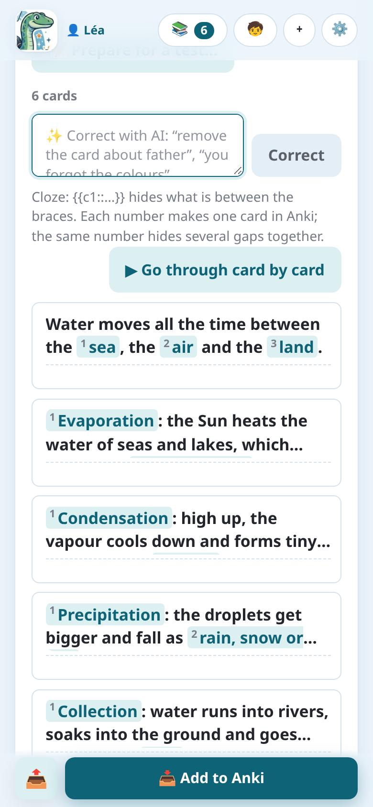
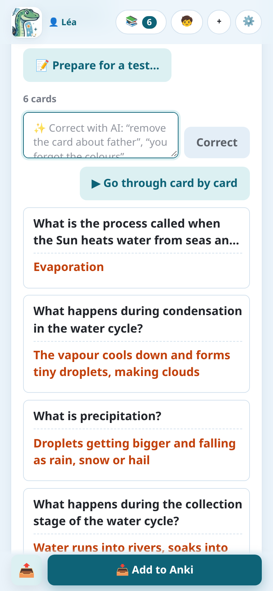
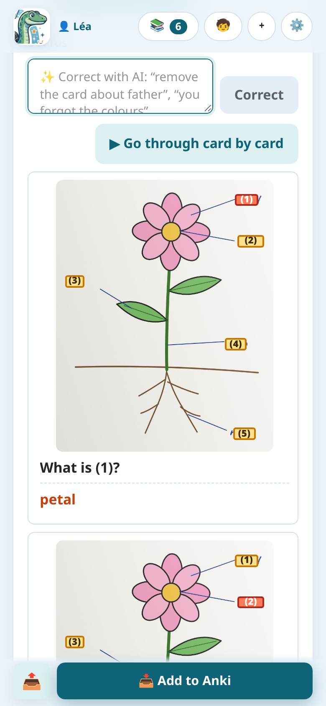
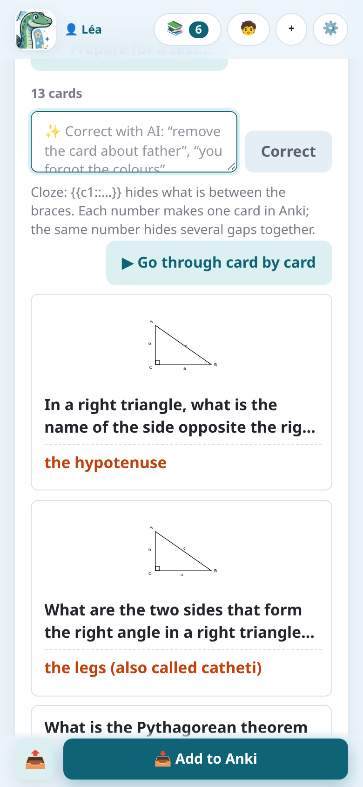
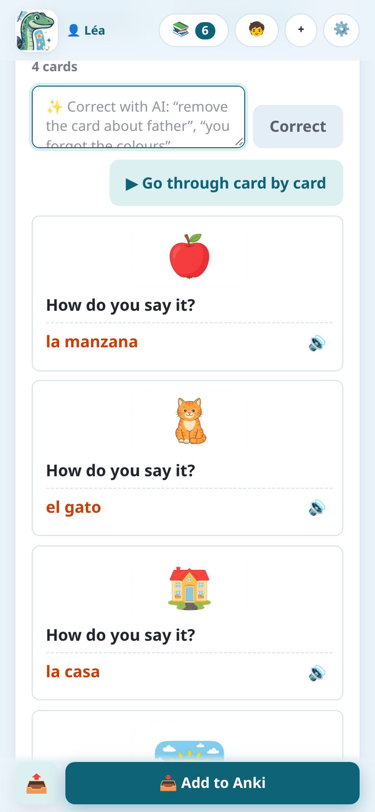
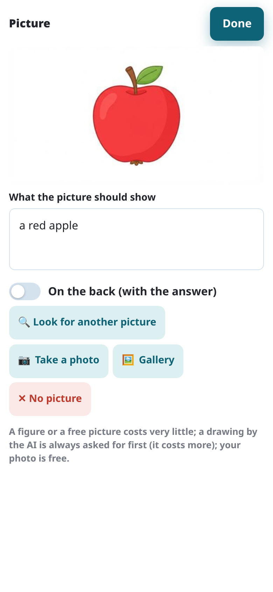

import { Tabs, TabItem } from '@astrojs/starlight/components';

Die Anweisungen bestimmen, welche Art von Karten die KI macht (siehe [Anweisungen](../instructions/)).
Jede Art wird in Anki zu einem eigenen **Notiztyp**, dessen Name mit „Notosaurus“ beginnt.

## Frage und Antwort

Die klassische Karte: eine **Vorderseite** (die Frage, ein Wort in deiner Sprache) und eine
**Rückseite** (die Antwort, das Wort in der Lernsprache), mit einer optionalen **Info** unter der
Antwort. Das machen die Anweisungen für Vokabeln, Sätze und Fragen.

Wenn die Anweisungen es verlangen, fügt Anki die **umgekehrte Karte** hinzu (Rückseite →
Vorderseite), lässt die Antwort **eintippen** (Buchstabe für Buchstabe verglichen) oder macht ein
**Diktat** (die Rückseite hören, sie schreiben). Siehe [Anweisungen](../instructions/).

## Lückentext

Die Anweisungen **Lückentext** machen Sätze mit Lücken:

> Die Sonne erwärmt das Wasser der Meere und Seen: Das ist die `{{c1::Verdunstung}}`.

Was zwischen `{{c1::` und `}}` steht, wird verdeckt. **Jede Nummer ergibt in Anki eine Karte**;
dieselbe Nummer zweimal verdeckt zwei Lücken zusammen. Bei der Durchsicht werden die Lücken
nummeriert angezeigt: Du kannst ihren Text ändern, welche hinzufügen oder entfernen, indem du die
Klammern bearbeitest.

Ein Lückensatz kann ein Bild haben, auf der Vorder- oder Rückseite wie jede Karte, und
ganz vorgelesen werden: vorne als Diktat (die gehörten Wörter in die Lücken schreiben), hinten als Antwort.

## Multiple Choice und richtig oder falsch

**Multiple-Choice**-Karten haben eine Frage, die **richtige Antwort** und **falsche Antworten**
(drei plausible): Ändere sie bei der Durchsicht oder füge mit **+ falsche Antwort** eine hinzu.
**Richtig / falsch** macht Aussagen, die Hälfte davon falsch, mit einem genauen Fehler.

In Anki zeigt die Frage die Optionen (A, B, C…, immer in derselben Reihenfolge), und die Antwort
markiert die richtige. Es ist einfaches HTML: Es sieht in jeder Anki-App gleich aus.

## Abbildungen

Mit den Anweisungen **Abbildung oder Karte beschriften** findet die KI jede Beschriftung einer
Abbildung und verdeckt sie hinter einer Nummer. Jede Karte fragt „Was ist (2)?“ und zeigt die
Antwort auf der Abbildung.

Bei der Durchsicht:

- zieh eine **rote Maske**, um sie zu verschieben, und ihre **runde Ecke**, um ihre Größe zu
  ändern, damit sie die ganze Beschriftung verdeckt;
- der **gestrichelte Rahmen** ist der Teil des Fotos, den Anki zeigt: Zieh seine blauen Ecken, um
  ihn zuzuschneiden.

Gemini und GPT setzen die Masken am genauesten. Prüfe bei Claude, ob die Masken auf Handschrift
die ganze Beschriftung verdecken.

## Formeln

Formeln werden in **MathJax** geschrieben, das Anki anzeigt: `\( \frac{a+b}{2} \)`,
`\( x^2 \)`. Formeln und chemische Gleichungen werden wie in der Chemie geschrieben:
`\( \ce{2H2 + O2 -> 2H2O} \)`. Einfache Rechnungen bleiben reiner Text.

Die Durchsicht zeichnet die Formeln unter dem Text, genau wie Anki und AnkiDroid sie anzeigen
werden (dasselbe MathJax): Was Anki nicht anzeigen kann, erscheint auch hier rot.

## Figuren

Für eine Figur mit Beschriftungen, Maßen oder Werten (ein rechtwinkliges Dreieck mit seiner
Hypotenuse, eine Kurve, ein Stromkreis, ein Molekül, eine Landkarte) **zeichnet die KI eine
exakte Figur** auf die Karte, statt eines Bildmodells, das Text und Maße schlecht zeichnen würde.
Die Figur zeigt nie die Antwort. In jedem Fach bekommt auch ein Begriff, den eine Figur klarer
macht, eine, besonders wenn die Seite der Lektion eine Figur dafür zeigt (Mengen mit schraffierter
Schnittmenge, ein Zahlenstrahl, ein Graph…): sauber auf der Karte neu gezeichnet.

Tippe auf die Figur einer geöffneten Karte, und ihre Seite **Bild** öffnet sich: Ändere ihre
Beschreibung und lass sie neu zeichnen, oder leg sie auf die Rückseite, wenn sie zur Antwort gehört. Die Anweisungen
**Geometrie (mit Figuren)** machen solche Karten, ebenso **Automatisch** und die
Formel-Anweisungen, wenn es hilft.

Die Figuren werden mit [Typst](https://typst.app) gezeichnet, jede Art mit einem eigens dafür
gemachten Paket:

- **Mathematik**: Geometrie (und ihre Schatten, die Finsternisse), Funktionsgraphen und Punkte im
  Koordinatensystem, Zahlenstrahlen, Brüche auf einer Form, Mengen und Venn-Diagramme,
  Wahrscheinlichkeitsbäume und Graphen, Körper in Schrägbildern, Wertetabellen, Uhren;
- **Physik/Chemie**: Stromkreise, Moleküle (Strukturformeln, Lewis-Formeln, Polarität), Kristalle,
  Lichtbrechung und Linsen, Kräfte und Chronofotografien, Feldlinien eines Magneten oder von
  Ladungen;
- **Biologie**: verglichene DNA- und Proteinsequenzen, phylogenetische Bäume;
- **Geschichte/Erdkunde**: Zeitstrahlen, Landkarten (siehe weiter unten);
- **und außerdem**: Diagramme der Statistik (Balkendiagramme, Kreisdiagramme, Messkurven,
  Histogramme, Streudiagramme mit ihrer Ausgleichsgerade, Boxplots, Alterspyramiden),
  Kästchen-und-Pfeil-Diagramme, Scratch-Skripte.

Was sich berechnen lässt, wird berechnet, nie nach Augenmaß platziert: eine Kurve aus ihrer
Funktion, eine Markierung auf ihrer Strecke, die Zeiger einer Uhr aus der Uhrzeit, ein gebrochener
Strahl aus den Brechungsindizes.
Unter der Figur sagt eine Zeile, was sie gezeichnet hat („📐 Gezeichnet von gemini-… mit Typst +
ctz-euclide“, jeweils mit Link zur Seite). Eine Figur, bei der du Zweifel hast:
**🔍 Figur prüfen**, unter der Figur der geöffneten Karte, lässt die KI sie ansehen; findet sie etwas Falsches, sagt sie was, und du
wählst **Behalten** oder **📐 Neu zeichnen** (dann, falls nötig, **📐 Sorgfältig neu zeichnen**).

### Landkarten in Geschichte und Erdkunde

Die Landkarten stammen aus einem eigens für Notosaurus gemachten Atlas: Die KI gibt nur Namen an,
nie einen Umriss oder eine Position. Sie zeigen:

- **Länder, Städte, Regionen**, Flüsse, Gebirge, Meere, Meerengen und Kanäle, benannt in der
  Sprache der Lektion;
- **Länder oder Regionen, nach Gruppe gefärbt**, mit einer Legende: die Bündnisse von 1914, die
  Erweiterungen der Europäischen Union, die Blöcke des Kalten Kriegs;
- **Routen und Ströme**: die Reisen von Kolumbus oder Magellan, eine Seeroute über Suez und
  Malakka, Migrationen als Pfeile, über das Meer um die Landmassen herum verlaufend;
- **die Grenzen eines vergangenen Jahres**, von 1815 bis 1991: das Europa des Wiener Kongresses,
  Österreich-Ungarn, das Europa von 1942, die UdSSR und die beiden deutschen Staaten, ein ganzes
  Kolonialreich mit seinen Kolonien (Grenzen von
  [OpenHistoricalMap](https://www.openhistoricalmap.org/), ergänzt durch
  [historical-basemaps](https://github.com/aourednik/historical-basemaps));
- **die Polarregionen, von oberhalb des Pols aus gesehen**: die Arktis mit ihren Seerouten, die
  Antarktis.

## Bilder

Die Anweisungen **Sprache: Vokabeln in Bildern** setzen ein Bild jedes Worts auf die
Vorderseite, frei gefunden oder von einem Bildmodell gezeichnet.

<Tabs syncKey="mode">
<TabItem label="Android-App">

Der Notosaurus-Dienst zeichnet die Bilder: nichts zu wählen. Eine Zeichnung kostet Credits, die
vorher angegeben werden.

</TabItem>
<TabItem label="Computer">

Eine Zeichnung kostet weniger als einen Cent bis ein paar Cent. Bilder zeichnet der KI-Dienst der
Karten, wenn er zeichnen kann (Gemini, OpenAI, OpenRouter), sonst ein anderer, gewählt unter
**Einstellungen → Bilder auf den Karten** (Claude und lokale Modelle können nicht zeichnen).
Dieser Abschnitt wählt auch das Bildmodell, oder **Keine Bilder**:

- **Empfohlen, nach unseren Tests** listet die Bildmodelle, die wir für den Dienst empfehlen, mit
  den Kosten eines Bildes; das mit ⭐ ist der Standard. Wir haben ihre Zeichnungen mit bloßem Auge
  verglichen: mit OpenAI GPT Image 2 (etwa 0,6 US-Cent pro Bild); mit Gemini oder OpenRouter
  Gemini 3.1 Flash-Lite Image (etwa 3 US-Cent).
- Das Feld bietet auch **jedes Bildmodell des Dienstes** an, neue eingeschlossen: Tippe, um sie
  zu filtern.
- **🖼️ Testen: eine Giraffe zeichnen** zeichnet ein echtes Bild mit dem gewählten Dienst und
  Modell und zeigt es wie auf einer Karte, mit Zeit und Kosten.

</TabItem>
</Tabs>

Tippe auf das Bild einer geöffneten Karte, und ihre Seite **Bild** öffnet sich im Vollbild (eine
Karte ohne Bild: ⋯ → **🖼️ Bild hinzufügen**); **Fertig** bringt dich zur Karte zurück:

- **Was das Bild zeigen soll**, in deiner eigenen Sprache: Leer gelassen entscheidet die KI anhand
  der Karte; oder schreib, was du willst („zwei sich überschneidende Mengen, ihre Vereinigung
  schraffiert“, „ein roter Apfel“);
- **📐 Figur zeichnen** (oder **📐 Figur neu zeichnen**) oder, für ein Bild, **🔍 Bild finden**
  (oder **🔍 Anderes Bild suchen**) macht es nach der Beschreibung darüber, das Günstigste zuerst:
  Eine Figur wird gleich gezeichnet; für ein Bild werden freie Bilder gesucht (passt eins, kommt es auf die Karte; bei
  mehreren tippst du auf das passende, ⭐ ist die Wahl der KI); passt keins, fragt Notosaurus, ob
  die KI eins zeichnen soll (**🎨 Zeichnen**): Das kostet Credits in der App, am Computer weniger
  als einen Cent bis ein paar US-Cent;
- **📷 Foto aufnehmen** oder **🖼️ Galerie**: statt dessen dein eigenes Foto, gleich aufgenommen oder ausgewählt, kostenlos;
- **✕ Kein Bild**: entfernt es;
- **Auf der Rückseite (mit der Antwort)**: wenn das Bild die Antwort verrät.

Ein Bild, das nicht zu seiner Karte zu passen scheint (ein gefundenes, ein gezeichnetes oder dein
eigenes Foto): **🔍 Bild prüfen**, unter dem Bild der geöffneten Karte, lässt die KI es mit der
Karte ansehen. Sie antwortet „✓ Das Bild scheint zu passen.“ oder sagt, was nicht stimmt;
**🖼️ Bild ändern** öffnet dann seine Seite, um ein anderes zu suchen, eins zeichnen zu lassen oder
dein eigenes einzusetzen.

### Freie Bilder, gefunden statt gezeichnet

Für eine reale Sache (eine Person, einen Ort, ein Bauwerk, ein Kunstwerk, ein Tier, ein
Lebensmittel) schreibt die KI mit der Karte ein paar englische Suchwörter („Storming of the
Bastille painting“, „dog“). Notosaurus sucht dann ein **freies Bild**, bevor eins gezeichnet wird:
ein Foto oder Gemälde, gemeinfrei oder unter CC0 (**Wikimedia Commons**, **Openverse**; in der
Android-App auch **Pixabay**), sodass auf den Karten nichts zu nennen ist. Die KI der Karten sieht
sich die gefundenen Bilder an und behält das passende; passt keins, wird gezeichnet. Das ist
kostenlos (nur die Wahl der KI kostet: deutlich unter einem Cent) und exakt: das echte Gemälde
vom Sturm auf die Bastille, das echte Porträt eines Präsidenten.

Die gefundenen Bilder sind für Schüler gefiltert (keine Inhalte für Erwachsene).

Jede Karte merkt sich, woher ihr Bild kommt: Ihr Bereich sagt es („Quelle: Wikimedia Commons ·
Public Domain“, mit einem Link zur Seite des Bildes; „Von der KI gezeichnet“; „Dein Foto“). Am
Computer behält es auch die Anki-Notiz, in einem verborgenen Feld **Source**: Es steht auf keiner
Karte, geht aber mit dem Stapel mit, wenn du ihn teilst. Bei einer Figur nennt es auch das Modell
und die Typst-Pakete, die sie gezeichnet haben.
