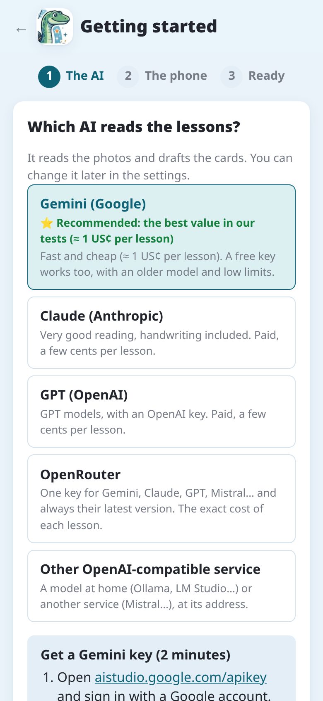
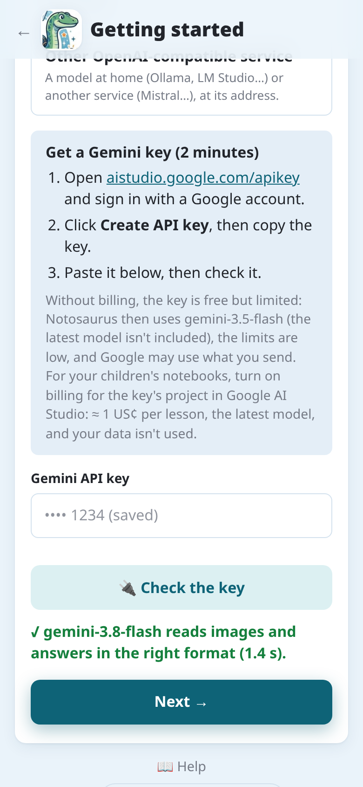
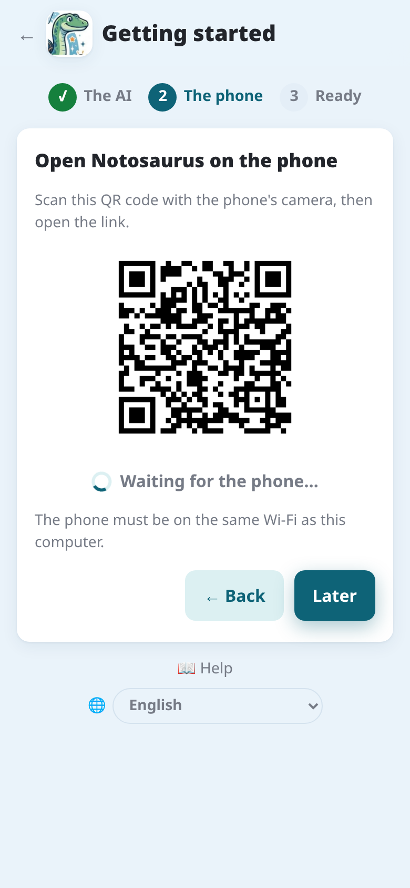
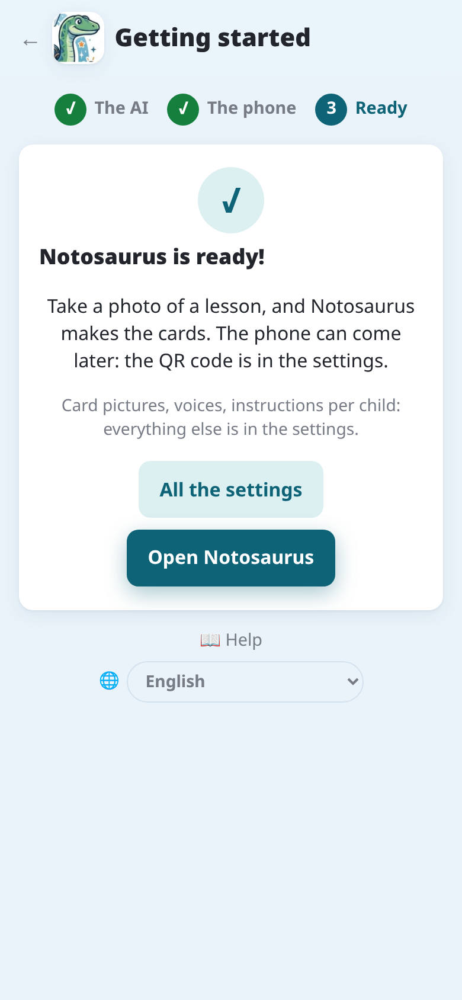
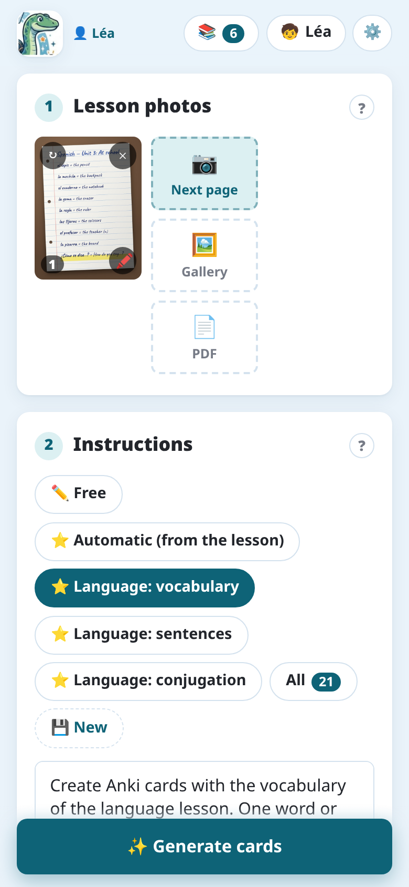
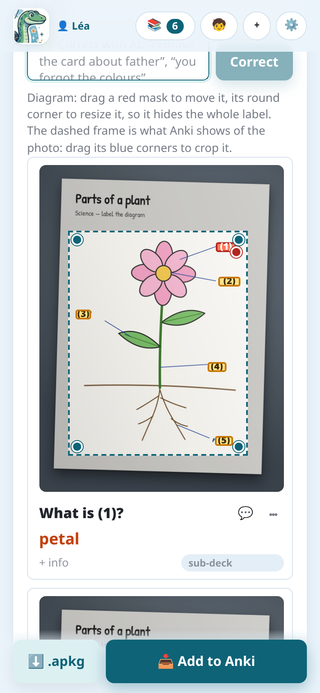

Die Anki-Erweiterung lässt Notosaurus auf deinem Computer laufen, in Anki, kostenlos, mit deinem
eigenen KI-Schlüssel. Du benutzt es über den Browser des Handys oder über die Android-App, im
selben WLAN. Lieber die App für sich allein? Siehe [Welches Notosaurus?](../which-notosaurus/).

## Was du brauchst

- **Anki** auf einem Computer (Windows, macOS oder Linux), eine aktuelle Version.
- **Ein Handy** im selben WLAN wie der Computer.
- **Einen Schlüssel für einen KI-Dienst.** Gemini ist am günstigsten und hat ein kostenloses
  Kontingent, um Notosaurus auszuprobieren; Claude und GPT funktionieren auch gut. Eine Lektion
  kostet einen Bruchteil eines Cents bis ein paar Cent.

:::caution[Kostenlose Kontingente und Datenschutz]
Bei kostenlosen Kontingenten darf der KI-Anbieter meist das Gesendete nutzen, um seine Modelle
zu verbessern. Für die Hefte deiner Kinder nimm lieber einen kostenpflichtigen Schlüssel: Ein paar
Euro reichen lange.
:::

## 1. Die Erweiterung installieren

1. Lade `notosaurus-<version>.ankiaddon` aus dem
   [neuesten Release](https://github.com/cchabanois/notosaurus/releases/latest) herunter.
2. Doppelklicke auf die Datei (oder in Anki: **Extras → Erweiterungen → Aus Datei installieren**),
   dann starte Anki neu.
3. Beim ersten Start fragt Notosaurus, bevor es seine Komponenten installiert (etwa 300 MB). Das
   dauert ein paar Minuten, einmalig.

## 2. Der Einrichtungsassistent

Sind die Komponenten installiert, bietet Anki **„Jetzt einrichten?“** an: Der Assistent öffnet
sich im Browser des Computers. Zwei Schritte, ein paar Minuten. Er ist immer unter **Extras →
Notosaurus → Einrichtungsassistent**, und solange keine KI eingerichtet ist, zeigt die Seite von
Notosaurus **„Noch ein Schritt“** mit einer Schaltfläche, um ihn zu starten.

**Die KI.** Wähle den Dienst, der die Lektionen liest. **Gemini** wird empfohlen: das beste
Preis-Leistungs-Verhältnis in unseren Tests, etwa 1 US-Cent pro Lektion (siehe
[Einstellungen und KI-Dienste](../ai-services/) für die anderen).

Für Gemini erklärt der Assistent in drei Schritten, wie man den Schlüssel bekommt. Füge ihn ein
und tippe auf **🔌 Schlüssel prüfen**: Notosaurus prüft, ob das Modell ein Bild liest und im
richtigen Format antwortet. **Weiter** erscheint, sobald das klappt.

**Das Handy.** Scanne den QR-Code mit der Kamera des Handys und öffne den Link. Der Assistent
wartet auf das Handy und zeigt dann **„✓ Das Handy ist verbunden.“** Füge die Seite danach zum
Startbildschirm hinzu: Sie öffnet sich wie eine App (siehe [Auf dem Handy](../phone/) für jeden
Browser). **Später** überspringt diesen Schritt: Der QR-Code bleibt unter **Extras → Notosaurus →
Auf dem Handy öffnen …** und in den Einstellungen.

**Fertig!** Öffne Notosaurus oder alle Einstellungen: Bilder der Karten, Stimmen, Anweisungen pro
Kind… Die Einstellungen öffnen sich nur am Computer: Kinder können sie nicht vom Handy aus ändern.

:::tip
Nur Geräte, die diesen QR-Code gescannt haben, können Notosaurus benutzen. Ist ein Handy verloren
oder verliehen: **Einstellungen → Handys → Alle Handys abmelden**.
:::

## 3. Deine erste Lektion

1. Unter **Fotos der Lektion** fotografiere die Seite (oder mehrere Seiten), oder füge ein PDF
   hinzu: siehe [Fotos und PDFs](../photos/).
2. Unter **Anweisungen** wähle, was gemacht werden soll: Vokabeln, Fragen, Lückentext, eine zu
   beschriftende Abbildung… **Automatisch** wählt nach der Lektion. Siehe
   [Anweisungen](../instructions/).

   

3. Tippe auf **Karten erzeugen** und warte ein paar Sekunden.
4. Prüfe die Karten. Bearbeite sie, lösche welche, oder bitte die KI in eigenen Worten, sie zu
   verbessern: siehe [Die Karten durchsehen](../review/).

   

   

5. Tippe auf **Zu Anki hinzufügen**.

Die Lektion wird gespeichert: Du kannst sie später aus der Liste der Lektionen wieder öffnen,
korrigieren und erneut senden. Ihre Karten werden in Anki aktualisiert, nicht verdoppelt.

Mit den Anweisungen **Abbildung oder Karte beschriften** werden die Beschriftungen einer Abbildung
hinter Nummern verdeckt: Jede Karte fragt nach einer davon.

## 4. Auf dem Handy lernen

Um auf dem Handy zu lernen, nutze **AnkiDroid** (Android) oder **AnkiMobile** (iPhone) mit einem
**AnkiWeb**-Konto: Notosaurus synchronisiert Anki nach dem Senden der Karten. Bei mehreren Kindern
siehe [Mehrere Kinder](../several-children/).
