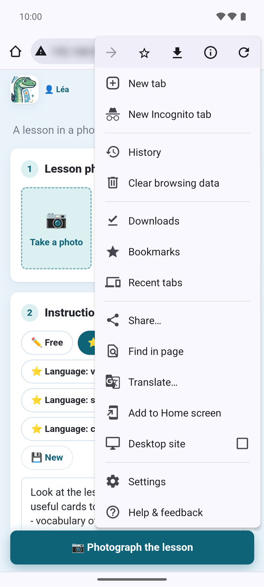
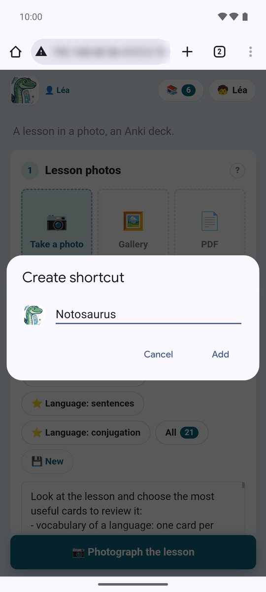
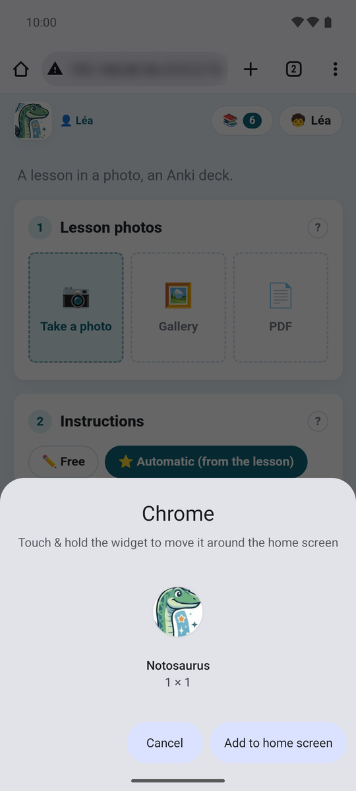

Mit der Anki-Erweiterung auf dem Computer öffnet das Handy Notosaurus in seinem Browser: eine
Webseite, im selben WLAN. Zum Startbildschirm hinzugefügt, öffnet sie sich dann mit einem Tippen,
wie eine App.

:::tip[Auf Android: die App]
Auf Android kann das auch die [Notosaurus-App](../android-app/): In ihrem Modus **💻 Auf meinem
Computer** zeigt sie die Seite des Computers, ohne Browser. Oder sie macht in **📱 Auf diesem
Handy** die Karten selbst, ohne den Computer.
:::

## 1. Notosaurus öffnen

In Anki auf dem Computer zeigt **Extras → Notosaurus → Auf dem Handy öffnen …** einen QR-Code.
Scanne ihn mit der Kamera des Handys, das im **selben WLAN** wie der Computer ist, und öffne den
Link.

Das Scannen des QR-Codes **erlaubt auch diesem Handy**, Notosaurus zu benutzen: Andere Geräte im
WLAN können es nicht (siehe
[Datenschutz und Sicherheit am Computer](../privacy/#wer-notosaurus-benutzen-kann)).

## 2. Zum Startbildschirm hinzufügen

Mach das **gleich nach dem Scannen des QR-Codes**, von der geöffneten Seite aus: Das Symbol behält
die Berechtigung des Handys.

### Android

In **Chrome**:

1. Das Menü **⋮** oben rechts → **Zum Startbildschirm hinzufügen**.

   

2. **Verknüpfung erstellen**: Behalte den Namen **Notosaurus**, dann **Hinzufügen**.

   

3. **Zum Startbildschirm hinzufügen** (oder halte das Symbol gedrückt, um es selbst zu platzieren).

   

4. Das Symbol **Notosaurus** ist auf dem Startbildschirm, manchmal auf der nächsten Seite.

   

In anderen Browsern:

- **Samsung Internet**: das Menü **≡** → **Seite hinzufügen zu** → **Startbildschirm**.
- **Firefox**: das Menü **⋮** → **Zum Startbildschirm hinzufügen** (oder **Installieren**).

### iPhone und iPad

In **Safari**: die Schaltfläche **Teilen** (das Quadrat mit einem Pfeil) → **Zum Home-Bildschirm**
→ **Hinzufügen**. Auf einem iPhone teilt das Symbol nicht den Speicher von Safari: Es gleich nach
dem Scannen des QR-Codes hinzuzufügen, lässt es herein.

## Gut zu wissen

- **Das Handy muss im selben WLAN sein** wie der Computer, und Anki muss auf dem Computer geöffnet
  sein (mit der Erweiterung): Notosaurus funktioniert zu Hause, nicht unterwegs.
- **Wurden alle Handys abgemeldet** (Einstellungen → Handys) oder hat sich die Adresse des
  Computers geändert (nach einem Neustart des Routers), öffnet das Symbol Notosaurus nicht mehr:
  Scanne den QR-Code erneut, dann füge die Seite erneut zum Startbildschirm hinzu (und entferne das
  alte Symbol).
