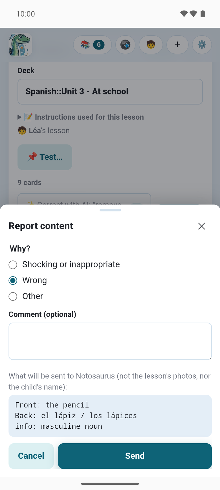

Auch die beste KI liest ab und zu ein Wort falsch: **sieh die Karten immer durch**, bevor du
sie sendest. Alles, was du änderst, wird laufend gespeichert („✓ Gespeichert“).

:::tip[Stimmt etwas nicht? Melde es]
In der Android-App: Eine Karte, die nicht stimmt (ein falsch gelesenes Wort, eine falsche
Antwort, eine schiefe Figur, ein unpassendes Bild, eine sinnlose Karte): **⋯ → ⚑ Melden** auf
ihr. Jede Meldung wird gelesen, und so wird Notosaurus am besten verbessert. Siehe
[Ein Problem melden](#ein-problem-melden).
:::

## Der Stapel und die Karten

- **Stapel**: der Name des Anki-Stapels. `::` erzeugt Unterstapel: `Spanisch::Unidad 3 - En la escuela`.
- Jede Karte hat eine **Vorderseite** (die Frage) und eine **Rückseite** (die Antwort). Tippe auf
  einen Text, um ihn zu ändern.
- **+ Info** fügt eine Notiz unter der Antwort hinzu: Geschlecht, Plural, ein Beispiel…
- **Unterstapel** legt die Karte in einen Unterstapel der Lektion („Vokabeln“, „Verben“).
- **Rückseite anhören** (🔊) spielt sie mit der Stimme der Lektion ab.
- **Weitere Aktionen** (⋯), oben rechts auf der Karte, löscht sie; **＋ Karte hinzufügen**, unten,
  fügt eine hinzu.

**📝 Für diese Lektion verwendete Anweisungen**, über den Karten, erinnert daran, worum die KI
gebeten wurde.

## Eine Lektion, die falsch aussieht

Wenn die Lektion selbst einen Fehler zu enthalten scheint (Notizen eines Schülers, ein
Abschreibfehler: ein falsches Datum, ein falscher Name, eine falsche Zahl oder Formel), behält die
Karte, was die Lektion sagt, mit einem Hinweis (⚠️), warum es falsch aussieht, und der
vorgeschlagenen Korrektur. **Korrigieren** übernimmt sie; **Lektion beibehalten** blendet den
Hinweis aus. Gemeldet werden nur klare, überprüfbare Fehler, nie eine Konvention oder eine
Vereinfachung, und der Hinweis kommt nie nach Anki.

## Ein Problem melden

In der Android-App sagt **⋯ → ⚑ Melden**, oben rechts auf einer Karte, Notosaurus, was schiefging:
ein falsch gelesenes Wort, eine falsche Antwort, eine Figur mit einer Markierung an der falschen
Stelle, ein unpassendes Bild, eine sinnlose Karte. Zögere nicht: **Jede Meldung wird gelesen**,
und so werden solche Fehler in Notosaurus behoben, für alle kommenden Lektionen.

- Sag, warum (**Falsch**, **Anstößig oder unangemessen**, **Sonstiges**), und füge, wenn du
  willst, einen Kommentar hinzu: Was du erwartet hast, hilft am meisten.
- Gesendet wird die ganze Karte, so wie du sie siehst (ihre Texte, ihre Erklärung, wenn sie
  angezeigt wird, ihr Bild oder ihre Figur, außer einem Foto, das du selbst gemacht hast); das
  Fenster zeigt genau, was, nie die Fotos der Lektion oder den Namen des Kindes. Siehe
  [Datenschutz](../app-privacy/).
- Danach kannst du die Karte löschen oder ihr Bild entfernen.

## Mit der KI korrigieren

Statt die Karten einzeln zu ändern, bitte in eigenen Worten, im Feld über den Karten:

- „entferne die Karte über den Vater“
- „du hast die Farben unten auf der Seite vergessen“
- „füge den Plural auf der Rückseite hinzu, etwa: la regla / las reglas“
- „kürzere Fragen“

Tippe auf **Korrigieren**. Die KI sieht die Fotos noch einmal und ändert nur, worum du gebeten
hast: Geänderte Karten werden als **geändert** markiert, neue als **neu**, und ein Satz fasst
zusammen, was sie getan hat. **↩ Rückgängig** stellt die Karten wieder her, wie sie waren.

## Eine Karte erklären

**Diese Karte erklären** (💬) bittet die KI, sie zu erklären: was sie bedeutet und warum ihre
Antwort die Antwort ist, in zwei bis vier Sätzen, auf Schülerniveau, in der Sprache der Seite.
Praktisch für ein Fach, das man vergessen hat, oder eine Karte, die das Kind nicht versteht.

Unter der Erklärung bietet die KI nur an, was bei **dieser** Karte hilft:

- **Ein Beispiel**: ein Satz mit dem Wort, eine Rechnung mit der Formel;
- **Eine Merkhilfe**: wenn es eine naheliegende gibt;
- **Warum ist das richtig?**: wenn es nicht offensichtlich ist, und bei einer Multiple-Choice-
  oder Richtig/falsch-Karte (warum die anderen Antworten falsch sind).

**In „Info“ behalten** fügt das Erklärte der Info der Karte hinzu: Du findest es in Anki auf der
Rückseite. Jede Erklärung ist ein kurzer KI-Aufruf: Credits in der App; am Computer ein Bruchteil
eines Cents mit Gemini Flash, etwa ein Cent mit Claude Sonnet, bei den Kosten der Lektion
mitgezählt.

## Neu erzeugen

**✨ Neu erzeugen**, unter den Anweisungen, macht die Karten der offenen Lektion noch einmal, etwa
mit anderen Anweisungen oder nach dem Hinzufügen einer Seite. Es ersetzt die Karten;
**↩ Rückgängig** holt sie zurück, außer die Fotos haben sich geändert. Wurde die Lektion schon an
Anki gesendet, bleiben die gesendeten Karten dort, und die neuen kommen beim nächsten Senden dazu.

## Kartenoptionen

Unten in der Lektion sagt eine Zeile, wie die Karten abgefragt werden: **↔ In beide Richtungen**
(Anki fragt auch Rückseite → Vorderseite), **⌨️ Getippte Antwort** (Anki vergleicht Buchstabe für
Buchstabe), **🎧 Mit Diktat** (die Rückseite hören, sie schreiben) oder **🎧 Nur Diktat**.

Diese Optionen kommen aus den [Anweisungen](../instructions/): Die KI liest sie in ihrem Text. Um
sie zu ändern, sag es in der Korrektur, z. B. „nur in eine Richtung“ oder „mit eingetippter
Antwort“: Die Karten bleiben gleich, nur wie Anki sie abfragt, ändert sich.

Die Zeile darunter sagt, welche Stimme die Rückseiten liest. Sie ist im Stapel enthalten, spielt
also überall, auch offline.

## Wessen Lektion es ist

Über den Karten sagt eine Zeile, für wen die Lektion ist: **🧒 Lektion von Paul**. Wenn Anki am
Computer im Benutzerprofil eines anderen Kindes geöffnet ist, sagt es das, bevor du die Karten
sendest.

**⧉ Kopieren für…** macht, wenn es ein weiteres Kind gibt, eine Kopie der Lektion für es: seine
Stapel, seine eigenen Karten in Anki. Das ist kostenlos: Die KI wird nichts gefragt.

Am Computer öffnet sich eine Lektion, die eine ältere Version mit allen Benutzerprofilen geteilt
hat, in den anderen Profilen **schreibgeschützt**: Du kannst sie noch zu deinem eigenen Anki
hinzufügen oder kopieren, ändern lässt sie sich aber nur im Profil ihres Besitzers. Siehe
[Mehrere Kinder](../several-children/).
