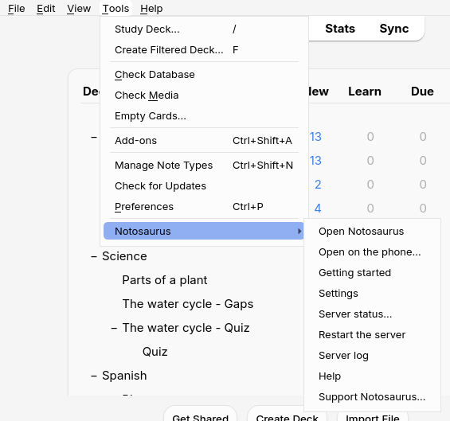
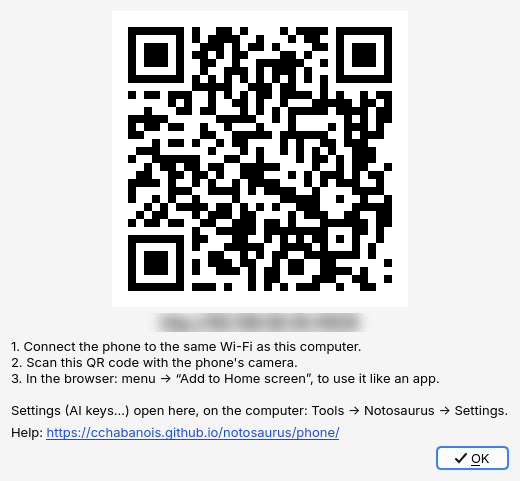

Con el complemento, Notosaurus funciona dentro de Anki en el ordenador: arranca con Anki, se
detiene con él, y escribe las tarjetas directamente en el perfil abierto.

## El menú Herramientas → Notosaurus

- **Abrir Notosaurus** abre Notosaurus en el navegador del ordenador.
- **Abrir en el móvil…** muestra un código QR para abrir Notosaurus en el móvil, y los tres pasos
  para llegar (consulta [En el móvil](../phone/)).
- **Asistente de inicio** abre el asistente de configuración: la IA y su clave, luego el móvil
  (consulta [Primeros pasos con el complemento](../getting-started/#2-el-asistente-de-configuración)).
  La primera vez, Anki lo ofrece solo cuando aún no hay ninguna IA configurada.
- **Ajustes** abre los ajustes (servicio de IA y clave, voces, hijos…) en el navegador del
  ordenador. Solo se abren en el ordenador: el móvil no puede cambiarlos.
- **Estado del servidor…** dice si Notosaurus está en marcha, sus direcciones (en el móvil y en
  este ordenador), y dónde están sus archivos y tus lecciones.
- **Reiniciar el servidor** detiene y vuelve a arrancar Notosaurus: tras cambiar la configuración
  del complemento, o cuando algo se ha atascado.
- **Registro del servidor** muestra lo que ha hecho Notosaurus últimamente. Es lo primero que hay
  que mirar cuando algo va mal (consulta [Solucionar problemas del complemento](../troubleshooting/)).
- **Ayuda** abre esta documentación, en el idioma de Anki.
- **Apoyar Notosaurus…** abre su página de [Ko-fi](https://ko-fi.com/notosaurus), para hacer un
  donativo si te gusta. Notosaurus sigue siendo gratis.

Cambiar de perfil en Anki deja Notosaurus en marcha: las tarjetas van entonces al perfil abierto
(consulta [Varios hijos](../several-children/)).

## La configuración del complemento

Algunas opciones técnicas están en **Herramientas → Complementos**, selecciona **Notosaurus** y
luego **Configuración**:

- `autostart`: arrancar Notosaurus con Anki (`true` por defecto). Con `false`, arranca la primera
  vez que usas el menú.
- `host`: `0.0.0.0` (por defecto) deja que el móvil llegue a Notosaurus en la misma wifi;
  `127.0.0.1` lo limita a este ordenador.
- `port`: `8000` por defecto. Cámbialo si otro programa ya usa ese puerto.
- `source`, `python`, `data`: déjalos vacíos. Solo sirven para desarrollar Notosaurus.

Tras un cambio: **Herramientas → Notosaurus → Reiniciar el servidor**.

Los mazos que crea Notosaurus y cómo se ven sus tarjetas en Anki, en el ordenador y en los móviles:
consulta [Las tarjetas en Anki](../cards-in-anki/).
