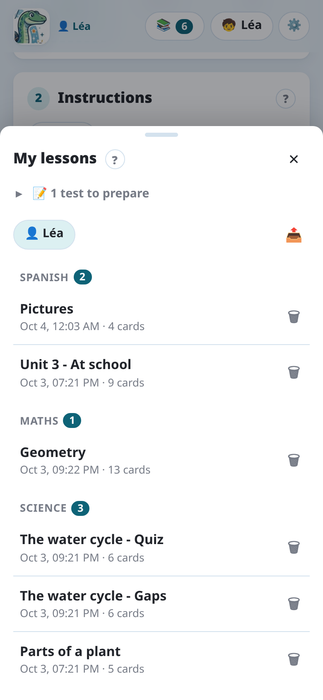

import { Tabs, TabItem } from '@astrojs/starlight/components';

Cada generación crea una **lección**: sus fotos, sus instrucciones y sus tarjetas, guardadas
donde funciona Notosaurus (en el móvil con la aplicación, en el ordenador con el complemento).
Puedes volver a ella en cualquier momento para corregirla, generarla de nuevo o enviarla otra vez
a Anki.

## La lista de lecciones

El botón **Lecciones** (📚), arriba de la página, abre **Mis lecciones** (hasta arriba de la
pantalla cuando hay muchas): las lecciones del **hijo elegido** (y, en el ordenador, del **perfil
abierto en Anki**), las más recientes primero. Encima, una sola línea de herramientas: la
búsqueda, con más de un hijo **👤 Paul** (tócalo para **👥 Todos**: las lecciones de todos los
hijos) y **📤** para compartir lecciones.

- Las lecciones se **agrupan por asignatura**: la primera parte del nombre del mazo (`Inglés`,
  `Ciencias`…), la asignatura trabajada por última vez primero.
- **exportada** marca una lección ya enviada a Anki o descargada.
- Con muchas lecciones (más de 8), aparece un **buscador** (da igual mayúsculas o tildes), las 3
  lecciones más recientes se muestran primero, y las asignaturas se pliegan, salvo la de la
  lección abierta. Una asignatura abierta o cerrada a mano se queda así en ese dispositivo.

Toca una lección para volver a abrirla: sus fotos y tarjetas vuelven, listas para corregirlas o
enviarlas otra vez. **＋ Nueva** empieza una lección nueva.

## Lecciones e hijos

Una lección es del hijo elegido cuando se hizo (el botón **Hijos**, 🧒, arriba de la página) y, en
el ordenador, pertenece al perfil abierto entonces en Anki. **⧉ Copiar para…**, en su revisión,
hace una copia para otro hijo, gratis. Consulta [Varios hijos](../several-children/).

## Exámenes que preparar

¿Un examen abarca varias lecciones? Reúnelas, o algunas de sus tarjetas, y repásalas juntas:
consulta [Preparar un examen](../tests/). Arriba de **Mis lecciones**, una línea plegada los
menciona («📝 2 exámenes por preparar»): al tocarla, los muestra, con **＋ Nuevo examen**.

## Compartir las tarjetas con otra familia

¿Otra familia tiene la misma lección (un compañero de clase, un primo)? Envíale las tarjetas en
un archivo, que abra con Anki o AnkiDroid:

- **varias lecciones**: en **Mis lecciones**, **📤** (Compartir lecciones), y luego marca las
  lecciones, una a una o toda una asignatura, y **📤 Compartir**;
- **un examen**: en su ficha, **📤 Compartir las tarjetas del examen** (consulta
  [Preparar un examen](../tests/));
- **la lección abierta**: **📤 Compartir**, junto a **📥 Añadir a Anki**.

Ni el nombre del niño ni su historial de repaso van con las tarjetas. Las fotos y los esquemas de
las lecciones, en cambio, sí van: comprueba que se puedan compartir.

<Tabs syncKey="mode">
<TabItem label="Aplicación Android">

**📤 Crear el archivo** abre el menú de compartir de Android: envíalo por mensaje, por correo o a
un drive.

</TabItem>
<TabItem label="Ordenador">

**📤 Crear el archivo** descarga un archivo `.apkg`: envíalo por correo o mensajería.

</TabItem>
</Tabs>

## Eliminar una lección

El botón **Eliminar la lección** (🗑), junto a una lección, la elimina, con sus fotos. Si sus
tarjetas están en Anki, Notosaurus las busca y ofrece **eliminarlas también**: su historial de
repaso se pierde entonces. Si no, las tarjetas ya enviadas se quedan en Anki.

<Tabs syncKey="mode">
<TabItem label="Aplicación Android">

**Ajustes** (⚙️) → **🗂️ Lecciones en este teléfono** dice cuántas lecciones guarda el móvil y su
tamaño, y **Borrar todas las lecciones** las borra todas, con su sonido. Las tarjetas que ya están
en AnkiDroid se quedan, con su sonido.

</TabItem>
<TabItem label="Ordenador">

Las lecciones también se gestionan en **Ajustes → Lecciones**: a qué perfil de Anki pertenece cada
una (se puede cambiar ahí), cuánto costó, y eliminarla.

</TabItem>
</Tabs>
