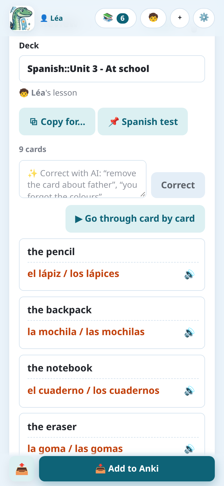
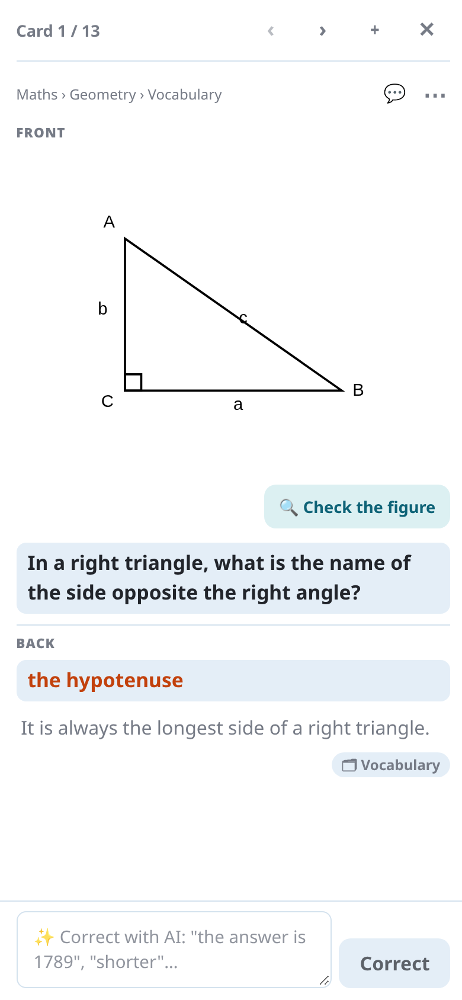
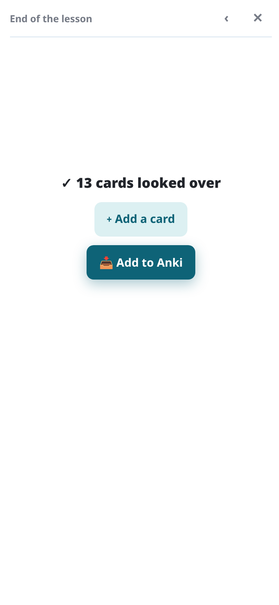
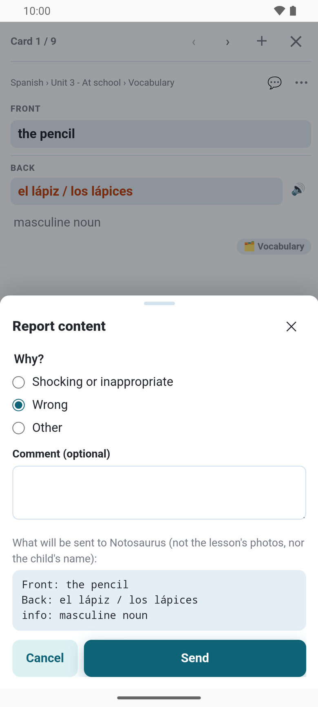
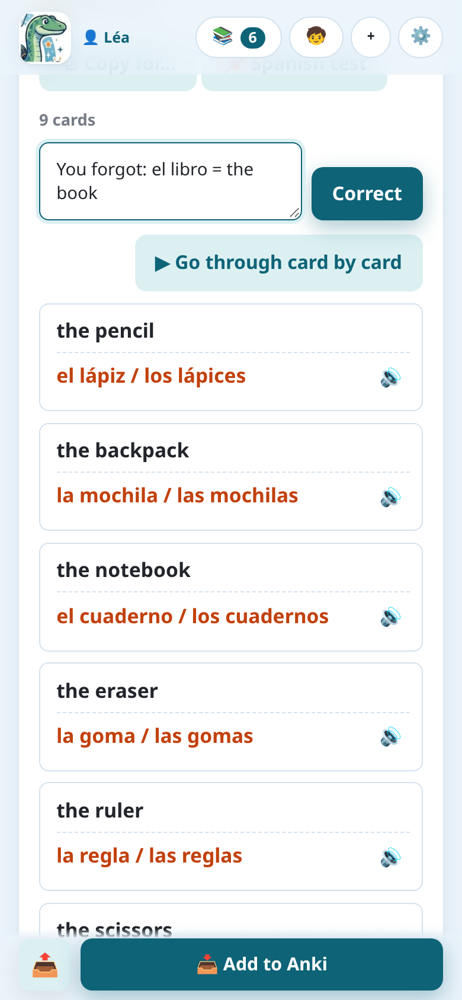

Incluso la mejor IA lee mal una palabra de vez en cuando: **revisa siempre las tarjetas** antes
de enviarlas. Todo lo que cambias se guarda sobre la marcha («✓ Guardada»).

:::tip[¿Algo no va bien? Señálalo]
En la aplicación Android, una tarjeta que no está bien (una palabra mal leída, una respuesta
incorrecta, una figura torcida, una imagen inadecuada, una tarjeta sin sentido): **⋯ →
⚑ Reportar** en ella. Leemos cada aviso, y es la mejor forma de que se corrija Notosaurus.
Consulta [Señalar un problema](#señalar-un-problema).
:::

## El mazo y las tarjetas

- **Mazo**: el nombre del mazo de Anki. `::` crea submazos: `Inglés::Unit 3 - At school`.
- **Voz**: el idioma en que se leen las tarjetas en voz alta. Una lección hecha sin voz (ninguna
  encontrada entonces para su idioma, o ninguna pedida) recibe una aquí: elige su idioma y toma la
  voz elegida para ese idioma en los ajustes. **Sin voz**: no se lee nada. Tarjetas que leer en una
  lección sin voz: se indica en rojo.
- Cada tarjeta tiene un **anverso** (la pregunta) y un **reverso** (la respuesta).

### La lista

La lista es compacta, como una vista previa: el anverso, el reverso bajo una línea de puntos,
una imagen pequeña encima de la pregunta o después de la respuesta, como en Anki, y solo
**🔊** para oír la tarjeta. **Toca una tarjeta para abrirla**; **▶ Revisar tarjeta por
tarjeta** abre la primera.

### Una tarjeta abierta

La tarjeta se abre a pantalla completa (una ventana en el ordenador), con las fórmulas y las
figuras dibujadas, tal como la mostrará Anki:

- arriba, en pequeño, **su mazo** en Anki («Paul › 1.º ESO › Inglés › … › Ejercicios») y sus
  botones: **📄 p. 3**, la página de la lección de la que viene la tarjeta (al tocarlo, las
  páginas de la lección se abren en grande en esa, ‹ › para las demás; no aparece en una tarjeta
  cuya página no se conoce), **💬 Explicar esta tarjeta** y **Más acciones** (⋯);
- **ANVERSO**: la pregunta, con su imagen cuando va en el anverso; una línea y luego
  **REVERSO**: la respuesta y su **🔊**, la imagen cuando va en el reverso, y después la info y
  las ayudas;
- abajo del todo, el campo **✨ Corregir con la IA**, con **Corregir** al lado (consulta
  [Corregir con la IA](#corregir-con-la-ia)).

Toca un texto para editarlo. **Desliza el dedo** en cualquier parte de la tarjeta, o toca
**‹ ›**, para pasar a la tarjeta anterior o a la siguiente. Después de la última llega el **fin
de la lección**: cuántas tarjetas se han revisado («✓ 12 tarjetas revisadas»), **＋ Añadir una
tarjeta** y el botón para enviar la lección a Anki. **✕**, Escape o el botón atrás del móvil
cierran la tarjeta, guardada.

Toca la imagen de una tarjeta para cambiarla: su página se abre a pantalla completa (consulta
[Imágenes](../card-types/#imágenes)). Una tarjeta sin imagen: ⋯ → **🖼️ Añadir una imagen**.

- **+ info** añade una nota mostrada bajo la respuesta: el género, el plural, un ejemplo…
- **+ submazo** pone la tarjeta en un submazo de la lección («Vocabulario», «Verbos»); una
  tarjeta puesta en uno muestra el nombre de su submazo. Al tocarlo, se abre una lista:
  **Ninguno: en el mazo de la lección**, los submazos de la lección con su número de tarjetas,
  o **Nuevo submazo…**.
- **🔊**, junto a la respuesta, la reproduce con la voz de la lección. Cada tarjeta dice qué
  caras se leen: la respuesta de una tarjeta de vocabulario, un texto con huecos por las dos
  caras, entero (el anverso como un dictado: se escriben en los huecos las palabras oídas). El
  menú ⋯ de la tarjeta: **Leer el anverso en voz alta**, **Dejar de leer el reverso**…
- **Más acciones** (⋯) también elimina la tarjeta.

### Añadir una tarjeta

**＋** arriba de una tarjeta abierta añade una justo después; **＋ Añadir una tarjeta**, bajo la
lista o en el fin de la lección, añade una al final. La nueva tarjeta se abre, vacía; si se deja
vacía, desaparece al cerrarla.

Lo más sencillo suele ser que **la IA la escriba**: en **¿Qué debe preguntar esta tarjeta?**,
abajo, di qué debe preguntar («el pretérito de ir», «la fecha de la toma de la Bastilla») y
toca **Escribir**. En un móvil no se abre ningún teclado: toca **🎤** para dictarlo, o el campo
para escribirlo. También puedes rellenar tú mismo el anverso y el reverso.

**📝 Instrucciones usadas para esta lección**, encima de las tarjetas, recuerda lo que se le pidió
a la IA.

## Una lección que parece errónea

Cuando la propia lección parece contener un error (apuntes de un alumno, un error al copiar: una
fecha, un nombre, una cifra o una fórmula equivocados), la tarjeta mantiene lo que dice la
lección, con una nota (⚠️) que explica por qué parece errónea y la corrección propuesta.
**Corregir** la aplica; **Mantener la lección** retira la nota. Solo se señalan errores claros y
verificables, nunca una convención o una simplificación, y la nota nunca va a Anki.

## Señalar un problema

En la aplicación Android, **⋯ → ⚑ Reportar**, arriba a la derecha de una tarjeta, le dice a
Notosaurus qué ha fallado: una palabra mal leída, una respuesta incorrecta, una figura con una
marca mal colocada, una imagen inadecuada, una tarjeta sin sentido. No lo dudes: **leemos cada
aviso**, y así se corrigen esos errores en Notosaurus, para todas las lecciones futuras.

- Di por qué (**Incorrecto**, **Ofensivo o inapropiado**, **Otro**) y, si quieres, añade un
  comentario: lo que esperabas es lo que más ayuda.
- Lo que se envía es la tarjeta entera tal como la ves (sus textos, su explicación si se muestra,
  su imagen o figura, salvo una foto que hayas hecho tú); la ventana muestra exactamente qué,
  nunca las fotos de la lección ni el nombre del niño. Consulta [Privacidad](../app-privacy/).
- Después puedes eliminar la tarjeta o quitar su imagen.

## Corregir con la IA

En vez de cambiar las tarjetas una a una, pide con tus palabras, en el campo encima de las
tarjetas:

- «quita la tarjeta sobre el padre»
- «te has olvidado de los colores al final de la página»
- «añade el plural en el reverso, así: the child / the children»
- «preguntas más cortas»

Toca **Corregir**. La IA vuelve a ver las fotos (con más de 10 páginas, solo las tarjetas: dice entonces
lo que no ha podido hacer sin las páginas) y solo cambia lo que has pedido: las tarjetas
cambiadas se marcan como **cambiada**, las nuevas como **nueva**, y una frase resume lo que ha
hecho, con cuántas tarjetas se han añadido, cambiado y quitado. Debajo:

- **↩ Deshacer** deja las tarjetas como estaban;
- **🎯 Rehacer con cuidado**, tras una corrección rápida, la vuelve a hacer con la reflexión
  del modelo;
- **✓ Conservar** la conserva: ya no se puede deshacer.

La corrección se puede deshacer mientras no la conserves ni empieces a editar una tarjeta.

**Una sola tarjeta** se corrige desde la tarjeta abierta, en el campo **✨ Corregir con la IA**
de abajo («la respuesta es 1789», «más corto»), y luego **Corregir**. Aparecen los mismos
**↩ Deshacer**, **🎯 Rehacer con cuidado** y **✓ Conservar**; cerrar la tarjeta, o pasar a la
siguiente, también conserva la corrección.

En la aplicación, **🎤** junto al campo dicta la corrección. No hace falta parar el dictado
antes: toca **Corregir** enseguida, y lo que has dicho se escribe y se envía.

¿Cambias de opinión mientras la IA corrige (la lección o una sola tarjeta)? **Cancelar** la
detiene de inmediato: las tarjetas se quedan como estaban.

## Explicar una tarjeta

**Explicar esta tarjeta** (💬) pide a la IA que la explique: qué quiere decir y por qué su
respuesta es la respuesta, en dos a cuatro frases, al nivel de un alumno, en el idioma de la
página. Útil para una asignatura que has olvidado, o una tarjeta que el alumno no entiende.

Bajo la explicación, la IA ofrece solo lo que ayudaría con **esa** tarjeta:

- **Un ejemplo**: una frase con la palabra, un cálculo resuelto con la fórmula;
- **Un truco para recordarlo**: cuando existe uno natural;
- **¿Por qué es correcta?**: cuando no es evidente, y para una tarjeta de opción múltiple o de
  verdadero/falso (por qué las otras opciones son incorrectas).

**Guardar en «Info»** añade lo explicado a la info de la tarjeta: lo encontrarás en el reverso en
Anki. Cada explicación es una llamada corta a la IA: créditos en la aplicación; en el ordenador,
una fracción de céntimo con Gemini Flash, alrededor de un céntimo con Claude Sonnet, contados con
los costes de la lección.

## Volver a generar

**✨ Volver a generar**, bajo las instrucciones, vuelve a hacer las tarjetas de la lección
abierta, por ejemplo con otras instrucciones o tras añadir una página. Sustituye las tarjetas;
**↩ Deshacer** las recupera, salvo si las fotos han cambiado. Si la lección ya se envió a Anki,
las tarjetas enviadas se quedan allí, y las nuevas se añaden en el siguiente envío.

## Opciones de las tarjetas

Al final de la lección, una línea dice cómo se preguntan las tarjetas: **↔ En los dos sentidos**
(Anki pregunta también reverso → anverso), **⌨️ Respuesta escrita** (Anki compara letra a letra),
**🎧 Con un dictado** (oír el reverso, escribirlo) o **🎧 Solo dictado**.

Estas opciones vienen de las [instrucciones](../instructions/): la IA las lee en su texto. Para
cambiarlas, dilo en la corrección, p. ej. «en un solo sentido» o «con la respuesta escrita»: las
tarjetas siguen igual, solo cambia cómo las pregunta Anki.

La línea de debajo dice qué voz lee los reversos. Va incluida en el mazo, así que suena en todas
partes, incluso sin conexión.

## De quién es la lección

Encima de las tarjetas, una línea dice para quién es la lección: **🧒 Lección de Paul**. En el
ordenador, si Anki está abierto en el perfil de otro hijo, lo dice antes de que envíes las
tarjetas.

**⧉ Copiar para…**, cuando hay otro hijo, hace una copia de la lección para él: sus mazos, sus
propias tarjetas en Anki. Es gratis: no se le pide nada a la IA.

En el ordenador, una lección compartida con todos los perfiles por una versión anterior se abre
en **solo lectura** en los demás perfiles: aún puedes añadirla a tu propio Anki o copiarla, pero
solo desde el perfil de su dueño se puede cambiar. Consulta [Varios hijos](../several-children/).
