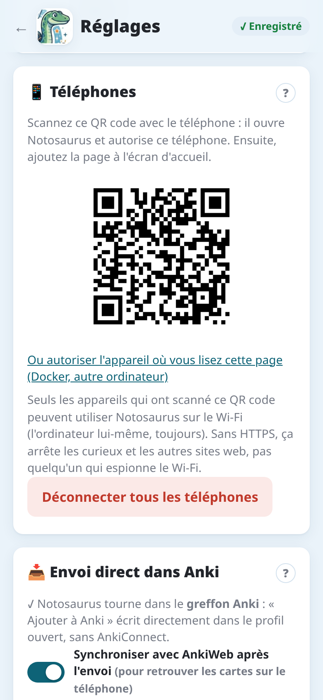
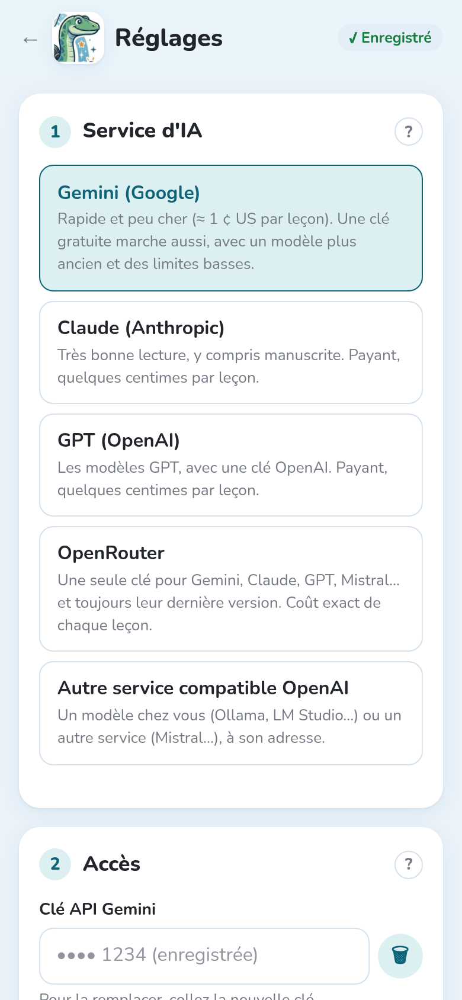
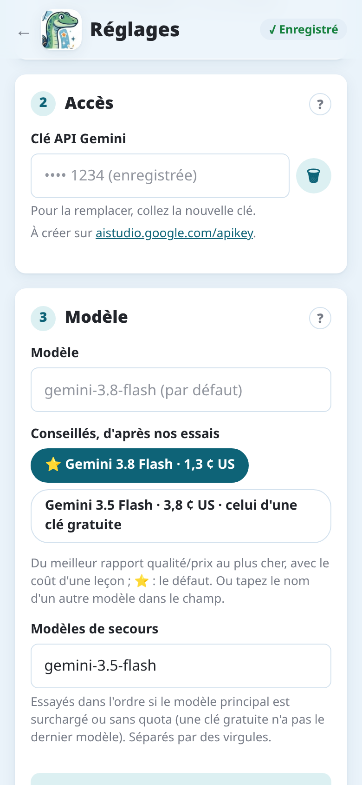
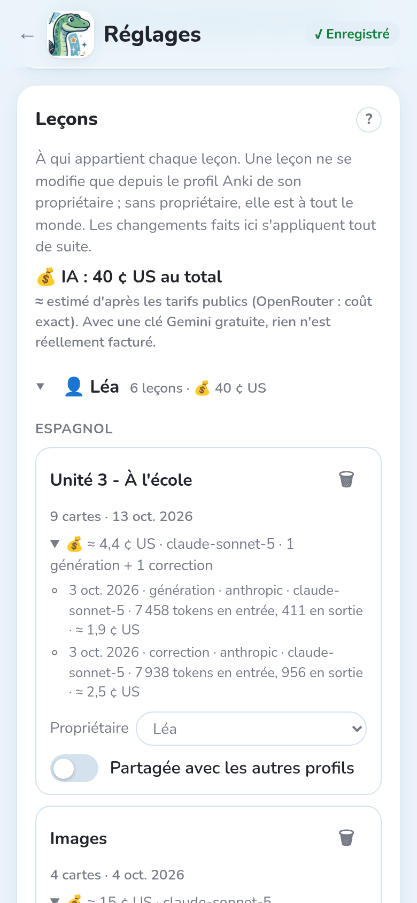

Notosaurus n'a pas sa propre IA : il utilise le service que vous choisissez, avec **votre propre
clé**. Vous payez directement le service, selon ce que vous utilisez : pas d'abonnement.

## Les réglages

Sur l'ordinateur, **Outils → Notosaurus → Réglages** les ouvre dans le navigateur. Ils ne
s'ouvrent que sur l'ordinateur lui-même : un téléphone ne peut ni les changer ni voir les clés.
En autonome ou avec Docker, la page des réglages (`/admin.html`) est joignable depuis le réseau,
protégée par un **🔐 Mot de passe administrateur** créé à la première visite.

Ce que seul l'ordinateur a :

- **Service d'IA**, **Accès** (les clés d'API) et **Modèle** : ci-dessous.
- **Images des cartes** : le **Service qui dessine** (celui des cartes quand il sait dessiner :
  Gemini, OpenAI, OpenRouter ; Claude et les modèles locaux ne savent pas) et son **Modèle
  d'images**, avec **🖼️ Tester : dessiner une girafe**. Voir
  [Les types de cartes](../card-types/#images).
- **📥 Envoi direct dans Anki** : AnkiConnect, en autonome, et la synchronisation avec AnkiWeb.
  Voir [Envoyer vers Anki sur l'ordinateur](../send-to-anki/).
- **📱 Téléphones** : le QR code qui ouvre Notosaurus sur un téléphone et l'autorise, et
  **Déconnecter tous les téléphones**. Voir [Sur le téléphone](../phone/) et
  [Confidentialité et sécurité](../privacy/).
- **Leçons** : à qui appartient chaque leçon, ce qu'elle a coûté, la supprimer (voir
  [Ce que ça coûte](#ce-que-ça-coûte)).

Les **📝 Instructions pour l'IA** et les **Voix des cartes** sont aussi dans les réglages de
l'application Android : voir [Les consignes](../instructions/#les-instructions-permanentes) et
[Les voix](../voices/).

## Quel service ?

| Service | Pour qui | Coût d'une leçon |
|---|---|---|
| **Gemini** (Google) | le choix par défaut : rapide, peu cher, bonne lecture ; une offre gratuite pour essayer | une fraction de centime |
| **Claude** (Anthropic) | parmi les meilleures lectures de l'écriture manuscrite, et le plus rapide (Sonnet) | quelques centimes |
| **OpenAI** (GPT) | si vous avez déjà un compte OpenAI | quelques centimes |
| **OpenRouter** | une seule clé pour Gemini, Claude, GPT, Mistral… ; le coût exact de chaque leçon | le prix du modèle choisi |
| **Autre service compatible OpenAI** | un modèle chez vous (Ollama, LM Studio), ou un autre service | gratuit chez vous |

Vous pouvez changer de service à tout moment dans **Réglages → Service d'IA** : les leçons déjà
faites restent comme elles sont.

## Obtenir une clé

Créez la clé sur le site du service, collez-la dans **Réglages → Accès** et touchez
**🔌 Tester** : Notosaurus vérifie que le modèle lit une image et répond au bon format.
La première fois, l'[assistant de démarrage](../getting-started/#2-lassistant-de-démarrage)
fait la même chose en deux étapes.

### Gemini

1. Ouvrez [aistudio.google.com/apikey](https://aistudio.google.com/apikey) et connectez-vous
   avec un compte Google.
2. **Create API key** (créer une clé), puis copiez-la.
3. L'offre gratuite suffit pour essayer Notosaurus, mais ses limites sont basses (quelques
   dizaines de requêtes par jour sur les meilleurs modèles) et Google peut utiliser ce que vous
   envoyez pour améliorer ses produits. Pour les cahiers de vos enfants, activez la facturation
   du projet de la clé dans Google AI Studio : vous payez alors une fraction de centime par
   leçon et, d'après les conditions de Google, vos données ne servent pas à améliorer ses
   produits.

### Claude

1. Ouvrez [console.anthropic.com](https://console.anthropic.com) et créez un compte.
2. Dans **Billing** (facturation), ajoutez un peu de crédit : quelques euros durent longtemps.
3. Dans **Settings → API keys**, **Create key**, puis copiez la clé.

### OpenAI

1. Ouvrez [platform.openai.com](https://platform.openai.com) et créez un compte.
2. Ajoutez un peu de crédit dans les réglages de facturation.
3. Dans **API keys**, créez une clé secrète, puis copiez-la.

### OpenRouter

1. Ouvrez [openrouter.ai](https://openrouter.ai) et connectez-vous.
2. Achetez des crédits : OpenRouter ajoute de petits frais à chaque achat, donc préférez un
   achat de 15 $ ou plus à plusieurs petits.
3. Dans **Keys**, créez une clé, puis copiez-la.

Une seule clé OpenRouter donne accès à Gemini, Claude, GPT et bien d'autres : pratique pour les
comparer. Par défaut, Notosaurus utilise Gemini Flash via OpenRouter.

## Le modèle

- **Notosaurus choisit pour vous** : avec le champ **Modèle** vide, chaque service prend son
  modèle par défaut, celui qui a une ⭐.
- **Conseillés, d'après nos essais**, sous **Modèle**, liste les modèles que nous conseillons
  pour ce service, du meilleur rapport qualité/prix au plus cher, avec le coût d'une leçon.
  Touchez-en un pour le choisir, ou tapez n'importe quel autre modèle du service ; avec les
  services compatibles OpenAI, **📋 Charger les modèles du service** ne liste que les modèles qui
  acceptent les images.
- **Comment nous les avons choisis**, et les modèles à éviter : voir
  [Quel modèle ?](../which-model/).

Gemini a aussi des **modèles de secours**, essayés dans l'ordre quand le modèle principal est
surchargé ou pas inclus dans l'offre de la clé (une clé gratuite n'a pas le dernier modèle :
elle en prend alors un plus ancien).

## Un modèle chez vous

Avec **Autre service compatible OpenAI**, Notosaurus peut utiliser un modèle qui tourne sur votre
ordinateur, avec [Ollama](https://ollama.com) ou [LM Studio](https://lmstudio.ai). L'adresse se
termine en général par `/v1` (Ollama : `http://localhost:11434/v1`). Rien ne sort de la maison
et rien n'est payé, mais :

- le modèle doit **accepter les images** (un modèle « vision ») : **📋 Charger les modèles du
  service** les liste ;
- il faut une **bonne carte graphique** (ou un Mac récent avec beaucoup de mémoire) ;
- il lit **beaucoup moins bien l'écriture manuscrite** que Gemini ou Claude ;
- avec Ollama, les corrections ont besoin d'un contexte plus long que celui par défaut : réglez
  `OLLAMA_CONTEXT_LENGTH` (par exemple à 16384) avant de le lancer.

## Ce que ça coûte

**Réglages → Leçons** affiche ce qu'a coûté l'IA, au total, par profil et par leçon, avec
chaque génération, correction et image.

Ces montants sont estimés d'après les tarifs publics des services (OpenRouter donne le coût
exact). Avec une clé Gemini gratuite, rien n'est réellement facturé. Par exemple, la leçon de
vocabulaire de ces captures a coûté environ 2 centimes de dollar à générer avec Claude Sonnet,
et autant pour sa correction. Les images coûtent de moins d'un centime à quelques centimes
chacune ; les figures, moins d'un centime (dessinées vite, quelques secondes chacune, pendant
que vous relisez les cartes). Une figure vous semble douteuse : « 🔍 Vérifier la figure », dans
son panneau d'image, la fait regarder par l'IA ; si elle y voit une erreur, vous choisissez de
la faire redessiner avec soin, avec la réflexion du modèle (jusqu'à une minute).
