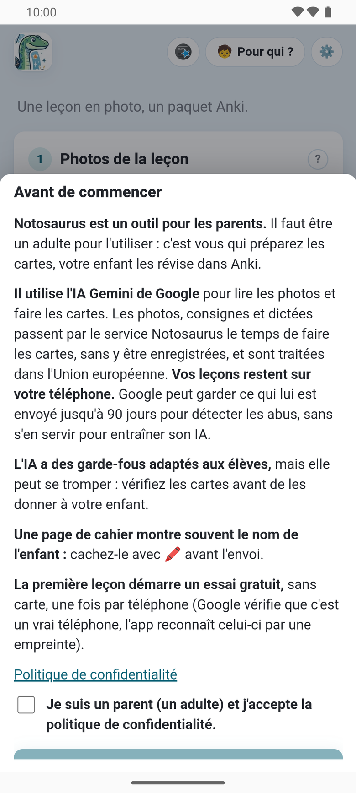
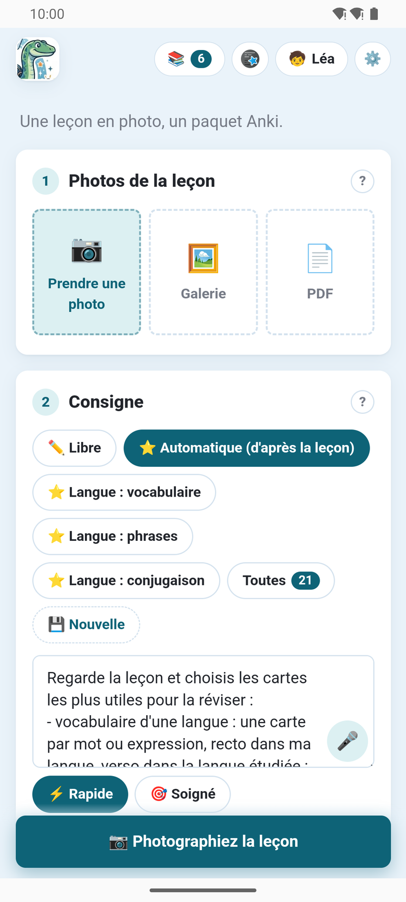
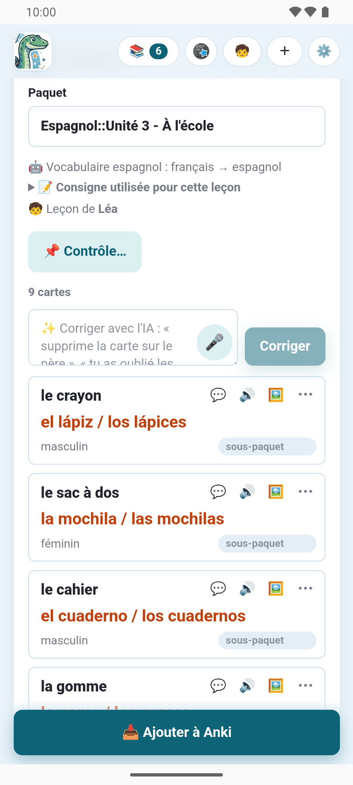
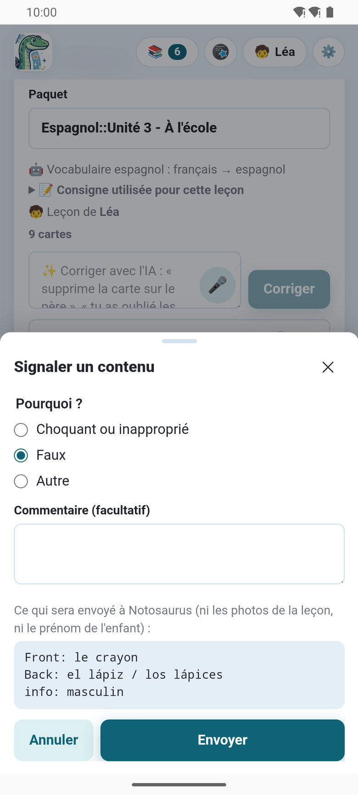

L'**application Notosaurus pour Android** fait les cartes sur le téléphone lui-même : prenez la
leçon en photo, vérifiez les cartes, et elles vont directement dans **AnkiDroid**. Pas
d'ordinateur, pas de clé d'IA à obtenir. Elle arrive sur Google Play.

C'est le même Notosaurus que sur l'ordinateur : la même page, les mêmes consignes, types de
cartes et relecture, les enfants et les contrôles à préparer. Tout ce que disent
[Photos et PDF](../photos/), [Les consignes](../instructions/) et
[Relire les cartes](../review/) vaut aussi dans l'application.

## Ce qu'il faut

- **Un téléphone Android**, avec l'application installée depuis **Google Play**.
- **AnkiDroid**, l'application Anki gratuite pour Android, où vont les cartes. Ouvrez-le une fois
  après l'avoir installé, pour qu'il crée sa collection (voir
  [L'application et AnkiDroid](../app-ankidroid/)).
- **Un abonnement**, après un essai gratuit qui démarre à votre première leçon (voir
  [L'abonnement](../app-subscription/)). Avec le greffon Anki sur votre ordinateur,
  l'application est gratuite (voir [Avec votre ordinateur](../app-with-computer/)).

## Avant de commencer

Au premier lancement, l'application dit en quelques lignes ce qu'elle est et où vont les
leçons, puis vous demande d'accepter sa [politique de confidentialité](../app-privacy/) :

- Notosaurus est un **outil pour les parents** : c'est vous qui préparez les cartes, votre
  enfant les révise dans Anki.
- Il utilise l'**IA Gemini de Google**. Les photos, consignes et dictées passent par le service
  Notosaurus le temps de faire les cartes, sans y être enregistrées, et sont traitées dans
  l'Union européenne. Vos leçons restent sur votre téléphone.
- L'IA a des garde-fous adaptés aux élèves, mais elle peut se tromper : vérifiez les cartes avant
  de les donner à votre enfant.
- Une page de cahier montre souvent le nom de l'enfant : cachez-le avec le bouton **Cacher** (🖍️) avant l'envoi
  (voir [Photos et PDF](../photos/)).

## Votre première leçon

1. **🧒** en haut de la page : ajoutez la fiche de votre enfant (prénom, classe), pour que les
   cartes soient à son niveau. Voir [Plusieurs enfants](../several-children/).
2. Sous **Photos de la leçon**, prenez la page en photo (ou plusieurs pages), ou ajoutez un PDF.
3. Sous **Consigne**, choisissez ce qu'il faut faire, ou gardez **Automatique (d'après la
   leçon)** : voir [Les consignes](../instructions/). Le bouton **Dicter** (🎤), à côté du champ, permet de les
   dire au lieu de les taper.
4. Touchez **✨ Générer les cartes**. La première leçon démarre l'essai gratuit.
5. Vérifiez les cartes, corrigez-les ou demandez à l'IA en quelques mots : voir
   [Relire les cartes](../review/).
6. Touchez **📥 Ajouter à Anki** : les cartes vont dans AnkiDroid. La première fois, AnkiDroid
   demande si Notosaurus peut y ajouter des cartes.

La leçon est gardée sur le téléphone : rouvrez-la depuis le bouton **Leçons** (📚) pour la corriger et la renvoyer.
Ses cartes sont mises à jour dans AnkiDroid, pas dupliquées.

## Où elle fonctionne

Le service Notosaurus fait ce qui demande une IA : lire les photos, faire et corriger les
cartes, en expliquer une, lire les versos à voix haute, dessiner une image ou en trouver une
libre (Wikimedia Commons, Openverse et Pixabay). Tout le reste se passe sur le téléphone : les
leçons sont gardées dans le stockage privé de l'application, les cartes sont écrites dans
AnkiDroid.

Dans les réglages, **📍 Où travaille Notosaurus ?** choisit **📱 Sur ce téléphone** (par défaut)
ou **💻 Sur mon ordinateur**, avec le greffon Anki : voir
[Avec votre ordinateur](../app-with-computer/).

## Ce qui est propre à l'application

L'essentiel de Notosaurus est le même que sur l'ordinateur. Ce que seule l'application a, ou n'a
pas :

- **🎤 Dicter** : dites une consigne ou une correction au lieu de la taper. L'application demande
  le micro la première fois.
- **⚑ Signaler**, sur une carte, signale à Notosaurus un contenu faux ou inadapté fait par l'IA
  (voir [Relire les cartes](../review/)).
- **Les voix** sont celles de Google, par le service Notosaurus ; les
  [réglages des voix](../voices/) sont les mêmes.
- **Pas de `.apkg`** ni de Ko-fi : les cartes vont directement dans AnkiDroid, et l'abonnement
  finance Notosaurus.
- **Les mises à jour** passent par Google Play. Quand une nouvelle version est disponible,
  l'application dit **Une nouvelle version de Notosaurus est disponible**, avec un bouton
  **Mettre à jour**.

Voir aussi [Les réglages de l'application](../app-settings/) et, quand quelque chose ne va pas,
[Dépannage de l'application](../app-troubleshooting/).
