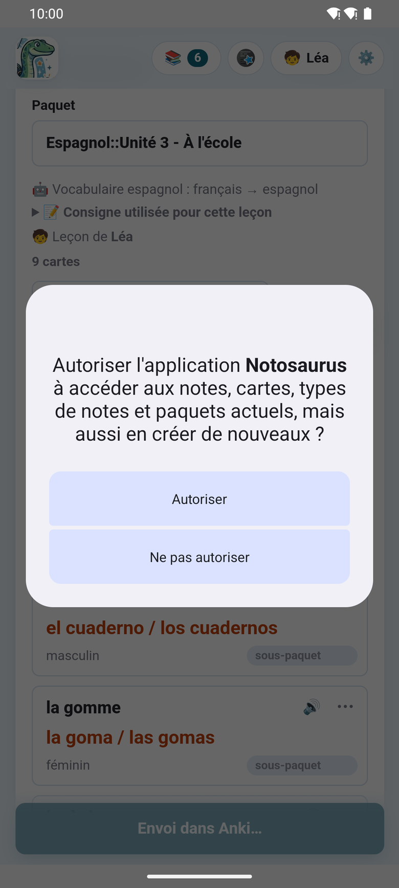
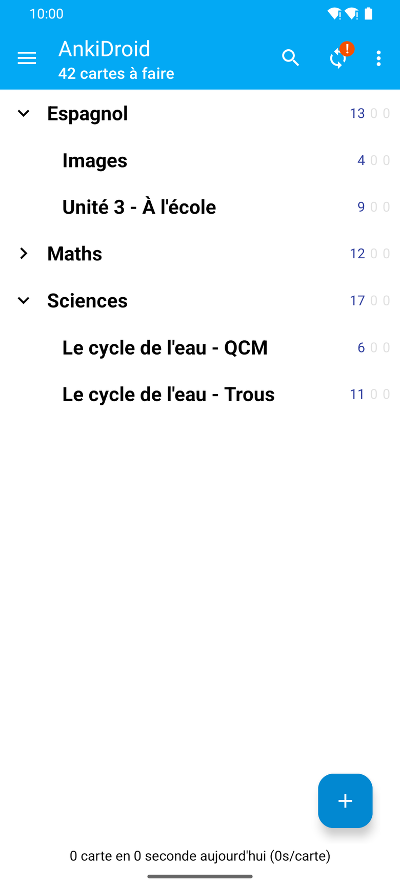
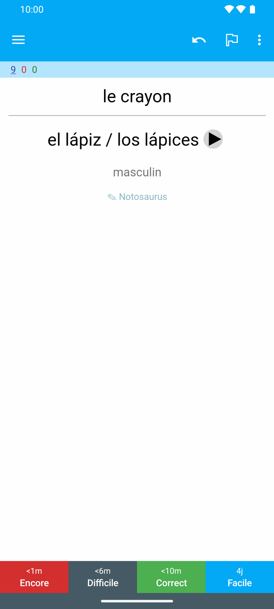

Sur ce téléphone, les cartes vont dans **AnkiDroid**, l'application Anki gratuite pour Android :
pas de `.apkg`, pas d'ordinateur, pas de synchronisation à attendre.

## La première fois

1. **Installez AnkiDroid** depuis Google Play, s'il n'y est pas : l'application ouvre sa page
   quand il manque.
2. **Ouvrez AnkiDroid une fois**, pour qu'il crée sa collection.
3. Au premier **📥 Ajouter à Anki**, AnkiDroid demande si Notosaurus peut y ajouter des cartes
   (la fenêtre d'AnkiDroid lui-même) : autorisez-le.

**📥 AnkiDroid**, dans les réglages de l'application, dit où on en est : **✓ AnkiDroid est
installé et Notosaurus peut y ajouter des cartes**, ou un bouton pour **Installer AnkiDroid** ou
pour **Autoriser**.

## Envoyer les cartes

**📥 Ajouter à Anki** écrit les cartes dans AnkiDroid, dans le paquet de la leçon, avec leurs sons
et leurs images. Comme sur l'ordinateur :

- **Renvoyée**, une leçon **met à jour** ses cartes au lieu de les dupliquer, et leur historique
  de révision reste.
- **Les cartes supprimées de la leçon** restent dans AnkiDroid : après l'envoi, l'application les
  liste et propose de les supprimer (avec leur historique de révision), jamais sans demander.
- **Supprimer une leçon** propose de supprimer aussi ses cartes dans AnkiDroid.

AnkiDroid synchronise les cartes avec AnkiWeb comme d'habitude, s'il est connecté à un compte :
elles arrivent alors dans Anki sur un ordinateur, ou sur un autre téléphone.

## Ouvrir AnkiDroid

**Ouvrir AnkiDroid**, en haut de la page et en bas, l'ouvre d'un geste, pour réviser les cartes
qui viennent d'être envoyées.

## Corriger une carte depuis AnkiDroid

Sous chaque réponse dans AnkiDroid, un petit **✎ Notosaurus** ouvre la carte dans l'application
pour la corriger (AnkiDroid ouvre d'abord une courte page web, dont le bouton ouvre
l'application). La correction met à jour la même note : son historique de révision reste. Une
leçon faite avec l'ordinateur ([Avec votre ordinateur](../app-with-computer/)) s'ouvre sur
l'ordinateur, pas dans l'application.

Jusqu'à **AnkiDroid 2.25.2**, activez d'abord **Paramètres → Avancé → Autoriser les cartes à
lancer d'autres applications** dans AnkiDroid : sans ce réglage, AnkiDroid bloque tout lien d'une
carte (« La carte ne peut pas lancer d'autres applications »). Depuis AnkiDroid 2.25.3, les liens
vers une page web passent sans ce réglage.

## Le paquet filtré d'un contrôle

Un contrôle à préparer réunit des cartes de plusieurs leçons sous une étiquette (voir
[Préparer un contrôle](../tests/)). Dans sa fiche, **Ouvrir dans AnkiDroid** ouvre les cartes du
contrôle dans le navigateur d'AnkiDroid, quels que soient leurs paquets ; puis
**⋮ → Créer un paquet filtré → Générer** (au-delà de 100 cartes, augmentez d'abord
**Limiter à**). AnkiDroid ne laisse aucune autre application créer elle-même un paquet filtré.

Quelque chose ne va pas ? Voir [Dépannage de l'application](../app-troubleshooting/).
