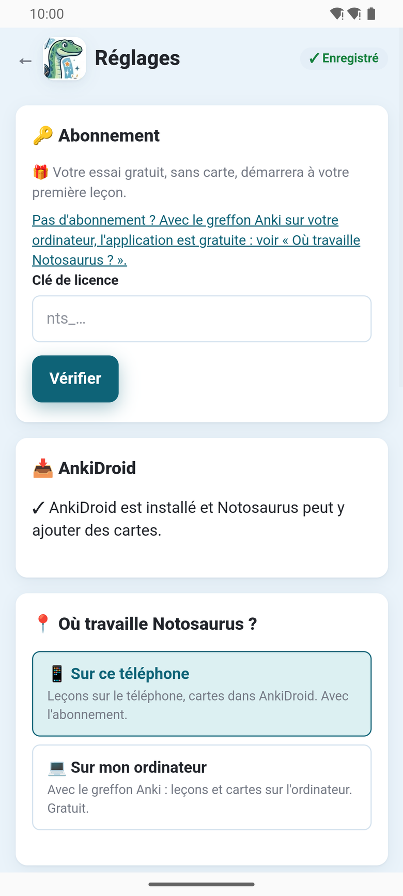
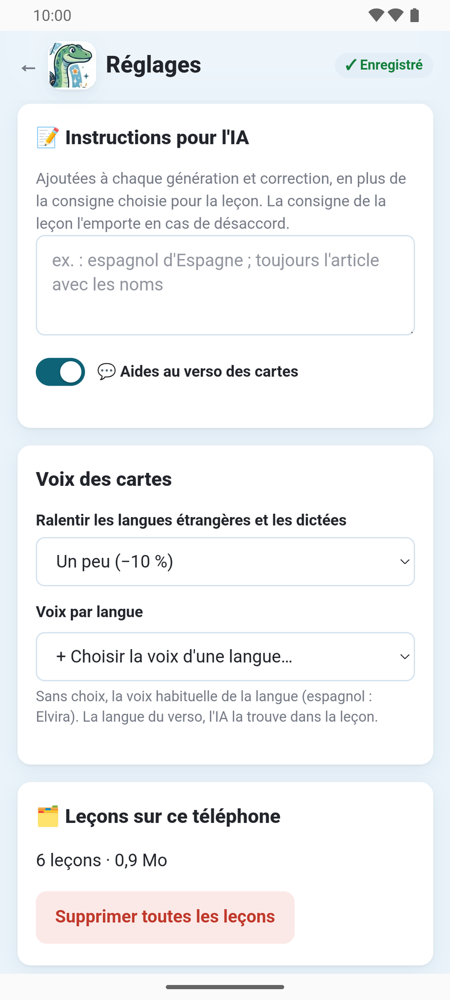

Le bouton **Réglages** (⚙️), en haut de la page, ouvre les réglages propres à l'application. Ils s'enregistrent au fur
et à mesure.

- **🔑 Abonnement** : l'essai gratuit ou la formule, les crédits qui restent ce mois-ci et
  aujourd'hui, quand ils sont renouvelés ; **J'ai déjà un abonnement**, **Gérer l'abonnement
  (Google Play)**, et un champ **Clé de licence**. Voir [L'abonnement](../app-subscription/).
- **📥 AnkiDroid** : si AnkiDroid est installé et si Notosaurus peut y ajouter des cartes, avec
  **Installer AnkiDroid** ou **Autoriser** au besoin. Voir
  [L'application et AnkiDroid](../app-ankidroid/).
- **📍 Où travaille Notosaurus ?** : **📱 Sur ce téléphone** ou **💻 Sur mon ordinateur**. Voir
  [Avec votre ordinateur](../app-with-computer/).
- **📝 Instructions pour l'IA** : les instructions pour tous les enfants (« espagnol
  d'Espagne »), ajoutées à chaque leçon, et **💬 Aides au verso des cartes**. Celles de chaque
  enfant sont dans sa fiche, depuis le bouton **Enfants** (🧒) de la page principale : voir
  [Plusieurs enfants](../several-children/).
- **Voix des cartes** : **Ralentir les langues étrangères et les dictées**, et une **Voix par
  langue**, avec **Écouter**. Voir [Les voix et l'audio](../voices/).
- **🗂️ Leçons sur ce téléphone** : combien il y en a et leur taille. **Supprimer toutes les
  leçons** les efface, avec leur son ; les cartes déjà dans AnkiDroid restent.
- **ℹ️ À propos** : la version, la licence, le code source, la
  [politique de confidentialité](../app-privacy/) et les licences des bibliothèques utilisées.
- **Avancé** : l'adresse du relais, pour les tests seulement. Laissez-la telle quelle.

En bas, **🌐** choisit la langue de la page, et **📖 Aide** ouvre cette documentation.

Avec **💻 Sur mon ordinateur**, les réglages ne montrent que le choix du mode, la langue et
**ℹ️ À propos** : le reste est celui de l'ordinateur, dans **Anki → Outils → Notosaurus →
Réglages**.
