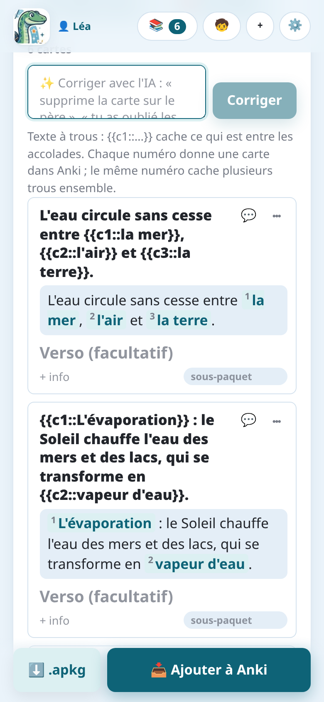
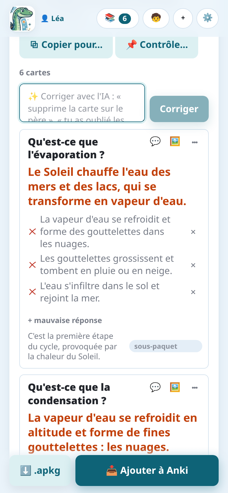
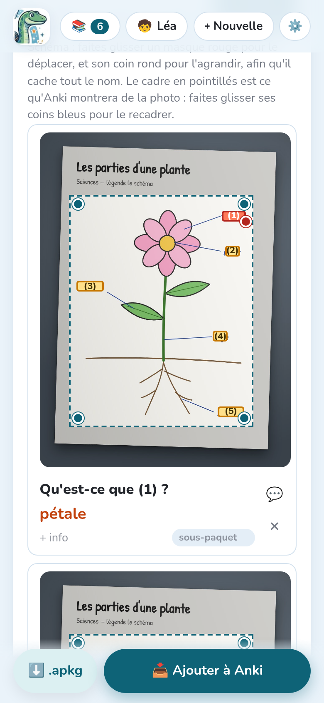
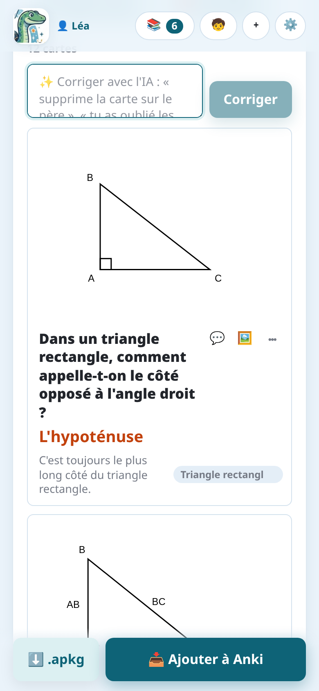
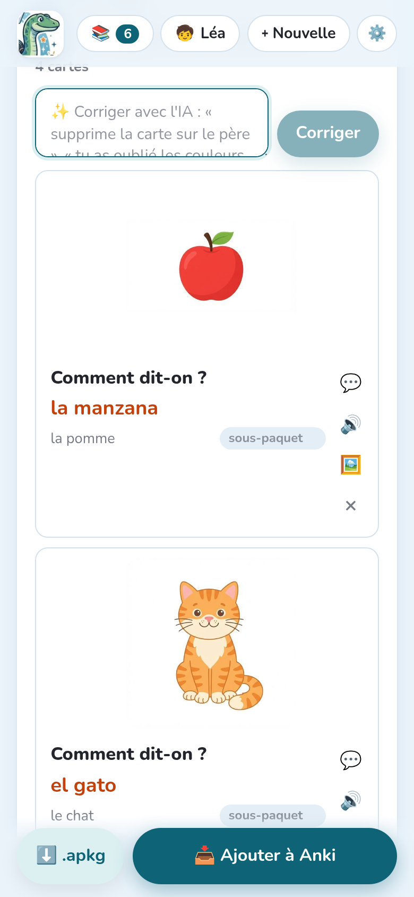
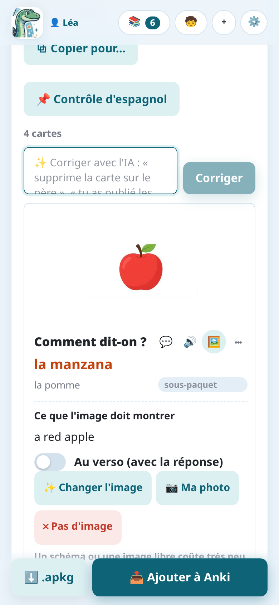

import { Tabs, TabItem } from '@astrojs/starlight/components';

La consigne décide du type de cartes que fait l'IA (voir [Les consignes](../instructions/)).
Chaque type devient son propre **type de note** dans Anki, dont le nom commence par
« Notosaurus ».

## Question et réponse

La carte classique : un **recto** (la question, un mot dans votre langue) et un **verso** (la
réponse, le mot dans la langue étudiée), avec une **info** facultative affichée sous la
réponse. C'est ce que font les consignes de vocabulaire, de phrases et de questions.

Quand la consigne le demande, Anki ajoute la **carte inverse** (verso → recto), fait **taper la
réponse** (comparée lettre par lettre) ou fait une **dictée** (entendre le verso, l'écrire). Voir
[Les consignes](../instructions/).

## Texte à trous

La consigne **Texte à trous** fait des phrases à trous :

> Le Soleil chauffe l'eau des mers et des lacs : c'est `{{c1::l'évaporation}}`.

Ce qui est entre `{{c1::` et `}}` est caché. **Chaque numéro donne une carte** dans Anki ; le
même numéro utilisé deux fois cache deux trous ensemble. Dans la relecture, les trous
s'affichent numérotés : vous pouvez changer leur texte, en ajouter ou en retirer en modifiant les
accolades.

## QCM et vrai ou faux

Les cartes de **QCM** ont une question, la **bonne réponse** et des **mauvaises réponses**
(trois, plausibles) : modifiez-les dans la relecture, ou ajoutez-en avec **+ mauvaise
réponse**. **Vrai / faux** fait des affirmations, dont la moitié fausses avec une seule erreur
précise.

Dans Anki, la question affiche les choix (A, B, C…, toujours dans le même ordre) et la réponse
marque le bon. C'est du HTML simple : le rendu est le même sur toutes les applis Anki.

## Schémas

Avec la consigne **Schéma ou carte à compléter**, l'IA trouve chaque légende d'un schéma et la cache
derrière un numéro. Chaque carte demande « Qu'est-ce que (2) ? » et montre la réponse sur le
schéma.

Dans la relecture :

- faites glisser un **masque rouge** pour le déplacer, et son **coin rond** pour l'agrandir,
  afin qu'il cache toute la légende ;
- le **cadre en pointillés** est la partie de la photo qu'Anki affiche : faites glisser ses
  coins bleus pour la recadrer.

Gemini et GPT placent les masques le plus précisément. Avec Claude, vérifiez que les masques
cachent toute la légende sur une écriture manuscrite.

## Formules

Les formules sont écrites en **MathJax**, qu'Anki affiche : `\( \frac{a+b}{2} \)`, `\( x^2 \)`.
La relecture les affiche dessinées sous le texte. Les calculs simples restent en texte.

## Figures

Pour la géométrie et les figures simples avec des légendes (un triangle rectangle et son
hypoténuse, un cercle et son rayon, un rectangle et ses mesures), l'IA **dessine une figure
exacte** sur la carte, au lieu d'un modèle d'images qui dessinerait mal le texte et les
mesures. La figure ne montre jamais la réponse. Dans toute matière, une notion qu'une figure
fait mieux comprendre en a une aussi, en particulier quand la page de la leçon en montre une
(des ensembles avec leur intersection hachurée, une droite graduée, un graphique…) : redessinée
proprement sur la carte.

Le bouton **Image** (🖼️) d'une carte ouvre sa figure : modifiez sa description et redessinez-la, ou
déplacez-la au verso quand elle fait partie de la réponse. La consigne **Géométrie (avec
figures)** fait ce type de cartes, tout comme **Automatique** et les consignes de formules
quand c'est utile.

Les figures sont dessinées avec [Typst](https://typst.app), chaque type avec un paquet fait pour
lui (géométrie, courbes de fonctions, ensembles, schémas, circuits électriques, chimie, frises
chronologiques) : une courbe est calculée à partir de sa fonction, un codage est sur son segment.
Sous la figure, une ligne dit ce qui l'a dessinée (« 📐 Dessinée par gemini-… avec Typst +
ctz-euclide », chacun avec un lien vers sa page). Une figure qui vous laisse un doute :
**🔍 Vérifier la figure** demande à l'IA de la regarder ; si elle trouve une erreur, elle dit
laquelle, et vous choisissez **Garder** ou **📐 Redessiner** (puis, si besoin, **📐 Redessiner avec
soin**).

## Images

La consigne **Langue : vocabulaire en images** met au recto une image de chaque mot, trouvée
gratuitement ou dessinée par un modèle d'images.

<Tabs syncKey="mode">
<TabItem label="Application Android">

Le service Notosaurus dessine les images : rien à choisir. Un dessin coûte des crédits,
annoncés avant qu'il soit fait.

</TabItem>
<TabItem label="Ordinateur">

Un dessin coûte de moins d'un centime à quelques centimes. Les images sont dessinées par le
service d'IA des cartes quand il sait dessiner (Gemini, OpenAI, OpenRouter), sinon par un autre
choisi dans **Réglages → Images des cartes** (Claude et les modèles locaux ne dessinent pas).
Cette section choisit aussi le modèle d'images, ou **Pas d'images** :

- **Conseillés, d'après nos essais** liste les modèles d'images que nous conseillons pour le
  service, avec le coût d'une image ; celui qui a une ⭐ est le défaut. Nous avons comparé
  leurs dessins à l'œil : avec OpenAI, GPT Image 2 (environ 0,6 centime de dollar par image) ;
  avec Gemini ou OpenRouter, Gemini 3.1 Flash-Lite Image (environ 3 centimes).
- Le champ propose aussi **tous les modèles d'images du service**, nouveaux compris : tapez
  pour les filtrer.
- **🖼️ Tester : dessiner une girafe** dessine une vraie image avec le service et le modèle
  choisis, et la montre comme sur une carte, avec la durée et le coût.

</TabItem>
</Tabs>

Le bouton **Image** (🖼️) d'une carte ouvre son panneau **Image** :

- **Ce que l'image doit montrer**, dans votre langue : laissez vide et l'IA décide d'après la
  carte ; ou écrivez ce que vous voulez (« deux ensembles qui se chevauchent, leur réunion
  hachurée », « une pomme rouge ») ;
- **✨ Image** (ou **✨ Changer l'image**) la fait, le moins cher d'abord : une figure est
  dessinée tout de suite ; pour une image, des images libres sont cherchées (une convient, elle
  va sur la carte ; plusieurs, touchez celle qui va, celle marquée ⭐ est le choix de l'IA) ;
  aucune ne convient, Notosaurus demande avant que l'IA en dessine une (**🎨 Dessiner**) : cela
  coûte des crédits dans l'application, de moins d'un centime à quelques centimes de dollar sur
  l'ordinateur ;
- **📷 Ma photo** : mettez votre propre photo à la place, gratuitement ;
- **✕ Pas d'image** : retirez-la ;
- **Au verso (avec la réponse)** : quand l'image donne la réponse.

### Des images libres, trouvées plutôt que dessinées

Pour une chose réelle (un personnage, un lieu, un monument, une œuvre, un animal, un aliment),
l'IA écrit avec la carte quelques mots en anglais pour la chercher (« Storming of the Bastille
painting », « dog »). Notosaurus cherche alors une **image libre** avant d'en dessiner une : une
photo ou un tableau du domaine public ou sous CC0 (**Wikimedia Commons**, **Openverse** ; dans
l'application Android, **Pixabay** aussi), donc rien à citer sur les cartes. L'IA des cartes
regarde les images trouvées et garde celle qui convient ; si aucune ne va, l'image est dessinée.
C'est gratuit (seul le choix par l'IA coûte, bien moins d'un centime) et exact : le vrai tableau
de la prise de la Bastille, le vrai portrait d'un président.

Les images trouvées sont filtrées pour les élèves (pas de contenu adulte).

Chaque carte garde d'où vient son image : son panneau le dit (« Source : Wikimedia Commons ·
domaine public », avec un lien vers la page de l'image ; « Dessinée par l'IA » ; « Votre photo »).
Sur l'ordinateur, la note Anki la garde aussi, dans un champ caché **Source** : il n'apparaît sur
aucune carte, mais suit le paquet si vous le partagez. Pour une figure, il nomme aussi le modèle
et les paquets Typst qui l'ont dessinée.
