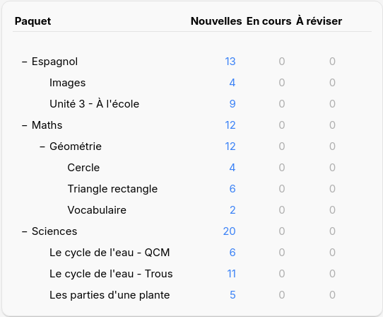
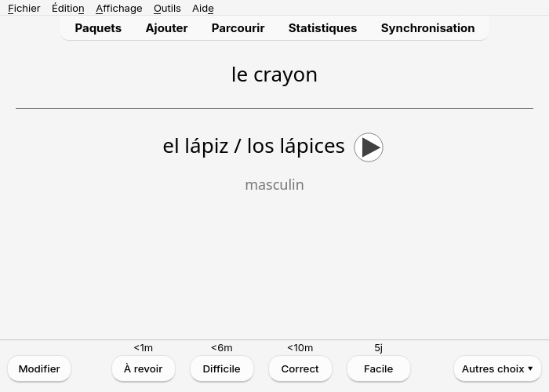
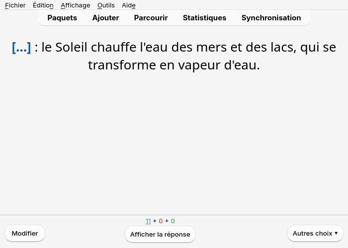
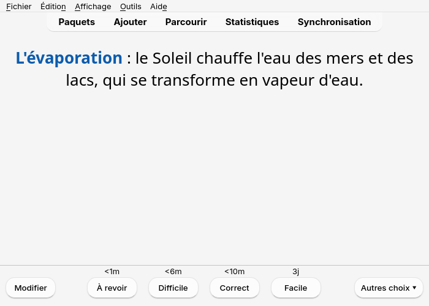
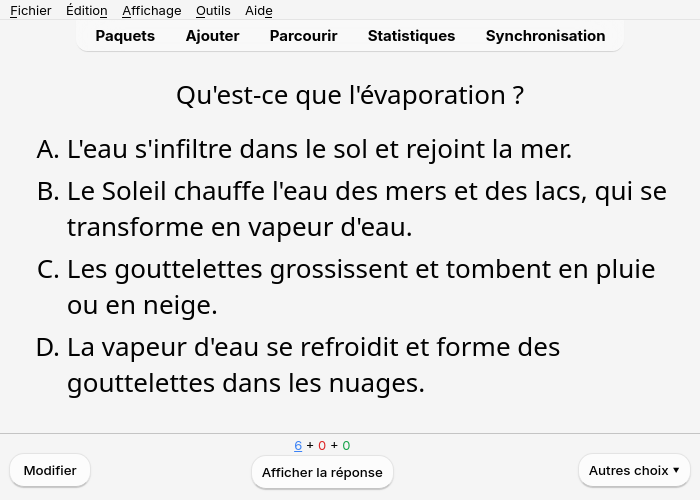
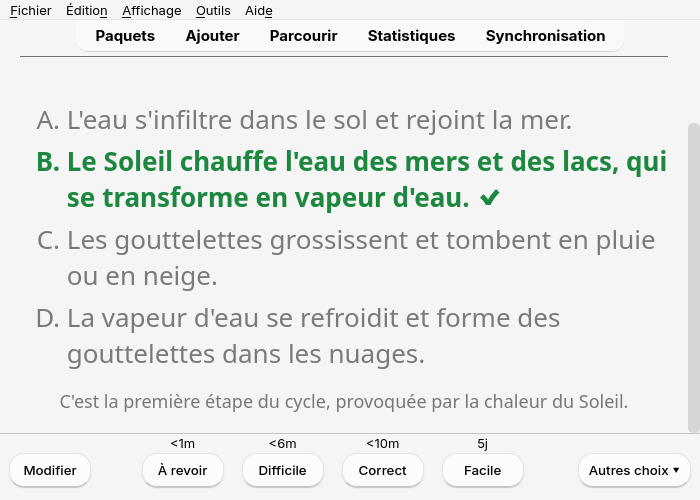
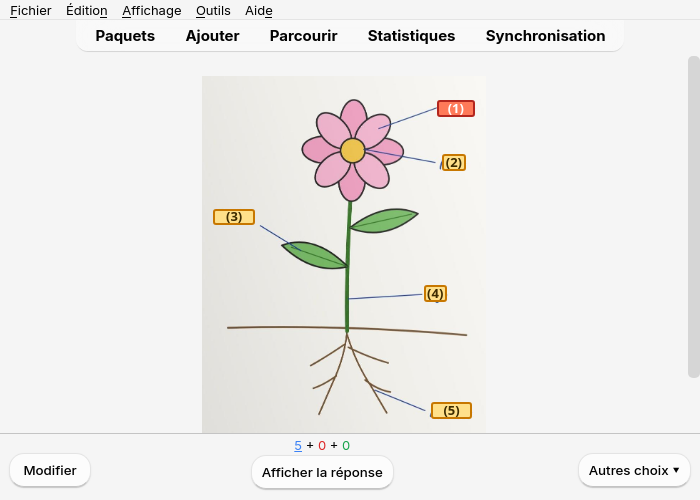
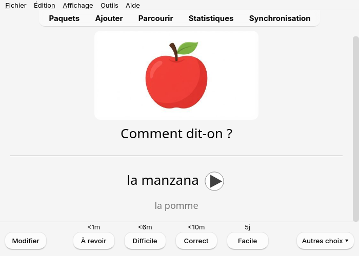
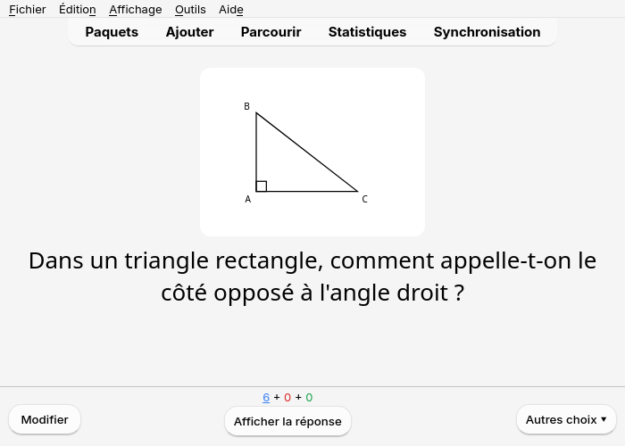

Qu'elles viennent de l'application (dans AnkiDroid) ou de l'ordinateur (dans Anki), les cartes
sont les mêmes : les mêmes paquets, les mêmes types de cartes, les mêmes mises à jour. Pour les
envoyer : voir [L'application et AnkiDroid](../app-ankidroid/) ou
[Envoyer vers Anki](../send-to-anki/).

## Les paquets

Chaque leçon a son paquet, par exemple `Espagnol::Unité 3 - À l'école` : `::` met un paquet
dans un autre, les leçons d'une matière sont donc regroupées. Les cartes qui ont une section
(Vocabulaire, QCM…) vont dans un sous-paquet du paquet de la leçon.

Pour réviser toute une matière, cliquez sur son paquet : Anki prend les cartes de tous les
paquets qu'il contient.

## Renvoyer une leçon

Une fois la leçon envoyée, le bouton devient **🔄 Mettre à jour dans Anki**. Vous pouvez corriger
une leçon et la renvoyer autant de fois que vous voulez :

- ses cartes sont **mises à jour** dans Anki, **pas dupliquées**, et chaque carte garde son
  historique de révision, même si vous avez corrigé son recto ;
- si vous avez changé le paquet de la leçon, ses cartes y sont **déplacées**, avec leur
  historique ;
- les cartes ajoutées depuis le dernier envoi sont ajoutées ;
- les cartes supprimées de la leçon restent dans Anki : après l'envoi, Notosaurus les liste et
  propose de les supprimer (avec leur historique de révision), jamais sans votre accord.

Supprimer une leçon entière dans Notosaurus propose de supprimer aussi ses cartes dans Anki, avec
leur historique de révision.

Sur l'ordinateur, changer une option des cartes (la carte inverse, la réponse tapée) sur une
leçon déjà envoyée fait passer ses cartes au type de note correspondant, historique gardé.

Dans Anki, les notes de chaque leçon portent l'étiquette `notosaurus::<leçon>` : pratique pour
les retrouver dans le navigateur.

## Corriger une carte depuis Anki

Sous chaque réponse, un petit **✎ Notosaurus** ouvre la carte dans Notosaurus pour la
corriger : dans l'application sur Android (AnkiDroid ouvre d'abord une courte page web, dont le
bouton ouvre l'application), dans la page sur l'ordinateur (Anki ouvert, Notosaurus sur son
port habituel). Rien n'est perdu : la correction met à jour la même note, son historique de
révision reste. Le lien ne sait ouvrir que là où la leçon se trouve : une
leçon faite sur l'ordinateur s'ouvre là, une leçon faite dans l'application s'ouvre dans
l'application. AnkiWeb et AnkiMobile ne l'affichent pas.

Jusqu'à AnkiDroid 2.25.2, activez d'abord **Paramètres → Avancé → Autoriser les cartes à
lancer d'autres applications** : sans ce réglage, AnkiDroid bloque tout lien d'une carte (« La
carte ne peut pas lancer d'autres applications »). Depuis AnkiDroid 2.25.3, les liens vers une
page web passent sans ce réglage.

## À quoi elles ressemblent

Voici à quoi ressemblent les [types de cartes](../card-types/) pendant une révision dans Anki
sur l'ordinateur. AnkiDroid et AnkiMobile affichent les mêmes cartes.

**Question et réponse** : un mot avec son audio (▶) et une précision.

**Texte à trous** : la question cache le mot, la réponse le montre.

**QCM** : la réponse marque le bon choix d'un ✔ et donne l'explication.

**Schémas** : la photo de la leçon avec des étiquettes numérotées ; une carte par étiquette à
nommer.

**Images** : un dessin à nommer dans la langue apprise, avec son audio.

**Figures** : la figure dessinée par Notosaurus accompagne la question.

