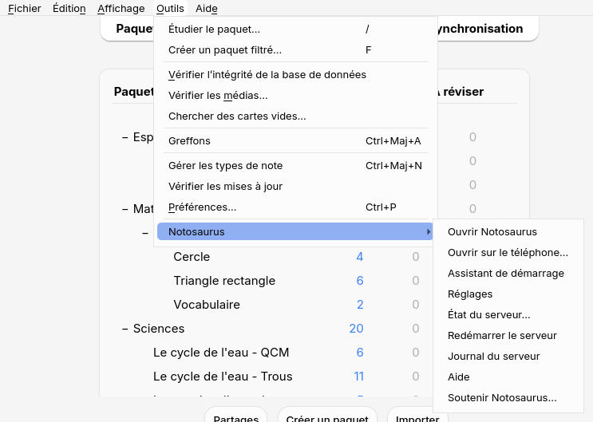
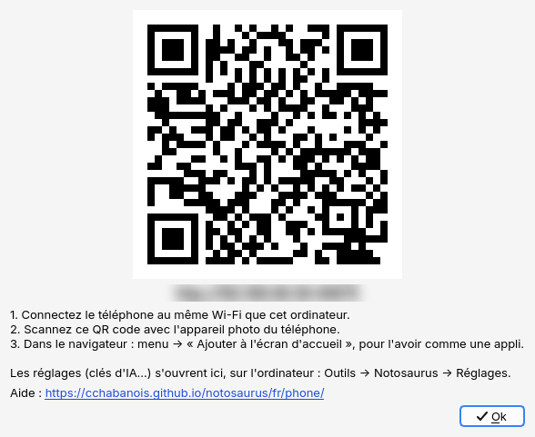

Avec le greffon, Notosaurus tourne dans Anki sur l'ordinateur : il démarre avec Anki, s'arrête
avec lui, et écrit les cartes directement dans le profil ouvert.

## Le menu Outils → Notosaurus

- **Ouvrir Notosaurus** ouvre Notosaurus dans le navigateur de l'ordinateur.
- **Ouvrir sur le téléphone…** affiche un QR code pour ouvrir Notosaurus sur le téléphone, et
  les trois étapes pour y arriver (voir [Sur le téléphone](../phone/)).
- **Assistant de démarrage** ouvre l'assistant : l'IA et sa clé, puis le téléphone (voir
  [Pour commencer](../getting-started/#2-lassistant-de-démarrage)). La première fois, Anki le
  propose tout seul tant qu'aucune IA n'est configurée.
- **Réglages** ouvre les réglages (service d'IA et clé, voix, enfants…) dans le navigateur de
  l'ordinateur. Ils ne s'ouvrent que sur l'ordinateur : le téléphone ne peut pas les changer.
- **État du serveur…** dit si Notosaurus est en marche, ses adresses (sur le téléphone et sur
  cet ordinateur), et où sont ses fichiers et vos leçons.
- **Redémarrer le serveur** arrête et relance Notosaurus : après avoir changé la configuration
  du greffon, ou quand quelque chose est bloqué.
- **Journal du serveur** montre ce que Notosaurus a fait dernièrement. C'est la première chose à
  regarder quand quelque chose ne va pas (voir [Dépannage du greffon](../troubleshooting/)).
- **Aide** ouvre cette documentation, dans la langue d'Anki.
- **Soutenir Notosaurus…** ouvre sa page [Ko-fi](https://ko-fi.com/notosaurus), pour faire un
  don si vous l'appréciez. Notosaurus reste gratuit.

Changer de profil dans Anki laisse Notosaurus en marche : les cartes vont alors dans le profil
ouvert (voir [Plusieurs enfants](../several-children/)).

## La configuration du greffon

Quelques options techniques sont dans **Outils → Greffons**, sélectionnez **Notosaurus**, puis
**Configuration** :

- `autostart` : démarrer Notosaurus avec Anki (`true` par défaut). Avec `false`, il démarre la
  première fois que vous utilisez le menu.
- `host` : `0.0.0.0` (par défaut) permet au téléphone d'atteindre Notosaurus sur le même
  Wi-Fi ; `127.0.0.1` le réserve à cet ordinateur.
- `port` : `8000` par défaut. Changez-le si un autre programme utilise déjà ce port.
- `source`, `python`, `data` : laissez-les vides. Ils ne servent qu'à développer Notosaurus.

Après un changement : **Outils → Notosaurus → Redémarrer le serveur**.

Les paquets que fait Notosaurus et l'allure de ses cartes dans Anki, sur l'ordinateur et les
téléphones : voir [Les cartes dans Anki](../cards-in-anki/).
