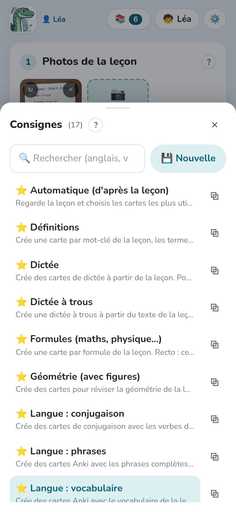
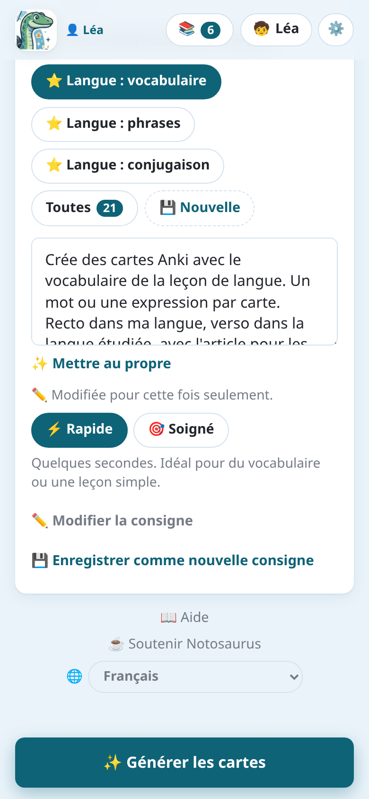
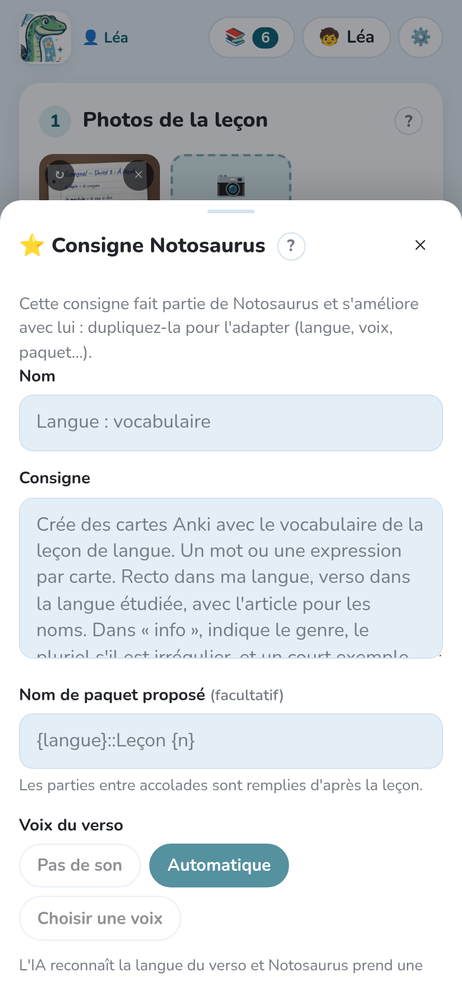

import { Tabs, TabItem } from '@astrojs/starlight/components';

La **consigne** dit à l'IA quoi faire de la leçon : quelles cartes, dans quel sens, dans
quelles langues. La photo dit *quoi* apprendre ; la consigne dit *comment*.

## Choisir une consigne

Dans **Consigne**, les plus récentes s'affichent en boutons. **Toutes** ouvre la liste
complète, avec une recherche.

Le texte de la consigne choisie s'affiche sous les boutons. Vous pouvez le modifier **pour cette
fois seulement** (« Modifiée pour cette fois seulement »), par exemple pour ajouter
« seulement les verbes » : votre modification reste avec la leçon, la consigne enregistrée ne
change pas. Dans l'application, le bouton **Dicter** (🎤) à côté du texte permet de le dicter : dites ce que vous voulez,
l'IA l'écrit.

**✨ Mettre au propre**, sous le texte, fait réécrire par l'IA une consigne tapée vite ou dictée :
claire et courte, dans sa langue, avec toutes ses intentions gardées (combien de cartes, quelles
langues et dans quel sens, quel genre de cartes), sans rien ajouter. **↩ Annuler** rend votre
texte, tant que vous n'avez pas modifié celui mis au propre. Ce n'est pas proposé pour les
consignes de Notosaurus telles quelles : elles sont déjà au propre.

## Rapide ou soigné

**Création des cartes**, sous la consigne, règle le temps de réflexion de l'IA :

- **⚡ Rapide** (par défaut) : quelques secondes. Idéal pour du vocabulaire ou une leçon simple.
- **🎯 Soigné** : plus long (jusqu'à 30 s), plus réfléchi : pour une leçon riche (schéma, maths).

Le choix est gardé sur l'appareil. Une leçon faite en mode rapide le dit dans la relecture
(« Créées en mode rapide. »), avec **🎯 Refaire en mode soigné**.

## Les consignes de Notosaurus

Les consignes marquées ⭐ sont fournies par Notosaurus et s'améliorent à chaque version.
Elles ne se modifient pas, mais se **dupliquent** pour en faire votre propre version.

| Consigne | Ce qu'elle fait |
|---|---|
| Automatique (d'après la leçon) | L'IA regarde la leçon et choisit les cartes les plus utiles. |
| Langue : vocabulaire | Une carte par mot ou expression, avec l'article, le genre et le pluriel dans l'info ; sans photo, à partir d'une liste ou d'un thème. |
| Langue : phrases | Une carte par phrase, dans votre langue et dans la langue étudiée. |
| Langue : conjugaison | Un verbe, un temps et une personne par carte ; la forme conjuguée au verso. |
| Tableau à apprendre | Un tableau à savoir par cœur (déclinaison, verbes irréguliers…) : une carte par case, ou par ligne quand chaque ligne est un mot ; la réponse tapée. |
| Questions / réponses | Des questions courtes sur le contenu : dates, définitions, idées clés. |
| Dates et repères | Une carte par date à retenir (une frise, un encadré) : l'événement au recto, sa date au verso, le siècle dans l'info ; avec la carte inverse, pour l'apprendre dans les deux sens. |
| Définitions et propriétés | Une carte par mot-clé à savoir définir ; pour une propriété ou un théorème, son nom → l'énoncé complet (« Si …, alors … ») et les hypothèses → la conclusion, la réciproque à part, à quoi il sert dans l'info. |
| Reconnaître sur un exemple | Une carte par exemple de la leçon (figure de style, classe de mots…) : l'exemple au recto, la notion au verso, sa définition dans l'info. Jamais d'exemple inventé. |
| Texte à trous | Des phrases à trous : une carte par numéro de trou. |
| QCM | Une question, la bonne réponse et trois mauvaises plausibles. |
| Vrai / faux | Des affirmations, dont la moitié fausses avec une seule erreur précise. |
| Méthodes (étapes) | Une carte par savoir-faire : « Comment … ? », les étapes au verso. |
| Formules (maths, physique…) | Une carte par formule, avec ce que représente chaque lettre. |
| Géométrie (avec figures) | Figures, propriétés et vocabulaire, avec une figure exacte dessinée sur les cartes. |
| Schéma ou carte à compléter | Les légendes d'un schéma ou d'une carte cachées derrière des numéros : une carte par légende. |
| Langue : vocabulaire en images | L'image de chaque mot au recto (trouvée ou dessinée) ; le mot dans la langue étudiée au verso. |
| Mots à trous | Une carte par mot à savoir écrire : une phrase où il manque le mot au recto, le mot au verso (tapé), une astuce d'orthographe. |
| Dictée | Seulement des cartes de dictée : les mots à savoir écrire, et le texte de la dictée phrase par phrase, entendus puis tapés. |
| Dictée à trous | Les mots les plus difficiles du texte de la dictée, un par carte : sa phrase avec le trou, entendue, le mot tapé. |
| Par cœur (poème, récitation) | Le texte recopié exactement, lu à voix haute : une carte titre → premier vers, puis une carte par vers (le titre, son numéro et les deux vers d'avant au recto, le début d'une strophe signalé). |

## Vos propres consignes

**Nouvelle** crée une consigne que vous réutiliserez, par exemple pour la langue que votre
enfant apprend chaque semaine. **Dupliquer** part d'une consigne de Notosaurus.

- **Nom** : ce qu'affiche le bouton.
- **Consigne** : ce que l'IA doit faire, avec vos mots (« une carte par date, au recto
  l'événement, au verso la date »).
- **Nom de paquet proposé** : le paquet Anki, avec `::` pour les sous-paquets. Les parties
  entre accolades sont remplies d'après la leçon : `Espagnol::Leçon {n}` devient
  `Espagnol::Leçon 5`.

La façon dont les cartes sont posées et entendues se dit aussi dans le texte, et l'IA la lit :
« avec la réponse tapée » (Anki compare lettre par lettre), « dans les deux sens » (la carte
inverse), « lu à voix haute », « avec une dictée » (entendre le verso, l'écrire) ou « seulement
une dictée ». Les versos dans une langue apprise sont lus de toute façon, avec la voix choisie
pour cette langue (voir [Les voix et l'audio](../voices/)).

**✏️ Libre** écrit une consigne pour cette fois seulement : elle reste avec la leçon, mais
n'est pas ajoutée à votre liste. **Enregistrer comme nouvelle consigne** la garde si elle a
bien marché.

## Les « Le savais-tu ? »

L'IA ajoute une anecdote courte et connue aux cartes où elle va bien (une sur trois au plus).
Elle s'affiche au verso dans Anki.

## Les aides au verso

L'IA ajoute, **seulement sur les cartes où elles aident vraiment** :

- **une explication** : pourquoi la réponse est la bonne, quand comprendre aide à retenir
  (une cause en histoire, une règle, une formule) ; jamais pour un simple mot ou une date
  seule ;
- **une astuce pour retenir** : l'origine ou la famille du mot (*hippopotame* : « le cheval du
  fleuve »), une image simple, un procédé d'école connu, une vraie règle d'orthographe.
  Jamais une astuce inventée.

Une leçon d'histoire reçoit donc surtout des explications, une leçon de vocabulaire quelques
astuces et aucune explication. Elles s'affichent au verso dans Anki, sous l'info (💬 et 🧠),
et se modifient ou s'effacent dans la relecture. Sur l'ordinateur, elles ajoutent environ 1 à 3
centimes de dollar par leçon avec Claude Sonnet.

Les deux sont activés au départ, pour toutes les leçons : pour les arrêter, voir
[Les désactiver](#les-désactiver). Pour une seule consigne, dites-le dans son texte : « sans
anecdotes », « sans aides ».

## Les images

L'IA ajoute une image aux cartes où elle aide vraiment à retenir, quelle que soit la consigne :
une œuvre, un personnage, un lieu, un monument, un animal. Jamais pour une notion abstraite,
ni sur chaque carte. Une image libre est cherchée d'abord ; la faire dessiner par l'IA vous est
toujours demandé. C'est activé au départ (voir [Les désactiver](#les-désactiver)). Pour une
seule consigne, dites-le dans son texte : « sans images ».

## Les désactiver

<Tabs syncKey="mode">
<TabItem label="Application Android">

**Réglages** (⚙️) **→ 📝 Instructions pour l'IA → 💬 Aides au verso des cartes** désactive les aides. Les
« Le savais-tu ? » et les images n'ont pas d'interrupteur dans l'application : dites-le dans le
texte de la consigne, ou dans les instructions permanentes ci-dessous.

</TabItem>
<TabItem label="Ordinateur">

**Réglages → 📝 Instructions pour l'IA** a un interrupteur pour chacun : **💡 « Le savais-tu ? »
sur les cartes**, **💬 Aides au verso des cartes** et **🖼️ Images sur les cartes**.

</TabItem>
</Tabs>

## Les instructions permanentes

Certaines instructions valent pour toutes les leçons : « espagnol d'Espagne », « toujours
l'article avec les noms ». Écrivez-les une fois dans les réglages : **Réglages** (⚙️) **→ 📝 Instructions pour l'IA** dans l'application,
**Réglages → 📝 Instructions pour l'IA → Pour tous les enfants** sur l'ordinateur. Celles propres à chaque enfant (sa classe, « il lit encore lentement ») sont dans
sa fiche, depuis le bouton **Enfants** (🧒) de la page principale : voir
[Plusieurs enfants](../several-children/#les-fiches-des-enfants).
