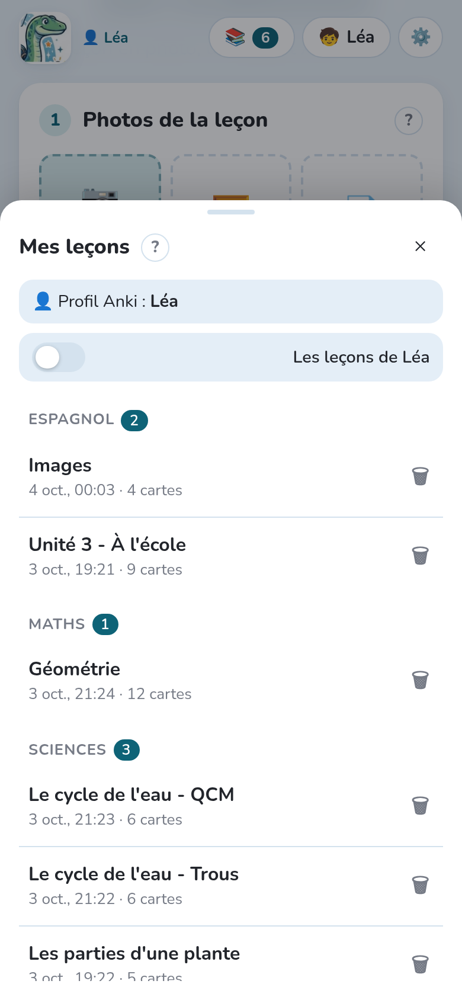

Chaque génération crée une **leçon** : ses photos, sa consigne et ses cartes, enregistrées sur
l'ordinateur. Vous pouvez y revenir à tout moment pour la corriger, la régénérer ou la renvoyer à
Anki.

## La liste des leçons

**📚** en haut de la page ouvre **Mes leçons** : les leçons de l'**enfant choisi** (et, sur
l'ordinateur, du **profil Anki ouvert**), les plus récentes d'abord. Avec plus d'un enfant,
l'interrupteur au-dessus de la liste montre **Les leçons de tous les enfants**.

- Les leçons sont **regroupées par matière** : la première partie du nom du paquet
  (`Espagnol`, `Sciences`…), la matière travaillée en dernier en premier.
- **exportée** marque une leçon déjà envoyée à Anki ou téléchargée.
- Avec beaucoup de leçons (plus de 8), une **recherche** apparaît (sans tenir compte des
  majuscules ni des accents), les 3 leçons les plus récentes s'affichent d'abord, et les matières
  sont repliées, sauf celle de la leçon ouverte. Une matière ouverte ou fermée à la main le reste
  sur cet appareil.

Touchez une leçon pour la rouvrir : ses photos et ses cartes reviennent, prêtes à être corrigées ou
renvoyées. **＋ Nouvelle** commence une nouvelle leçon.

## Leçons et enfants

Une leçon est pour l'enfant choisi quand elle a été faite (**🧒** en haut de la page) et, sur
l'ordinateur, appartient au profil ouvert dans Anki à ce moment-là. **⧉ Copier pour…**, dans sa
relecture, en fait une copie pour un autre enfant, gratuitement. Voir
[Plusieurs enfants](../several-children/).

## Contrôles à préparer

Une interro lundi sur trois leçons ? **📌 Contrôle…** dans la relecture d'une leçon l'ajoute à
un contrôle à préparer (un nom, une date), entière ou **quelques-unes de ses cartes seulement**
(une coche sur chaque carte). Les contrôles sont listés en haut de **Mes leçons**, où
**＋ Nouveau contrôle** en crée un ; sa fiche ajoute ensuite ses leçons (**＋ Ajouter des
leçons**, entières) et envoie à Anki celles qui n'y sont pas encore.

Chaque carte d'un contrôle reçoit une étiquette dans Anki, `Exam::<nom>`, posée tout de suite
sur ses notes quand elles sont dans Anki, ou avec elles à l'envoi de la leçon. L'**étude
personnalisée** d'Anki les réunit ensuite, quelles que soient leurs leçons : la fiche du contrôle
dit comment, sur l'ordinateur et dans AnkiDroid (ouvrir le paquet qui contient les leçons,
**Étude personnalisée → Étudier par état ou étiquette**, cocher l'étiquette). Une fois révisées,
les cartes retournent dans leurs paquets. Supprimer un contrôle retire l'étiquette ; les cartes
restent.

Sur l'ordinateur, Anki ouvert, **Réviser maintenant dans Anki** le fait en un clic : un paquet
filtré « Contrôle : … » avec les cartes du contrôle, ouvert dans Anki, refait à chaque fois et
supprimé avec le contrôle.

Dans l'application, **Ouvrir dans AnkiDroid** ouvre les cartes du contrôle dans le navigateur
d'AnkiDroid, quels que soient leurs paquets ; puis **⋮ → Créer un paquet filtré → Générer**
(au-delà de 100 cartes, augmentez d'abord **Limiter à**). AnkiDroid ne laisse aucune autre
application créer un paquet filtré.

## Supprimer une leçon

**🗑** à côté d'une leçon la supprime, avec ses photos. Si ses cartes sont dans Anki, Notosaurus
les cherche et propose de **les supprimer aussi** : leur historique de révision est alors perdu.
Sinon, les cartes déjà envoyées restent dans Anki.

Les leçons se gèrent aussi depuis l'ordinateur, dans **Réglages → Leçons** : à quel profil Anki
appartient chacune (il se change là), ce qu'elle a coûté, et sa suppression.
