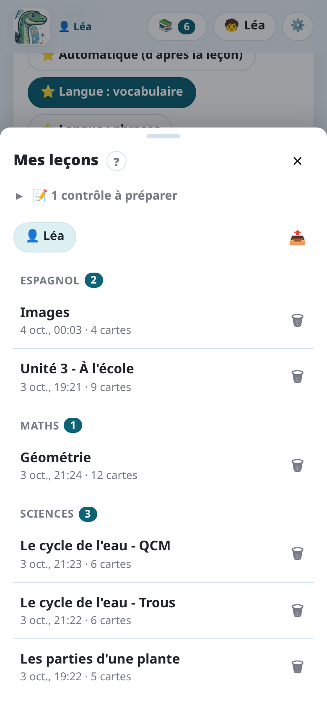

import { Tabs, TabItem } from '@astrojs/starlight/components';

Chaque génération crée une **leçon** : ses photos, sa consigne et ses cartes, enregistrées là où
tourne Notosaurus (sur le téléphone dans l'application, sur l'ordinateur avec le greffon). Vous pouvez y revenir à tout moment pour la corriger, la régénérer ou la renvoyer à
Anki.

## La liste des leçons

Le bouton **Leçons** (📚), en haut de la page, ouvre **Mes leçons** (jusqu'en haut de l'écran
quand il y en a beaucoup) : les leçons de l'**enfant choisi** (et, sur l'ordinateur, du **profil Anki ouvert**), les
plus récentes d'abord. Une seule ligne d'outils au-dessus : la recherche, avec plus d'un enfant
**👤 Jules** (touchez-le pour **👥 Tous** : les leçons de tous les enfants), et **📤** pour partager
des leçons.

- Les leçons sont **regroupées par matière** : la première partie du nom du paquet
  (`Espagnol`, `Sciences`…), la matière travaillée en dernier en premier.
- **exportée** marque une leçon déjà envoyée à Anki ou téléchargée.
- Avec beaucoup de leçons (plus de 8), une **recherche** apparaît (sans tenir compte des
  majuscules ni des accents), les 3 leçons les plus récentes s'affichent d'abord, et les matières
  sont repliées, sauf celle de la leçon ouverte. Une matière ouverte ou fermée à la main le reste
  sur cet appareil.

Touchez une leçon pour la rouvrir : ses photos et ses cartes reviennent, prêtes à être corrigées ou
renvoyées. **＋ Nouvelle** commence une nouvelle leçon.

## Leçons et enfants

Une leçon est pour l'enfant choisi quand elle a été faite (le bouton **Enfants**, 🧒, en haut de la page) et, sur
l'ordinateur, appartient au profil ouvert dans Anki à ce moment-là. **⧉ Copier pour…**, dans sa
relecture, en fait une copie pour un autre enfant, gratuitement. Voir
[Plusieurs enfants](../several-children/).

## Contrôles à préparer

Un contrôle porte sur plusieurs leçons ? Réunissez-les, ou quelques-unes de leurs cartes, et
révisez-les ensemble : voir [Préparer un contrôle](../tests/). En haut de **Mes leçons**, une
ligne repliée les annonce (« 📝 2 contrôles à préparer ») : touchée, elle les montre, avec
**＋ Nouveau contrôle**.

## Partager des cartes avec une autre famille

Une autre famille a la même leçon (un camarade de classe, un cousin) ? Envoyez-lui les cartes
dans un fichier, qu'elle ouvre avec Anki ou AnkiDroid :

- **plusieurs leçons** : dans **Mes leçons**, **📤** (Partager des leçons), puis cochez les leçons,
  une à une ou toute une matière, et **📤 Partager** ;
- **un contrôle** : dans sa fiche, **📤 Partager les cartes du contrôle** (voir
  [Préparer un contrôle](../tests/)) ;
- **la leçon ouverte** : **📤 Partager**, à côté de **📥 Ajouter à Anki**.

Ni le prénom de l'enfant ni l'historique de ses révisions ne partent avec les cartes. Les photos
et les schémas des leçons, eux, partent : vérifiez qu'ils peuvent être partagés.

<Tabs syncKey="mode">
<TabItem label="Application Android">

**📤 Créer le fichier** ouvre le menu de partage d'Android : envoyez-le par message, par mail ou
sur un drive.

</TabItem>
<TabItem label="Ordinateur">

**📤 Créer le fichier** télécharge un fichier `.apkg` : envoyez-le par mail ou messagerie.

</TabItem>
</Tabs>

## Supprimer une leçon

Le bouton **Supprimer la leçon** (🗑), à côté d'une leçon, la supprime, avec ses photos. Si ses cartes sont dans Anki, Notosaurus
les cherche et propose de **les supprimer aussi** : leur historique de révision est alors perdu.
Sinon, les cartes déjà envoyées restent dans Anki.

<Tabs syncKey="mode">
<TabItem label="Application Android">

**Réglages** (⚙️) → **🗂️ Leçons sur ce téléphone** dit combien de leçons le téléphone garde et leur taille, et
**Supprimer toutes les leçons** les supprime toutes, avec leur son. Les cartes déjà dans
AnkiDroid restent, avec leur son.

</TabItem>
<TabItem label="Ordinateur">

Les leçons se gèrent aussi dans **Réglages → Leçons** : à quel profil Anki appartient chacune
(il se change là), ce qu'elle a coûté, et sa suppression.

</TabItem>
</Tabs>
