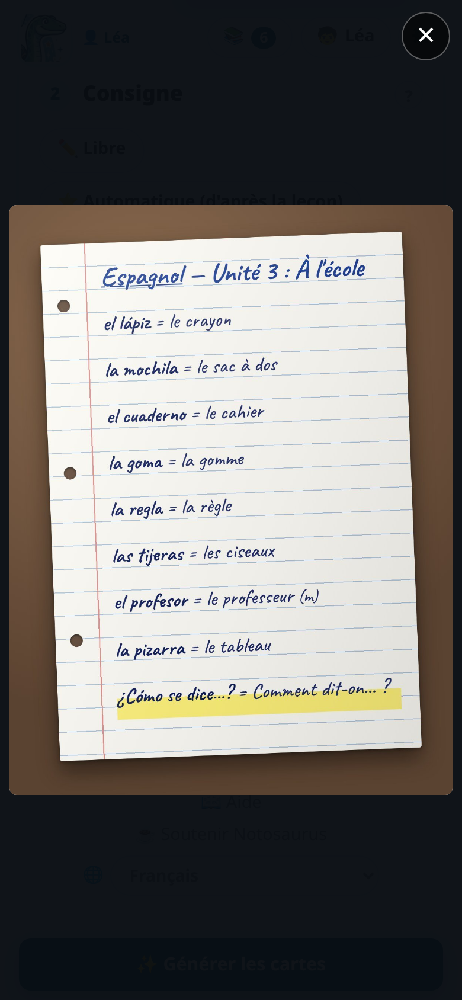
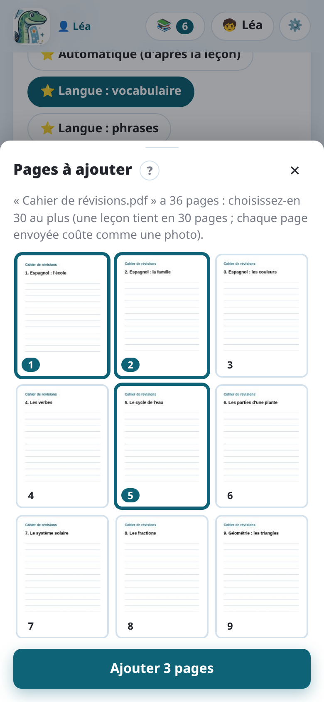

import { Tabs, TabItem } from '@astrojs/starlight/components';

L'IA lit ce qu'elle voit : une photo nette donne de meilleures cartes, et moins de
corrections.

## Conseils

- **Bonne lumière, pas d'ombre.** La lumière du jour près d'une fenêtre est idéale. Évitez
  l'ombre du téléphone et de votre main sur la page.
- **La page à plat, qui remplit la photo.** Tenez le téléphone au-dessus de la page,
  parallèle à elle. Un léger angle passe ; un angle fort rend flou le bas de la page.
- **Une page par photo.** Pour une double page, prenez deux photos.
- **Nette.** Touchez l'écran pour faire la mise au point avant de prendre la photo, et ne
  bougez pas.
- **Seulement la leçon.** Laissez hors du cadre les autres pages, les dessins dans la marge
  et les corrections qui ne sont pas à apprendre, ou dites à l'IA quoi ignorer dans la
  consigne.

L'écriture manuscrite est bien lue quand un adulte peut la lire. Sur l'ordinateur, où vous
choisissez l'IA, Claude la lit le mieux ; Gemini est un bon choix, moins cher.

## Plusieurs pages

Une leçon peut avoir **jusqu'à 30 pages**. Après la première photo, **Page suivante** en
ajoute une autre ; **Galerie** choisit des photos déjà prises (JPEG, PNG, WebP ou GIF). Sur un ordinateur, vous pouvez
aussi glisser des photos ou des PDF depuis un dossier et les déposer sur **Galerie** ou **PDF**.

Dans l'application Android, l'appareil photo est un **scanner de documents** (celui de Google,
des services Google Play) : photographiez plusieurs pages l'une après l'autre, puis gardez-les
toutes d'un coup. Chaque page est trouvée sur la photo, redressée et recadrée à ses bords, ses
ombres atténuées. L'application n'a pas besoin de l'autorisation de l'appareil photo et ne reçoit
que les pages gardées. Sur un téléphone sans services Google Play, ou tant que le scanner n'est
pas prêt (il se télécharge en arrière-plan après l'installation de l'application), c'est
l'appareil photo du téléphone qui prend la photo, une page à la fois.

Dans l'application Android, vous pouvez aussi partir d'une autre application (la galerie, les
fichiers, une messagerie, un mail) : **Partager → Notosaurus** sur des photos, un PDF ou un texte
en fait les pages d'une leçon, prêtes pour **✨ Générer les cartes**. L'adresse d'une page web
seule ne suffit pas : partagez plutôt une capture d'écran, ou la page enregistrée en PDF depuis
Chrome. (Quand l'application travaille [avec votre ordinateur](../app-with-computer/), ajoutez
plutôt le fichier depuis la page.)

Au-delà de 10 pages, l'IA les lit 10 par 10 : les premières font la leçon, les suivantes la
complètent, l'une après l'autre (« Pages 11 à 20 sur 30… »).

Sur chaque photo, son numéro et **Retirer** (×) : la photo quitte la leçon (🖍️ dessus : une partie
en est cachée). Un toucher l'affiche en plein écran : glissez pour passer d'une page à l'autre ; écartez deux
doigts pour zoomer, déplacez-la d'un doigt, ou touchez-la pour zoomer là où vous touchez ; de là :

- **Tourner** (↻) : d'un quart de tour ;
- **Retirer** (🗑️) ;
- **Recadrer** (l'icône de recadrage, deux équerres) : ne garde que la partie utile de la page
  (voir plus bas) ;
- **Noircir** (🖍️) : cache une partie de la page, un nom, avant l'envoi (voir plus bas).

Une fois la page recadrée, un point le dit dans le coin de **Recadrer** ; une fois une partie
cachée, dans celui de **Noircir**.

Quand la leçon a plus de pages qu'il n'en tient à côté des boutons (deux rangées), la dernière place
montre la page suivante voilée avec **+N**, le nombre de pages non affichées : touchez-la pour voir
**Toutes les pages**.
Là, toucher une page l'affiche en grand ; **Sélectionner** (ou un appui long sur une page) permet
de choisir des pages, puis **Retirer** les enlève toutes de la leçon d'un coup.

Une page photographiée de côté (le téléphone à plat au-dessus de la table) est lue quand même,
et gardée telle quelle : **Tourner** (↻) la remet à l'endroit, avec ses parties cachées et le
cadre du schéma.

## Ajouter une page plus tard

La suite de la leçon arrive quelques jours après ? Rouvrez la leçon depuis le bouton **Leçons** (📚), ajoutez la photo de
la nouvelle page avec **Page suivante**, puis touchez **➕ Ajouter les cartes de la nouvelle
page**. L'IA ne lit que les nouvelles pages, en sachant quelles cartes existent déjà : elle
n'en refait pas. Les nouvelles cartes s'ajoutent à la suite, marquées « nouvelle » pour que vous
les vérifiiez ; les autres ne bougent pas, et **🔄 Mettre à jour dans Anki** n'ajoute que les
nouvelles (l'historique de révision des autres est gardé). **✨ Régénérer**, à côté, refait
toute la leçon.

## Les PDF

**📄 PDF**, à côté de l'appareil photo et de la galerie, ajoute les pages d'un PDF : une fiche
envoyée par l'enseignant, une page de manuel numérique, un livret… Chaque page devient une photo
de la leçon : tout marche comme avec des photos, schémas, corrections et tous les services d'IA.

- **Un PDF fait sur ordinateur** (pas un scan) contient aussi son texte exact : Notosaurus
  l'envoie à l'IA avec sa page, et aucun mot, accent, date ni nombre n'est mal lu.
- **Plus de pages que la leçon n'a de place** (30 pages en tout) : Notosaurus les affiche toutes,
  et vous touchez celles à ajouter.
- **Chaque page envoyée coûte comme une photo** : choisissez seulement les pages de la leçon.
- **Un PDF protégé par un mot de passe** doit d'abord être enregistré sans son mot de passe.

## Recadrer, cacher un nom

Les deux boutons, sur une photo pas encore envoyée, ouvrent le même éditeur, **Préparer la
photo**, dans le mode qu'ils nomment : **Recadrer**, **Noircir** (⬛) et **Dénoircir** (◻️)
passent de l'un à l'autre. **Terminé** garde la photo ainsi préparée : c'est elle seule qui est
envoyée et enregistrée. Tant que la photo n'est pas envoyée, vous pouvez y revenir et tout changer.

**Recadrer** ne garde que la partie utile de la page : tirez les coins du cadre (il couvre
d'abord toute la photo), **Tout garder** le remet sur toute la photo. Le reste n'est ni envoyé à
l'IA ni gardé dans la leçon. Tourner la photo tourne le cadre avec elle.

Une page de cahier porte souvent le nom de l'enfant, sa classe, son école. Avec **Noircir** (🖍️),
le doigt passe en noir ce que l'IA ne doit pas voir, dans la partie gardée ; **Dénoircir** le fait
réapparaître.

Une page de PDF recadrée ou dont une partie est cachée part sans son texte (il contient aussi ce
qui est laissé de côté) : l'IA lit la page comme une image.

## Que deviennent les photos ?

<Tabs syncKey="mode">
<TabItem label="Application Android">

- Les photos passent par le **service Notosaurus** jusqu'à Gemini, de Google, pour être lues,
  traitées sur les serveurs de Google (hors de l'Union européenne aussi) et sans y être gardées. Voir la
  [politique de confidentialité de l'application](../app-privacy/).
- Elles sont **enregistrées avec la leçon** sur le téléphone, dans le stockage privé de
  l'application.

</TabItem>
<TabItem label="Ordinateur">

- Les photos sont envoyées au **service d'IA choisi dans les réglages**, pour être lues, et à
  personne d'autre. Voir [Confidentialité et sécurité sur l'ordinateur](../privacy/).
- Elles sont **enregistrées avec la leçon** sur votre ordinateur.

</TabItem>
</Tabs>

- Enregistrées avec la leçon, elles permettent de la rouvrir, la corriger ou la régénérer plus
  tard. Supprimer la leçon les supprime.
- Les cartes de schéma gardent une **copie recadrée** du schéma, avec ses légendes
  masquées : c'est ce qu'Anki affiche.

## Pas de photo ?

Sans photo, le gros bouton du bas devient **Générer à partir de la consigne seule** dès que la
consigne dit quoi apprendre ; une consigne Notosaurus a besoin de quelques mots à vous. Alors
mettez-y les mots (« les 20 verbes irréguliers : be, have, go… »), ou demandez un
sujet (« les planètes du système solaire »). Vérifiez bien ces cartes : elles ne viennent pas
de votre leçon.
