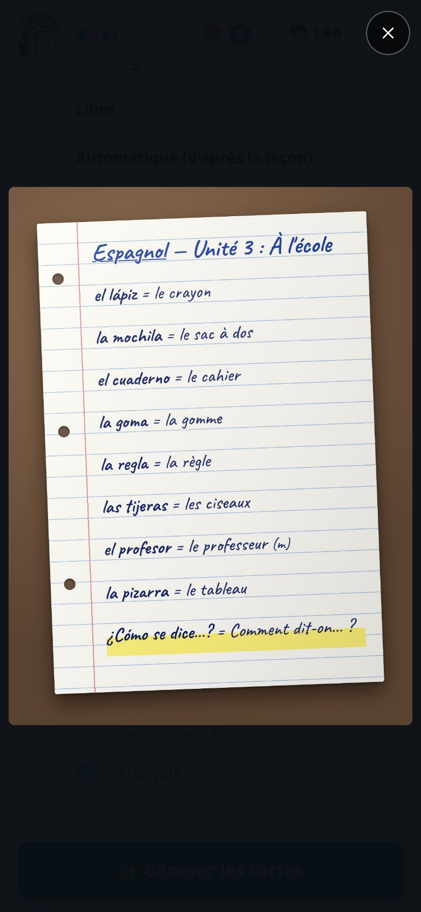
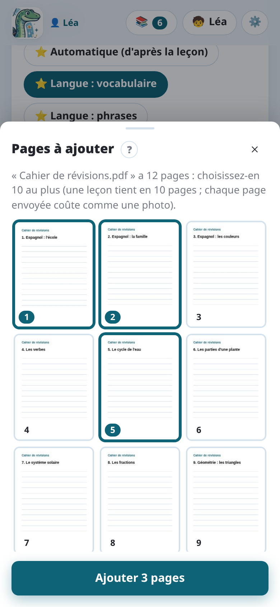

import { Tabs, TabItem } from '@astrojs/starlight/components';

L'IA lit ce qu'elle voit : une photo nette donne de meilleures cartes, et moins de
corrections.

## Conseils

- **Bonne lumière, pas d'ombre.** La lumière du jour près d'une fenêtre est idéale. Évitez
  l'ombre du téléphone et de votre main sur la page.
- **La page à plat, qui remplit la photo.** Tenez le téléphone au-dessus de la page,
  parallèle à elle. Un léger angle passe ; un angle fort rend flou le bas de la page.
- **Une page par photo.** Pour une double page, prenez deux photos.
- **Nette.** Touchez l'écran pour faire la mise au point avant de prendre la photo, et ne
  bougez pas.
- **Seulement la leçon.** Laissez hors du cadre les autres pages, les dessins dans la marge
  et les corrections qui ne sont pas à apprendre, ou dites à l'IA quoi ignorer dans la
  consigne.

L'écriture manuscrite est bien lue quand un adulte peut la lire. Sur l'ordinateur, où vous
choisissez l'IA, Claude la lit le mieux ; Gemini est un bon choix, moins cher.

## Plusieurs pages

Une leçon peut avoir **jusqu'à 10 pages**. Après la première photo, **Page suivante** en
ajoute une autre ; **Galerie** choisit des photos déjà prises (JPEG, PNG, WebP ou GIF). Sur un ordinateur, vous pouvez
aussi glisser des photos ou des PDF depuis un dossier et les déposer sur **Galerie** ou **PDF**.

Sur chaque photo :

- **↻** la tourne d'un quart de tour ;
- **×** la retire ;
- **🖍️** cache une partie de la page avant l'envoi (voir plus bas) ;
- un toucher l'affiche en plein écran : glissez pour passer d'une page à l'autre, touchez à
  nouveau pour la voir en taille réelle.

Pas besoin de redresser vous-même une photo prise de travers : Notosaurus trouve le sens de
chaque page en la lisant, et l'enregistre à l'endroit.

## Ajouter une page plus tard

La suite de la leçon arrive quelques jours après ? Rouvrez la leçon dans 📚, ajoutez la photo de
la nouvelle page avec **Page suivante**, puis touchez **➕ Ajouter les cartes de la nouvelle
page**. L'IA ne lit que les nouvelles pages, en sachant quelles cartes existent déjà : elle
n'en refait pas. Les nouvelles cartes s'ajoutent à la suite, marquées « nouvelle » pour que vous
les vérifiiez ; les autres ne bougent pas, et **🔄 Mettre à jour dans Anki** n'ajoute que les
nouvelles (l'historique de révision des autres est gardé). **✨ Régénérer**, à côté, refait
toute la leçon.

## Les PDF

**📄 PDF**, à côté de l'appareil photo et de la galerie, ajoute les pages d'un PDF : une fiche
envoyée par l'enseignant, une page de manuel numérique, un livret… Chaque page devient une photo
de la leçon : tout marche comme avec des photos, schémas, corrections et tous les services d'IA.

- **Un PDF fait sur ordinateur** (pas un scan) contient aussi son texte exact : Notosaurus
  l'envoie à l'IA avec sa page, et aucun mot, accent, date ni nombre n'est mal lu.
- **Plus de pages que la leçon n'a de place** (10 pages en tout) : Notosaurus les affiche toutes,
  et vous touchez celles à ajouter.
- **Chaque page envoyée coûte comme une photo** : choisissez seulement les pages de la leçon.
- **Un PDF protégé par un mot de passe** doit d'abord être enregistré sans son mot de passe.

## Cacher un nom ou une école

Une page de cahier porte souvent le nom de l'enfant, sa classe, son école. **🖍️**, sur une
photo pas encore envoyée, l'ouvre en grand : avec le doigt, **Noircir** passe en noir ce que
l'IA ne doit pas voir, **Dénoircir** le fait réapparaître. **Terminé** garde la photo noircie :
c'est elle seule qui est envoyée et enregistrée. Tant que la photo n'est pas envoyée, vous pouvez
y revenir et changer ce qui est caché.

Sur une page de PDF dont vous cachez une partie, son texte n'est pas envoyé (il contient aussi ce
qui est caché) : l'IA lit la page comme une image.

## Que deviennent les photos ?

<Tabs syncKey="mode">
<TabItem label="Application Android">

- Les photos passent par le **service Notosaurus** jusqu'à Gemini, de Google, pour être lues,
  traitées dans l'Union européenne et sans y être gardées. Voir la
  [politique de confidentialité de l'application](../app-privacy/).
- Elles sont **enregistrées avec la leçon** sur le téléphone, dans le stockage privé de
  l'application.

</TabItem>
<TabItem label="Ordinateur">

- Les photos sont envoyées au **service d'IA choisi dans les réglages**, pour être lues, et à
  personne d'autre. Voir [Confidentialité et sécurité](../privacy/).
- Elles sont **enregistrées avec la leçon** sur votre ordinateur.

</TabItem>
</Tabs>

- Enregistrées avec la leçon, elles permettent de la rouvrir, la corriger ou la régénérer plus
  tard. Supprimer la leçon les supprime.
- Les cartes de schéma gardent une **copie recadrée** du schéma, avec ses légendes
  masquées : c'est ce qu'Anki affiche.

## Pas de photo ?

Sans photo, **Générer à partir de la consigne seule** crée les cartes à partir de la
consigne : mettez-y les mots (« les 20 verbes irréguliers : be, have, go… »), ou demandez un
sujet (« les planètes du système solaire »). Vérifiez bien ces cartes : elles ne viennent pas
de votre leçon.
