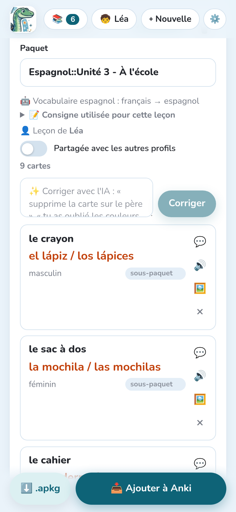
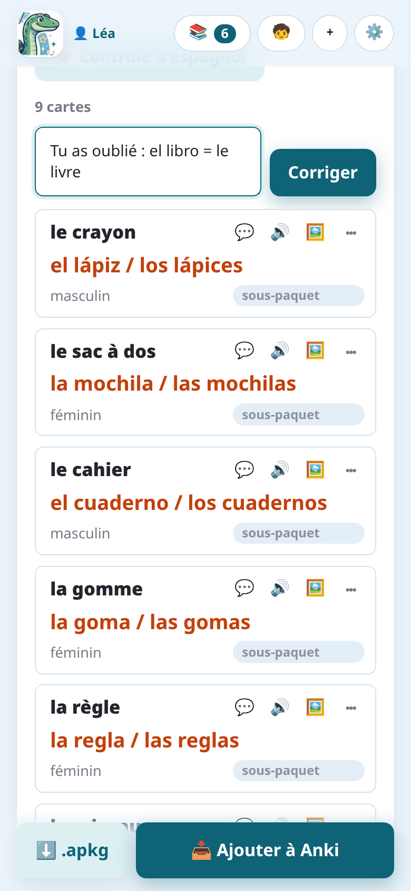

Même la meilleure IA lit parfois un mot de travers : **parcourez toujours les cartes** avant
de les envoyer. Tout ce que vous modifiez est enregistré au fur et à mesure (« ✓ Enregistrée »).

## Le paquet et les cartes

- **Paquet** : le nom du paquet Anki. `::` crée des sous-paquets :
  `Espagnol::Unité 3 - À l'école`.
- Chaque carte a un **recto** (la question) et un **verso** (la réponse). Touchez un texte
  pour le modifier.
- **+ info** ajoute une note affichée sous la réponse : genre, pluriel, un exemple…
- **sous-paquet** range la carte dans un sous-paquet de la leçon (« Vocabulaire »,
  « Verbes »).
- **Écouter le verso** (🔊) le fait entendre avec la voix de la leçon.
- **Plus d'actions** (⋯), en haut à droite de la carte, la supprime ; **＋ Ajouter une carte**, en bas, en ajoute une.

**📝 Consigne utilisée pour cette leçon**, au-dessus des cartes, rappelle ce qui a été
demandé à l'IA.

## Une leçon qui semble fausse

Quand la leçon elle-même semble contenir une erreur (des notes d'élève, une faute de copie : une
date, un nom, un nombre ou une formule faux), la carte garde ce que dit la leçon, avec une note
(⚠️) qui dit pourquoi cela semble faux et la correction proposée. **Corriger** l'applique ;
**Garder la leçon** retire la note. Seules les erreurs nettes et vérifiables sont signalées, jamais
une convention ou une simplification, et la note ne part jamais dans Anki.

## Corriger avec l'IA

Plutôt que de modifier les cartes une par une, demandez avec vos mots, dans le champ
au-dessus des cartes :

- « supprime la carte sur le père »
- « tu as oublié les couleurs en bas de la page »
- « ajoute le pluriel au verso, comme : la regla / las reglas »
- « des questions plus courtes »

Touchez **Corriger**. L'IA revoit les photos et ne change que ce que vous avez demandé : les
cartes changées sont marquées **modifiée**, les nouvelles **nouvelle**, et une phrase
résume ce qu'elle a fait. **↩ Annuler** remet les cartes comme avant.

## Expliquer une carte

**Expliquer cette carte** (💬) demande à l'IA de l'expliquer : ce qu'elle veut dire, et pourquoi sa réponse
est la réponse, en deux à quatre phrases, au niveau d'un élève, dans la langue de la page.
Pratique pour une matière qu'on a oubliée, ou une carte que l'élève ne comprend pas.

Sous l'explication, l'IA ne propose que ce qui aide pour **cette** carte :

- **Un exemple** : une phrase avec le mot, un calcul fait avec la formule ;
- **Une astuce pour retenir** : quand il en existe une naturelle ;
- **Pourquoi c'est juste ?** : quand ce n'est pas évident, et pour un QCM ou un vrai/faux
  (pourquoi les autres réponses sont fausses aussi).

**Garder dans « Info »** ajoute ce qui a été expliqué à l'info de la carte : on le retrouve au
verso dans Anki. Chaque explication est un appel court à l'IA : des crédits dans
l'application ; sur l'ordinateur, une fraction de centime avec Gemini Flash, environ un centime
avec Claude Sonnet, compté dans les coûts de la leçon.

## Signaler un contenu

Dans l'application Android, **⋯ → ⚑ Signaler** sur une carte signale à Notosaurus ce que l'IA a fait : la carte
entière, telle que vous la voyez (ses textes, son explication quand elle est affichée, son image ou
sa figure, sauf une photo que vous avez prise vous-même). Dites pourquoi (choquant ou inapproprié, faux,
autre), ajoutez un commentaire si vous voulez : la fenêtre montre exactement ce qui sera envoyé,
jamais les photos de la leçon ni le prénom de l'enfant. Ensuite, vous pouvez supprimer la carte ou
retirer son image. Voir [Confidentialité](../app-privacy/).

## Régénérer

**✨ Régénérer**, sous la consigne, refait les cartes de la leçon ouverte, par exemple avec
une autre consigne ou après avoir ajouté une page. Les cartes sont remplacées ;
**↩ Annuler** les remet, sauf si les photos ont changé. Si la leçon a déjà été envoyée à
Anki, les cartes envoyées y restent, et les nouvelles sont ajoutées au prochain envoi.

## Les options des cartes

En bas de la leçon, une ligne dit comment les cartes sont posées : **↔ Dans les deux sens**
(Anki demande aussi verso → recto), **⌨️ Réponse tapée** (Anki compare lettre par lettre),
**🎧 Avec une dictée** (entendre le verso, l'écrire), ou **🎧 Dictée seule**.

Ces options viennent de la [consigne](../instructions/) : l'IA les lit dans son texte. Pour les
changer, dites-le dans la correction, par exemple « dans un seul sens » ou « avec la réponse
tapée » : les cartes ne changent pas, seulement la façon dont Anki les pose.

La ligne en dessous indique la voix qui lit les versos. Elle est incluse dans le paquet :
elle fonctionne partout, même hors connexion.

## À qui est la leçon

Au-dessus des cartes, une ligne dit pour qui est la leçon : **🧒 Leçon de Paul**. Sur
l'ordinateur, si Anki est ouvert sur le profil d'un autre enfant, elle le dit avant que vous
envoyiez les cartes.

**⧉ Copier pour…**, quand il y a un autre enfant, en fait une copie pour lui : ses paquets, ses
propres cartes dans Anki. C'est gratuit : rien n'est demandé à l'IA.

Sur l'ordinateur, une leçon partagée avec tous les profils par une version précédente s'ouvre **en lecture seule**
dans les autres profils : vous pouvez quand même l'ajouter à votre Anki, ou la copier, mais elle
ne se modifie que depuis le profil de son propriétaire. Voir [Plusieurs enfants](../several-children/).
