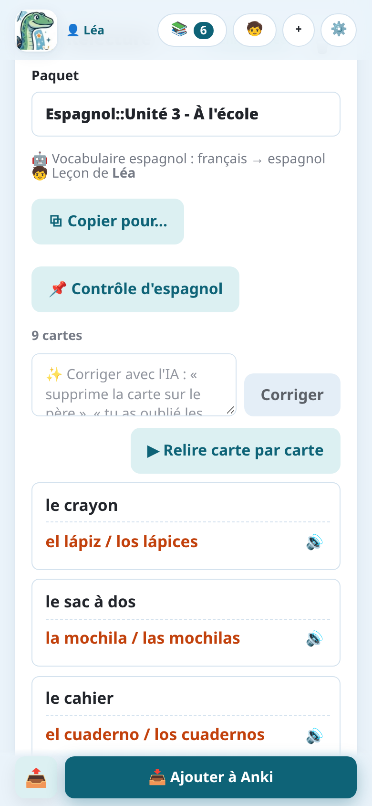
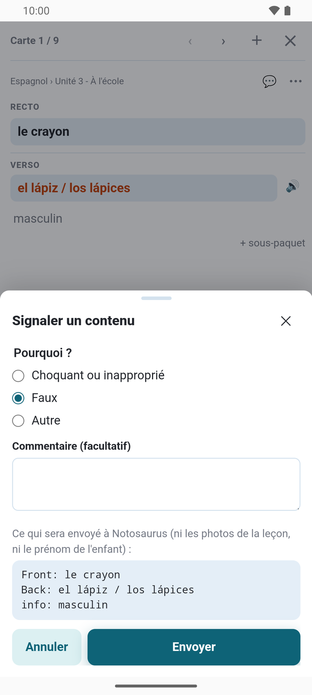
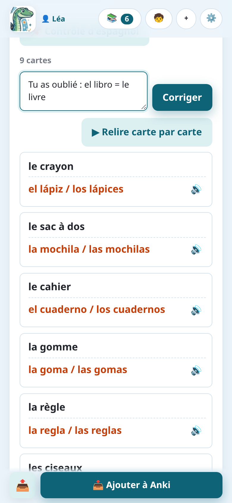

Même la meilleure IA lit parfois un mot de travers : **parcourez toujours les cartes** avant
de les envoyer. Tout ce que vous modifiez est enregistré au fur et à mesure (« ✓ Enregistrée »).

:::tip[Quelque chose ne va pas ? Signalez-le]
Dans l'application Android, une carte qui ne va pas (un mot mal lu, une réponse fausse, une figure
de travers, une image inadaptée, une carte qui n'a pas de sens) : **⋯ → ⚑ Signaler** dessus. Chaque
signalement est lu, et c'est le meilleur moyen de faire corriger Notosaurus. Voir
[Signaler un problème](#signaler-un-problème).
:::

## Le paquet et les cartes

- **Paquet** : le nom du paquet Anki. `::` crée des sous-paquets :
  `Espagnol::Unité 3 - À l'école`.
- Chaque carte a un **recto** (la question) et un **verso** (la réponse).

### La liste

La liste est compacte, comme un aperçu : le recto, le verso sous un trait pointillé, une petite
image au-dessus de la question ou après la réponse, comme dans Anki, et seulement **🔊** pour
entendre la carte. **Touchez une carte pour l'ouvrir** ; **▶ Relire carte par carte** ouvre la
première.

### Une carte ouverte

La carte s'ouvre en plein écran (une fenêtre sur l'ordinateur), formules et figures dessinées,
telle qu'Anki la montrera :

- en haut, petit, **son paquet** dans Anki (« Jules › 5e › Anglais › … › Exercices ») et ses
  boutons : **💬 Expliquer cette carte** et **Plus d'actions** (⋯) ;
- **RECTO** : la question, avec son image quand elle va au recto ; un trait, puis **VERSO** :
  la réponse et son **🔊**, l'image quand elle va au verso, puis l'info et les aides ;
- tout en bas, le champ **✨ Corriger avec l'IA**, avec **Corriger** à côté (voir
  [Corriger avec l'IA](#corriger-avec-lia)).

Touchez un texte pour le modifier. **Glissez du doigt** n'importe où sur la carte, ou touchez
**‹ ›**, pour passer à la carte précédente ou suivante. Après la dernière vient la **fin de la
leçon** : combien de cartes ont été relues (« ✓ 12 cartes relues »), **＋ Ajouter une carte**, et
le bouton pour envoyer la leçon à Anki. **✕**, Échap ou le bouton retour du téléphone referment
la carte, enregistrée.

Touchez l'image d'une carte pour la changer : sa page s'ouvre en plein écran (voir
[Images](../card-types/#images)). Une carte sans image : ⋯ → **🖼️ Ajouter une image**.

- **+ info** ajoute une note affichée sous la réponse : genre, pluriel, un exemple…
- **+ sous-paquet** range la carte dans un sous-paquet de la leçon (« Vocabulaire »,
  « Verbes ») ; une carte rangée affiche le nom de son sous-paquet.
- **🔊**, à côté de la réponse, la fait entendre avec la voix de la leçon. Chaque carte dit
  quelles faces sont lues : la réponse d'une carte de vocabulaire, un texte à trous des deux côtés, en entier (au recto
  comme une dictée : on écrit dans les trous les mots entendus). Le menu ⋯ de la carte : **Lire le recto à voix haute**, **Ne plus lire
  le verso**…
- **Plus d'actions** (⋯) supprime aussi la carte.

### Ajouter une carte

**＋** en haut d'une carte ouverte en ajoute une juste après ; **＋ Ajouter une carte**, sous la
liste ou à la fin de la leçon, en ajoute une à la fin. La nouvelle carte s'ouvre, vide ; laissée
vide, elle disparaît en la refermant.

Le plus simple est souvent de la faire **écrire par l'IA** : dans **Que doit demander cette
carte ?**, en bas, dites ce qu'elle doit demander (« le passé composé d'aller », « la date de la
prise de la Bastille »), puis touchez **Écrire**. Sur le téléphone, rien ne s'ouvre au clavier :
touchez **🎤** pour le dicter, ou le champ pour le taper. Vous pouvez aussi remplir le recto et
le verso vous-même.

**📝 Consigne utilisée pour cette leçon**, au-dessus des cartes, rappelle ce qui a été
demandé à l'IA.

## Une leçon qui semble fausse

Quand la leçon elle-même semble contenir une erreur (des notes d'élève, une faute de copie : une
date, un nom, un nombre ou une formule faux), la carte garde ce que dit la leçon, avec une note
(⚠️) qui dit pourquoi cela semble faux et la correction proposée. **Corriger** l'applique ;
**Garder la leçon** retire la note. Seules les erreurs nettes et vérifiables sont signalées, jamais
une convention ou une simplification, et la note ne part jamais dans Anki.

## Signaler un problème

Dans l'application Android, **⋯ → ⚑ Signaler**, en haut à droite d'une carte, dit à Notosaurus ce
qui ne va pas : un mot mal lu, une réponse fausse, une figure avec un codage mal placé, une image
inadaptée, une carte qui n'a pas de sens. N'hésitez pas : **chaque signalement est lu**, et c'est
ainsi que ces erreurs sont corrigées dans Notosaurus, pour toutes les leçons à venir.

- Dites pourquoi (**Faux**, **Choquant ou inapproprié**, **Autre**) et, si vous voulez, ajoutez un
  commentaire : ce que vous attendiez aide le plus.
- Ce qui part est la carte entière, telle que vous la voyez (ses textes, son explication quand
  elle est affichée, son image ou sa figure, sauf une photo que vous avez prise vous-même) ; la
  fenêtre montre exactement quoi, jamais les photos de la leçon ni le prénom de l'enfant. Voir
  [Confidentialité](../app-privacy/).
- Ensuite, vous pouvez supprimer la carte ou retirer son image.

## Corriger avec l'IA

Plutôt que de modifier les cartes une par une, demandez avec vos mots, dans le champ
au-dessus des cartes :

- « supprime la carte sur le père »
- « tu as oublié les couleurs en bas de la page »
- « ajoute le pluriel au verso, comme : la regla / las reglas »
- « des questions plus courtes »

Touchez **Corriger**. L'IA revoit les photos et ne change que ce que vous avez demandé : les
cartes changées sont marquées **modifiée**, les nouvelles **nouvelle**, et une phrase résume ce
qu'elle a fait, avec le compte des cartes ajoutées, modifiées et supprimées. Dessous :

- **↩ Annuler** remet les cartes comme avant ;
- **🎯 Refaire avec soin**, après une correction rapide, la refait avec la réflexion du modèle ;
- **✓ Garder** la garde : elle ne peut plus être annulée.

La correction reste annulable jusqu'à ce que vous la gardiez ou commenciez à modifier une carte.

**Une seule carte** se corrige depuis la carte ouverte, dans le champ **✨ Corriger avec l'IA**
en bas (« la réponse c'est 1789 », « plus court »), puis **Corriger**. Les mêmes **↩ Annuler**,
**🎯 Refaire avec soin** et **✓ Garder** s'affichent ; refermer la carte, ou passer à la
suivante, garde aussi la correction.

Dans l'application, **🎤** à côté du champ permet de dicter la correction. Pas besoin d'arrêter
la dictée d'abord : touchez directement **Corriger**, ce que vous avez dit est écrit puis envoyé.

Vous changez d'avis pendant que l'IA corrige (la leçon ou une seule carte) ? **Annuler** l'arrête
tout de suite : les cartes restent comme elles étaient.

## Expliquer une carte

**Expliquer cette carte** (💬) demande à l'IA de l'expliquer : ce qu'elle veut dire, et pourquoi sa réponse
est la réponse, en deux à quatre phrases, au niveau d'un élève, dans la langue de la page.
Pratique pour une matière qu'on a oubliée, ou une carte que l'élève ne comprend pas.

Sous l'explication, l'IA ne propose que ce qui aide pour **cette** carte :

- **Un exemple** : une phrase avec le mot, un calcul fait avec la formule ;
- **Une astuce pour retenir** : quand il en existe une naturelle ;
- **Pourquoi c'est juste ?** : quand ce n'est pas évident, et pour un QCM ou un vrai/faux
  (pourquoi les autres réponses sont fausses aussi).

**Garder dans « Info »** ajoute ce qui a été expliqué à l'info de la carte : on le retrouve au
verso dans Anki. Chaque explication est un appel court à l'IA : des crédits dans
l'application ; sur l'ordinateur, une fraction de centime avec Gemini Flash, environ un centime
avec Claude Sonnet, compté dans les coûts de la leçon.

## Régénérer

**✨ Régénérer**, sous la consigne, refait les cartes de la leçon ouverte, par exemple avec
une autre consigne ou après avoir ajouté une page. Les cartes sont remplacées ;
**↩ Annuler** les remet, sauf si les photos ont changé. Si la leçon a déjà été envoyée à
Anki, les cartes envoyées y restent, et les nouvelles sont ajoutées au prochain envoi.

## Les options des cartes

En bas de la leçon, une ligne dit comment les cartes sont posées : **↔ Dans les deux sens**
(Anki demande aussi verso → recto), **⌨️ Réponse tapée** (Anki compare lettre par lettre),
**🎧 Avec une dictée** (entendre le verso, l'écrire), ou **🎧 Dictée seule**.

Ces options viennent de la [consigne](../instructions/) : l'IA les lit dans son texte. Pour les
changer, dites-le dans la correction, par exemple « dans un seul sens » ou « avec la réponse
tapée » : les cartes ne changent pas, seulement la façon dont Anki les pose.

La ligne en dessous indique la voix qui lit les versos. Elle est incluse dans le paquet :
elle fonctionne partout, même hors connexion.

## À qui est la leçon

Au-dessus des cartes, une ligne dit pour qui est la leçon : **🧒 Leçon de Paul**. Sur
l'ordinateur, si Anki est ouvert sur le profil d'un autre enfant, elle le dit avant que vous
envoyiez les cartes.

**⧉ Copier pour…**, quand il y a un autre enfant, en fait une copie pour lui : ses paquets, ses
propres cartes dans Anki. C'est gratuit : rien n'est demandé à l'IA.

Sur l'ordinateur, une leçon partagée avec tous les profils par une version précédente s'ouvre **en lecture seule**
dans les autres profils : vous pouvez quand même l'ajouter à votre Anki, ou la copier, mais elle
ne se modifie que depuis le profil de son propriétaire. Voir [Plusieurs enfants](../several-children/).
