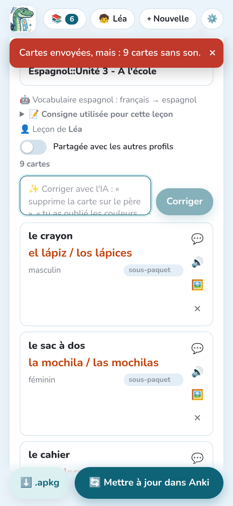

Avec le greffon (ou en autonome), une fois les cartes vérifiées, elles partent dans Anki sur
l'ordinateur d'un geste, ou sous forme de fichier. Dans l'application Android, elles vont
directement dans AnkiDroid : voir [L'application et AnkiDroid](../app-ankidroid/).

## Ajouter à Anki

**📥 Ajouter à Anki** écrit les cartes directement dans le **profil ouvert dans Anki**, dans
le paquet de la leçon, avec leur audio et leurs images. Un message dit ce qui a été fait, par
exemple « ✓ Dans Anki : 9 cartes ajoutées. Synchronisé avec AnkiWeb. »

- Avec le **greffon**, Notosaurus écrit dans Anki lui-même : rien d'autre à installer.
- Notosaurus **autonome** (sans le greffon) a besoin d'Anki ouvert sur l'ordinateur, avec le
  greffon [AnkiConnect](https://ankiweb.net/shared/info/2055492159).
- Si la leçon appartient à un autre enfant que le profil ouvert dans Anki, Notosaurus demande
  avant de l'écrire dans la mauvaise collection (voir [Plusieurs enfants](../several-children/)).

## Renvoyer une leçon

Une fois la leçon envoyée, le bouton devient **🔄 Mettre à jour dans Anki** : une leçon corrigée
et renvoyée met à jour ses cartes dans Anki, historique gardé, au lieu de les dupliquer. Voir
[Les cartes dans Anki](../cards-in-anki/).

## Le fichier .apkg

**⬇️ .apkg** télécharge le paquet sous forme de fichier, avec son audio et ses images, sans
qu'Anki ait besoin d'être ouvert :

- **sur un ordinateur**, double-cliquez dessus : Anki l'importe ;
- **sur Android**, ouvrez le fichier téléchargé et choisissez **AnkiDroid**. Si AnkiDroid n'est pas
  proposé, partagez le fichier vers AnkiDroid, ou utilisez **Importer** dans le menu
  d'AnkiDroid ;
- **sur iPhone**, ouvrez-le avec **AnkiMobile** depuis le menu de partage.

Importer un `.apkg` plus récent de la même leçon met aussi ses cartes à jour au lieu de les
dupliquer.

Avec le **greffon Notosaurus**, une leçon envoyée par **📥 Ajouter à Anki** et son `.apkg`
donnent les mêmes cartes : vous pouvez mélanger les deux, sur l'ordinateur et sur le téléphone. Avec
**AnkiConnect**, choisissez une seule méthode par profil Anki : un `.apkg` importé là où la leçon a
déjà été envoyée directement (ou dans un profil synchronisé avec lui) ajouterait chaque carte une
deuxième fois.

## Faire arriver les cartes sur le téléphone

Après **Ajouter à Anki**, Notosaurus **synchronise le profil avec AnkiWeb** (l'option
**Synchroniser avec AnkiWeb après l'envoi**, dans les réglages). Les cartes arrivent ensuite
dans AnkiDroid ou AnkiMobile à leur prochaine synchronisation. Si le profil n'est pas connecté
à AnkiWeb, les cartes sont ajoutées à Anki sur l'ordinateur, et le message indique qu'il n'y a
pas eu de synchronisation.

Sans compte AnkiWeb, le fichier `.apkg` ouvert sur le téléphone met le paquet directement dans
AnkiDroid, mais les révisions restent alors sur ce téléphone seulement.
