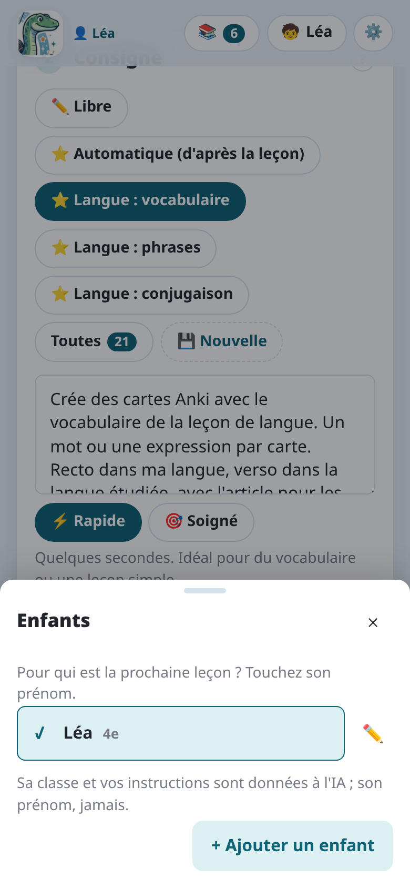
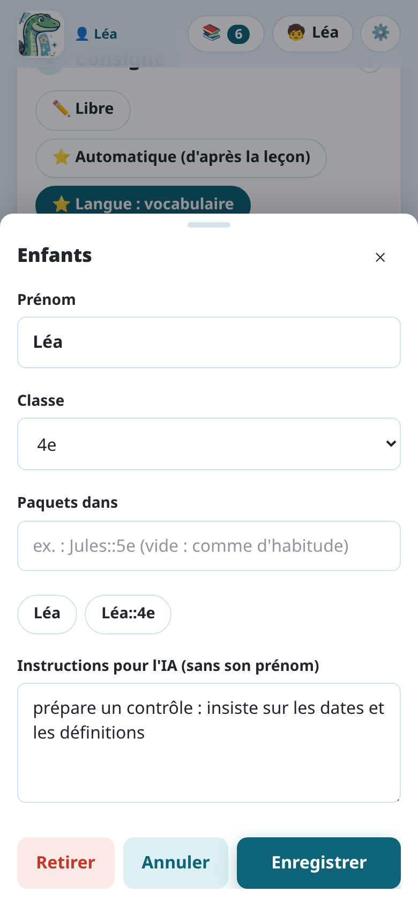
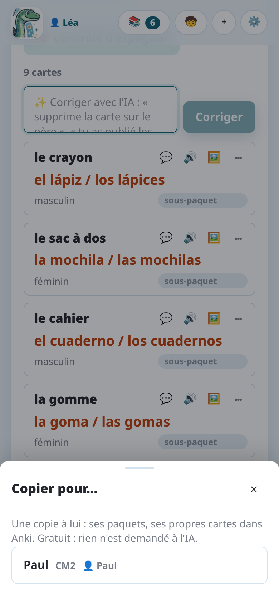

import { Tabs, TabItem } from '@astrojs/starlight/components';

Chaque enfant a sa **fiche** dans Notosaurus : son prénom, sa classe, les paquets où vont ses
leçons et vos instructions pour lui. Chaque leçon est pour un enfant. Où vont ses cartes dans
Anki dépend de l'endroit où tourne Notosaurus : voir
[Où vont les cartes de chaque enfant](#où-vont-les-cartes-de-chaque-enfant).

## Les fiches des enfants

Le bouton **Enfants** (🧒), en haut de la page, ouvre **Enfants**. **+ Ajouter un enfant** crée une fiche :

- **Prénom** : pour les distinguer. Il n'est **jamais envoyé à l'IA**.
- **Classe** : donnée à l'IA, pour que les cartes soient à son niveau.
- **Paquets dans** : où vont ses leçons dans Anki, vide au départ (le paquet de la leçon, comme
  d'habitude). Dessous, un toucher sur une suggestion le remplit : son prénom (`Jules`), ou son
  prénom et sa classe (`Jules::5e`), qui suit quand la classe change. Le paquet de la leçon vient
  alors après : `Jules::5e::Espagnol::Unité 3`. Tapé à la main, `{classe}` devient aussi sa
  classe.
- **Instructions pour l'IA (sans son prénom)** : ajoutées à chaque leçon de cet enfant (« il lit
  encore lentement : phrases courtes », « il prépare un contrôle : insiste sur les dates et les
  définitions »).

**Pour qui est la prochaine leçon ? Touchez son prénom** : l'enfant choisi s'affiche sur ce bouton,
et les leçons suivantes sont pour lui. **Modifier** (✏️), à côté d'un prénom, modifie sa fiche.

Les instructions pour tous les enfants (« espagnol d'Espagne ») sont dans les réglages : voir
[Les consignes](../instructions/#les-instructions-permanentes).

## Les leçons appartiennent à un enfant

- Une leçon est pour l'enfant choisi quand elle est créée. Sa relecture dit à qui elle est :
  **🧒 Leçon de Paul**.
- **📚 Mes leçons** montre les leçons de l'enfant choisi. Avec plus d'un enfant, l'interrupteur
  au-dessus de la liste montre **Les leçons de tous les enfants**.
- Sur l'ordinateur, si Anki est ouvert sur le profil d'un autre enfant, la leçon le dit avant que vous l'envoyiez :
  ⚠️ *Anki est ouvert pour Léa : ouvrez le profil de Paul dans Anki pour lui envoyer ses cartes.*

### La même leçon pour deux enfants

Deux enfants ont la même leçon ? **⧉ Copier pour…**, dans la relecture de la leçon, en fait une
copie pour un autre enfant : ses paquets, ses propres cartes dans Anki, son propre historique de
révision. C'est gratuit : rien n'est demandé à l'IA. La copie s'ouvre si cet enfant est dans le
profil ouvert ; sinon, elle l'attend dans ses leçons.

Sur l'ordinateur, les leçons partagées avec tous les profils par une version précédente restent visibles de tous
les profils, en lecture seule sauf depuis le profil de leur propriétaire : **⧉ Copier pour…**
donne à chaque enfant la sienne.

## Où vont les cartes de chaque enfant

<Tabs syncKey="mode">
<TabItem label="Application Android">

L'application écrit dans **AnkiDroid**, qui n'a pas de profils : une seule collection sur le
téléphone, connectée à un seul compte AnkiWeb. Chaque enfant a donc ses propres paquets :

- remplissez ses **Paquets dans** d'un toucher sur sa suggestion (`Léa::CM2`, `Paul::4e`) : ses
  leçons vont dans ses propres paquets ;
- pour réviser, chaque enfant ouvre **son** paquet (Léa, Paul) : AnkiDroid ne prend alors que ses
  cartes. Pas le bouton qui révise tout.

Notosaurus sépare les enfants dans cette collection :

- la liste des leçons montre celles de l'enfant choisi, rangées par matière (sans son prénom ni
  sa classe) ;
- les paquets proposés sont les siens, jamais ceux d'un autre enfant.

Chaque enfant voit quand même les paquets des autres dans AnkiDroid, et ses statistiques sont
communes.

</TabItem>
<TabItem label="Ordinateur">

**Un profil par enfant.** Les cartes vont dans le profil ouvert dans Anki. Pour que chaque enfant
ait ses propres cartes et sa progression, donnez-lui un profil :

1. Dans Anki, **Fichier → Changer de profil → Ajouter**, et créez un profil par enfant
   (Léa, Paul…).
2. Pour chaque profil, créez un **compte AnkiWeb** et connectez-le dans ce profil
   (**Outils → Préférences → Synchronisation**). Un compte AnkiWeb contient une seule
   collection : chaque enfant a besoin du sien.
3. Sur le téléphone de chaque enfant, connectez **AnkiDroid** ou **AnkiMobile** au compte
   AnkiWeb de cet enfant.
4. Ouvrez le profil de chaque enfant dans Anki, puis **🧒** dans Notosaurus, et créez sa fiche.

:::tip[Pas besoin d'une boîte mail par enfant]
Beaucoup de messageries acceptent les alias avec un `+` : `parent+lea@exemple.fr` et
`parent+paul@exemple.fr` arrivent dans votre propre boîte, mais comptent comme deux adresses.
:::

La fiche d'un enfant appartient au **profil Anki ouvert quand elle a été créée**. Notosaurus ne
propose que les fiches du profil ouvert dans Anki : ouvrez le profil de Paul, et Paul est choisi.

Après **Ajouter à Anki**, Notosaurus synchronise le profil ouvert avec AnkiWeb. Les cartes
arrivent sur le téléphone de l'enfant à sa prochaine synchronisation.

**Une seule tablette pour plusieurs enfants.** **AnkiDroid n'a pas de profils** : une
installation contient une seule collection, connectée à un seul compte AnkiWeb. AnkiMobile non
plus ne passe pas d'un compte à l'autre sans se déconnecter. Si les enfants partagent un
téléphone ou une tablette, le plus simple est donc **un seul profil Anki, avec un paquet par
enfant** :

1. Gardez un seul profil dans Anki, connecté à un seul compte AnkiWeb, et connectez AnkiDroid à
   ce compte.
2. Créez une fiche pour chaque enfant, et remplissez ses **Paquets dans** d'un toucher sur sa
   suggestion (`Léa::CM2`, `Paul::4e`). Ses leçons vont alors dans ses paquets, sans retaper son
   prénom.
3. Pour réviser, chaque enfant ouvre **son** paquet (Léa, Paul) : Anki ne prend alors que ses
   cartes. Pas le bouton qui révise tout.

Notosaurus sépare alors les enfants dans le même profil :

- la liste des leçons montre celles de l'enfant choisi, rangées par matière (sans son prénom ni
  sa classe) ;
- les paquets proposés sont les siens, jamais ceux d'un autre enfant.

Ce qu'on perd par rapport à un profil par enfant : chaque enfant voit les paquets des autres dans
Anki, et les statistiques d'Anki sont communes.

Si chaque enfant a son propre appareil, préférez **un profil par enfant**. Pour les plus à
l'aise : AnkiDroid peut être installé en plusieurs exemplaires sur le même appareil, un par
enfant, chacun avec son compte AnkiWeb (les « parallel builds », voir la
[FAQ d'AnkiDroid](https://github.com/ankidroid/Anki-Android/wiki/FAQ), en anglais).

</TabItem>
</Tabs>
