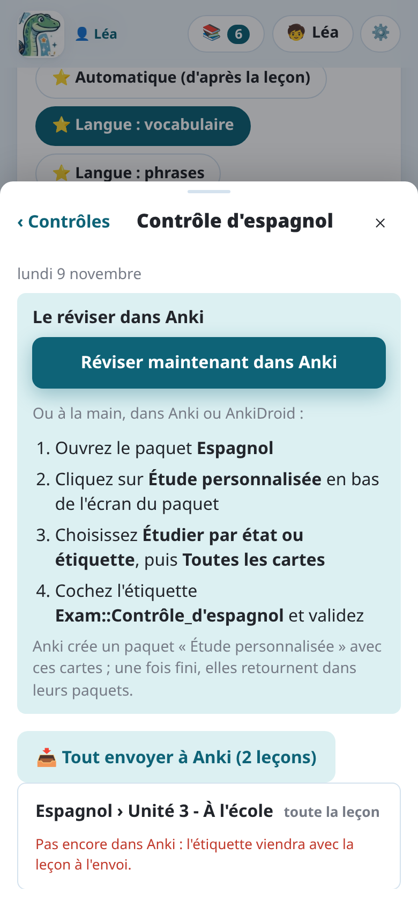

import { Tabs, TabItem } from '@astrojs/starlight/components';

Une interro lundi sur trois leçons ? Un **contrôle à préparer** les réunit, entières ou
quelques-unes de leurs cartes seulement, pour que l'enfant les révise ensemble, quels que soient
leurs paquets. Une fois révisées, les cartes retournent dans leurs paquets.

## Créer un contrôle

- Depuis une leçon : **📝 Préparer un contrôle…**, dans sa relecture, l'ajoute à un contrôle (un
  nom, une date), entière ou **quelques-unes de ses cartes seulement** (une coche sur chaque
  carte). Une fois la leçon dans un contrôle, le bouton affiche le nom du contrôle (**📌 …**).
- Depuis la liste : les contrôles sont en haut de **Mes leçons**, où **＋ Nouveau contrôle** en
  crée un. Sa fiche ajoute ensuite des leçons (**＋ Ajouter des leçons**, entières) et envoie à
  Anki celles qui n'y sont pas encore.

## Dans Anki : une étiquette

Chaque carte d'un contrôle reçoit une étiquette dans Anki, `Exam::<nom>`. Elle est posée tout de
suite sur ses notes quand elles sont déjà dans Anki, ou avec elles à l'envoi de la leçon.

Supprimer un contrôle (**Supprimer le contrôle**, dans sa fiche) retire l'étiquette. Les cartes
restent dans Anki, avec leur historique de révision.

## Le réviser

La fiche du contrôle dit comment, étape par étape. Avec les **révisions personnalisées** d'Anki, à la
main :

1. Ouvrez le paquet qui contient les leçons.
2. **Révisions personnalisées** → **Étude par carte ou par étiquette**, puis **Toutes les cartes dans
   un ordre aléatoire (ne pas replanifier)**.
3. Cochez l'étiquette `Exam::<nom>` et validez.

Anki crée une séance avec ces cartes ; une fois finie, elles retournent dans leurs paquets.
Quand les leçons sont dans des paquets différents, la fiche donne une recherche à coller dans
**Outils → Créer un paquet filtré**, avec un bouton **Copier**.

Un paquet filtré les réunit plus vite :

<Tabs syncKey="mode">
<TabItem label="Application Android">

1. Dans la fiche du contrôle, **Ouvrir dans AnkiDroid** : le navigateur d'AnkiDroid s'ouvre sur
   les cartes du contrôle, quels que soient leurs paquets.
2. Touchez **⋮**, puis **Créer un paquet filtré**, même si la liste semble vide.
3. Touchez **Générer**. Au-delà de 100 cartes, augmentez d'abord **Limiter à**.

AnkiDroid ne laisse aucune autre application créer elle-même un paquet filtré : ces trois gestes
sont nécessaires. Voir [L'application et AnkiDroid](../app-ankidroid/).

</TabItem>
<TabItem label="Ordinateur">

Anki ouvert, **Réviser maintenant dans Anki** le fait en un clic : un paquet filtré
« Contrôle : … » avec les cartes du contrôle, ouvert dans Anki. Il est refait à chaque fois, et
supprimé avec le contrôle.

</TabItem>
</Tabs>

Avec plusieurs enfants, un contrôle se fait avec les leçons de l'enfant choisi : voir
[Plusieurs enfants](../several-children/).
