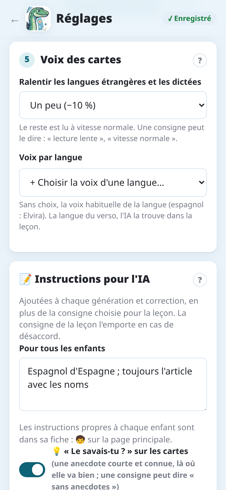

import { Tabs, TabItem } from '@astrojs/starlight/components';

Notosaurus peut lire à voix haute le verso de chaque carte : pratique pour les langues, pour
entendre la bonne prononciation. L'audio est **inclus dans le paquet** : il fonctionne partout
dans Anki, sur l'ordinateur et le téléphone, même hors connexion.

## Quelles cartes sont lues

Notosaurus lit à voix haute les versos **dans une langue apprise** : l'IA trouve cette langue
dans la leçon (espagnol d'Espagne, anglais britannique…). Une leçon dans la langue de l'enfant
(histoire, grammaire…) n'a pas de son, sauf si ses cartes servent à écrire ce qu'on entend
(réponse tapée, dictée) ou si sa consigne le demande (« lu à voix haute », comme **Par cœur**).
Les consignes de Notosaurus pour les questions, les QCM, les formules ou les schémas n'ont pas de
son.

En bas d'une leçon, une ligne indique la voix qui lit ses versos.

## Choisir la voix

Sans choix, chaque langue a sa voix habituelle (sur l'ordinateur : espagnol → Elvira, anglais
britannique → Sonia…). Pour en préférer une autre : **Réglages → Voix des cartes → Voix par
langue**, puis **+ Choisir la voix d'une langue…** : choisissez la langue, puis une de ses voix,
femme ou homme, et **Écouter** pour l'entendre. Le choix vaut pour les leçons suivantes dans
cette langue. Les réglages de l'application ont la même section, avec leurs propres voix.

## Écouter

Dans la relecture, le bouton **Écouter le verso** (🔊) d'une carte fait entendre son verso avec la voix de la leçon : vérifiez
la prononciation avant d'envoyer les cartes.

## Débit

Une leçon est ralentie là où ça aide : les versos dans une langue apprise, et les dictées (le temps
d'écrire). Une leçon dans la langue de l'enfant (histoire, français…) est lue à vitesse normale.

**Réglages → Voix des cartes → Ralentir les langues étrangères et les dictées** : **Beaucoup
(−25 %)**, **Un peu (−10 %)** (par défaut) ou **Non**. Une consigne peut aussi le dire, pour ses
leçons : « lecture lente », « vitesse normale ».

Le débit est choisi quand la leçon est faite et gardé avec elle : ses sons restent pareils, même si
le réglage change ensuite.

## Dictée

Une carte de dictée fait entendre le verso, puis l'écrire. Les consignes **Dictée** et **Dictée à
trous** ne font que ce genre de cartes ; pour les autres, dites-le dans leur texte : « avec une
dictée », ou « seulement une dictée ». **Automatique** fait des cartes de dictée quand la page est
une dictée à préparer. Voir [Les consignes](../instructions/).

## Des cartes sans son

Faire l'audio demande Internet :

<Tabs syncKey="mode">
<TabItem label="Application Android">

Les voix sont celles de Google, par le service Notosaurus. Voir la
[politique de confidentialité de l'application](../app-privacy/) pour ce qui est envoyé.

</TabItem>
<TabItem label="Ordinateur">

Les voix viennent du service de synthèse vocale de Microsoft, par
[edge-tts](https://github.com/rany2/edge-tts), un outil non officiel. Voir
[Confidentialité et sécurité sur l'ordinateur](../privacy/) pour ce qui est envoyé.

</TabItem>
</Tabs>

Si les voix ne répondent pas, les cartes sont envoyées sans son et le message dit combien.
Renvoyez la leçon plus tard : l'audio manquant est ajouté.
