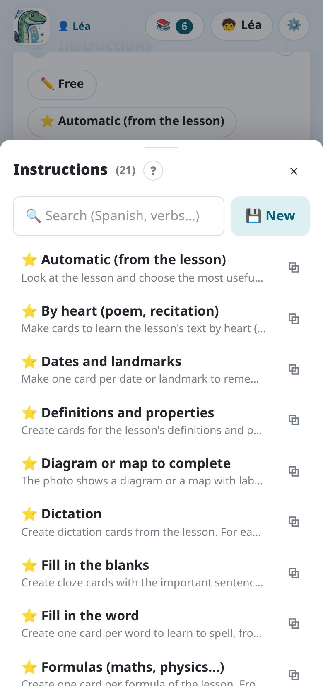
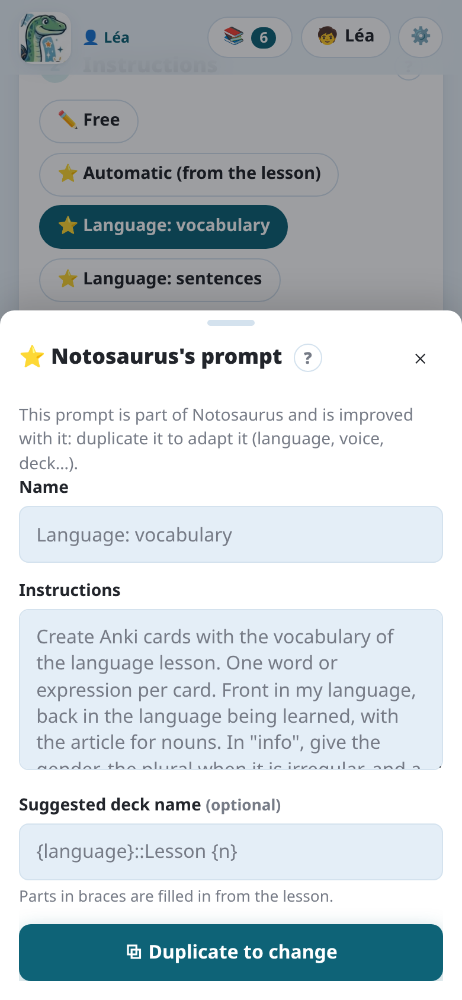

The **instructions** (or prompt) tell the AI what to make of the lesson: which cards, in which
direction, in which languages. The photo says *what* to learn; the instructions say *how*.

## Choosing instructions

Under **Instructions**, the most recent ones are shown as buttons. **All** opens the whole
list, with a search.

The text of the chosen instructions shows below the buttons. You can change it **for this
time only** (“Changed for this time only”), for instance to add “only the verbs”: your
change stays with the lesson, the saved instructions don't change.

## Notosaurus's instructions

The instructions marked ⭐ come with Notosaurus and get better with each version. They can't
be changed, but they can be **duplicated** to make your own version.

| Instructions | What they make |
|---|---|
| Automatic (from the lesson) | The AI looks at the lesson and chooses the most useful cards. |
| Language: vocabulary | One card per word or expression, with the article, gender and plural in the info; without a photo, from a list or a topic. |
| Language: sentences | One card per sentence, in your language and the language being learnt. |
| Language: conjugation | One verb, tense and person per card; the conjugated form on the back. |
| Table to learn | A table to know by heart (declension, irregular verbs…): one card per cell, or per row when each row is a word; the answer typed. |
| Questions / answers | Short questions on the content: dates, definitions, key ideas. |
| Dates and landmarks | One card per date to remember (a timeline, a box): the event on the front, its date on the back, the century in the info; with the reverse card, to learn it both ways. |
| Definitions and properties | One card per key word to define; for a property or a theorem, its name → the full statement ("If …, then …") and the hypotheses → the conclusion, the converse on its own, what it is for in the info. |
| Recognise from an example | One card per example of the lesson (a figure of speech, a word class…): the example on the front, the notion on the back, its definition in the info. Never a made-up example. |
| Fill in the blanks | Sentences with gaps (cloze): one card per gap number. |
| Multiple choice | A question, the right answer and three plausible wrong ones. |
| True / false | Statements, half of them false with one precise mistake. |
| Methods (steps) | One card per skill: "How do you …?", the steps on the back. |
| Formulas (maths, physics…) | One card per formula, with what each letter stands for. |
| Geometry (with figures) | Figures, properties and vocabulary, with an exact figure drawn on the cards. |
| Diagram or map to complete | The labels of a diagram or a map hidden behind numbers: one card per label. |
| Language: vocabulary in pictures | The picture of each word on the front (found or drawn); the word in the language being learned on the back. |
| Fill in the word | One card per word to spell: a sentence with the word missing on the front, the word on the back (typed), a spelling tip. |
| Dictation | Dictation cards only: the words to learn to spell, and the dictation text sentence by sentence, heard then typed. |
| Gap dictation | The hardest words of the dictation text, one per card: its sentence with the blank, heard, the word typed. |
| By heart (poem, recitation) | The text copied exactly, read aloud: one card title → first line, then one card per line (the title, its number and the two lines before on the front, a stanza's start said). |

## Your own instructions

**New** creates instructions you will use again, for example for a language your child learns
every week. **Duplicate** starts from a Notosaurus prompt.

- **Name**: what the button shows.
- **Instructions**: what the AI must do, in plain words (“one card per date, front the event,
  back the date”).
- **Suggested deck name**: the Anki deck, with `::` for sub-decks. The parts in braces are
  filled in from the lesson: `Spanish::Lesson {n}` becomes `Spanish::Lesson 5`.
- **Voice for the back**: no sound, **Automatic** (the AI recognises the language of the backs
  and Notosaurus picks a voice of that language), or a voice you choose and can listen to.
- **Card options**: type the answer (Anki compares letter by letter), add a dictation (hear
  the back, write it). They go with the lessons made with these instructions.

**✏️ Free** writes instructions for this time only: they stay with the lesson but aren't
added to your list. **Save as new instructions** keeps them if they worked well.

## “Did you know?” facts

The AI adds a short, well-known fact to the cards where one fits (one in three at most). It
shows on the back in Anki.

## Helps on the back

The AI adds, **only on the cards where they truly help**:

- **an explanation**: why the answer is the answer, when understanding helps remember it (a
  cause in history, a rule, a formula); never for a plain word or a bare date;
- **a way to remember it**: the word's origin or family (*hippopotame*: "the river horse"),
  a simple image, a well-known school mnemonic, a real spelling rule. Never a made-up one.

So a history lesson gets mostly explanations, a vocabulary lesson a few memory tricks and
no explanation. They show on the back in Anki, under the info (💬 and 🧠), and can be edited
or cleared in the review. They add about 1 to 3 US cents to a lesson with Claude Sonnet.

Both are on at first, for every lesson. To stop them: **Settings → Instructions for the AI**.
For one prompt only, say so in its text: "no fun facts", "no helps".

## Pictures

The AI adds a picture to the cards where it truly helps to remember, whatever the
instructions: a work of art, a person, a place, a monument, an animal. Never for an abstract
notion, nor on every card. A free picture is looked for first; having the AI draw one is
always asked. It is on at first: **Settings → Instructions for the AI → 🖼️ Pictures on the
cards**. For one prompt only, say so in its text: "no pictures".

## Standing instructions

Some instructions apply to every lesson: “Spanish from Spain”, “always the article with nouns”.
Write them once in **Settings → Instructions for the AI → For every child**. Each child's own
(their class, “still reads slowly”) are in their card, **🧒** on the main page: see
[Several children](../several-children/#the-childrens-cards).
