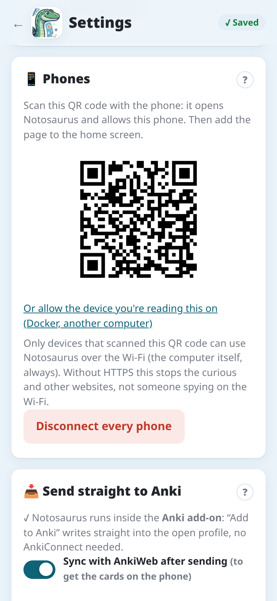
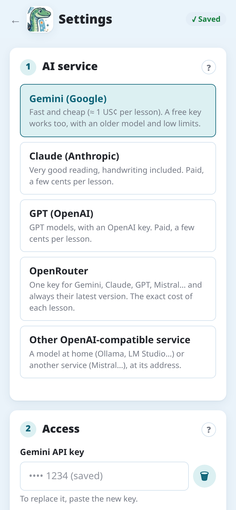
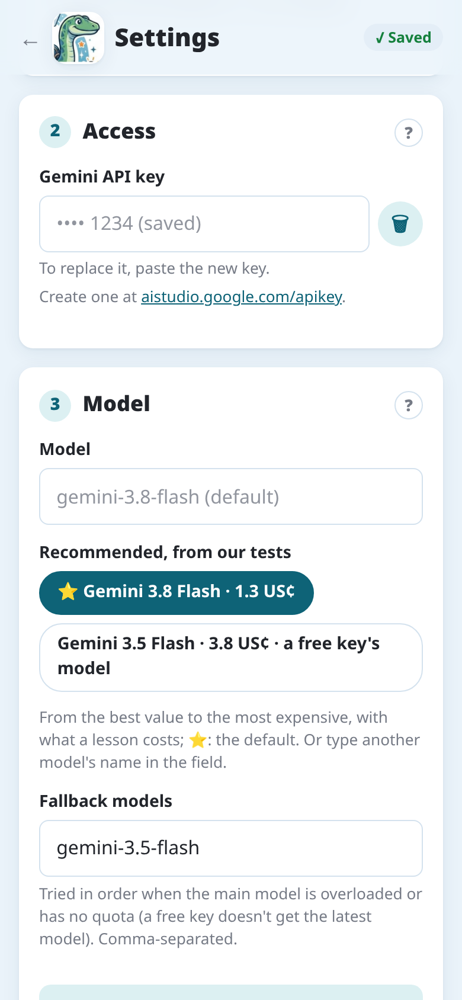
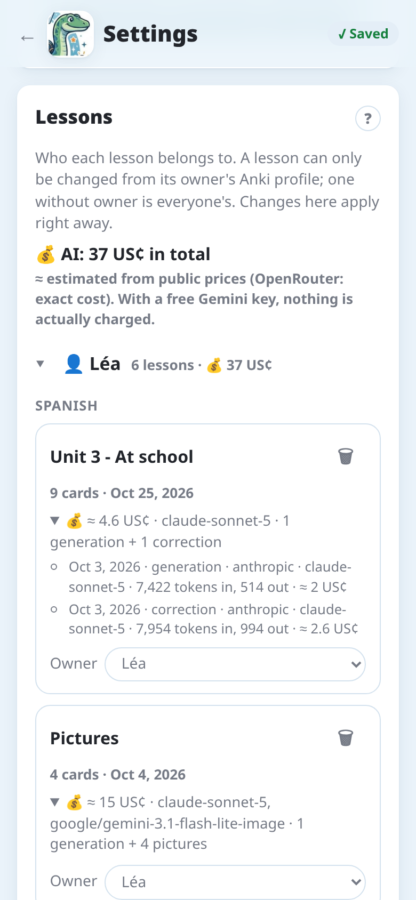

Notosaurus non ha un'IA propria: usa il servizio che scegli, con **la tua chiave**. Paghi il
servizio direttamente, per ciò che usi: nessun abbonamento.

## Le impostazioni

Sul computer, **Strumenti → Notosaurus → Impostazioni** le apre nel browser. Si aprono solo sul
computer stesso: un telefono non può cambiarle né vedere le chiavi. In autonomo o con Docker, la
pagina delle impostazioni (`/admin.html`) è raggiungibile dalla rete, protetta da una **🔐 Password
di amministrazione** creata alla prima visita.

Ciò che ha solo il computer:

- **Servizio di IA**, **Accesso** (le chiavi API) e **Modello**: vedi sotto.
- **Immagini sulle carte**: il **Servizio che le disegna** (quello delle carte quando sa
  disegnare: Gemini, OpenAI, OpenRouter; Claude e i modelli locali no) e il suo **Modello di
  immagini**, con **🖼️ Prova: disegna una giraffa**. Vedi [Tipi di carte](../card-types/#immagini).
- **📥 Invia direttamente ad Anki**: AnkiConnect, l'autonomo, e la sincronizzazione con AnkiWeb.
  Vedi [Inviare ad Anki](../send-to-anki/).
- **📱 Telefoni**: il codice QR che apre Notosaurus su un telefono e lo autorizza, e **Disconnetti
  tutti i telefoni**. Vedi [Sul telefono](../phone/) e [Privacy e sicurezza](../privacy/).
- **Lezioni**: a chi appartiene ogni lezione, quanto è costata, eliminarla (vedi
  [Quanto costa](#quanto-costa)).

**📝 Istruzioni per l'IA** e **Voci delle carte** sono anche nelle impostazioni dell'app Android:
vedi [Istruzioni](../instructions/#istruzioni-permanenti) e [Voci](../voices/).

## Quale servizio?

| Servizio | Per chi | Costo di una lezione |
|---|---|---|
| **Gemini** (Google) | il predefinito: veloce, economico, legge bene; un livello gratuito per provare | una frazione di centesimo |
| **Claude** (Anthropic) | tra le migliori letture della scrittura a mano, e il più veloce (Sonnet) | qualche centesimo |
| **OpenAI** (GPT) | se hai già un account OpenAI | qualche centesimo |
| **OpenRouter** | una chiave per Gemini, Claude, GPT, Mistral…; il costo esatto di ogni lezione | il prezzo del modello scelto |
| **Altro servizio compatibile con OpenAI** | un modello a casa (Ollama, LM Studio), o un altro servizio | gratis a casa |

Cambia servizio quando vuoi in **Impostazioni → Servizio di IA**: le lezioni già fatte restano
come sono.

## Ottenere una chiave

Crea la chiave sul sito del servizio, poi incollala in **Impostazioni → Accesso** e tocca
**🔌 Prova**: Notosaurus verifica che il modello legga un'immagine e risponda nel formato giusto.
La prima volta, la [procedura guidata](../getting-started/#2-la-procedura-guidata) fa lo stesso in
due passaggi.

### Gemini

1. Apri [aistudio.google.com/apikey](https://aistudio.google.com/apikey) e accedi con un account
   Google.
2. **Create API key**, poi copiala.
3. Il livello gratuito basta per provare Notosaurus, ma i suoi limiti sono bassi (qualche decina di
   richieste al giorno sui modelli migliori) e Google può usare ciò che invii per migliorare i suoi
   prodotti. Per i quaderni dei tuoi figli, attiva la fatturazione per il progetto della chiave in
   Google AI Studio: paghi allora una frazione di centesimo per lezione e, secondo le condizioni di
   Google, i tuoi dati non vengono usati per migliorare i suoi prodotti.

### Claude

1. Apri [console.anthropic.com](https://console.anthropic.com) e crea un account.
2. In **Billing**, aggiungi un po' di credito: pochi euro durano a lungo.
3. In **Settings → API keys**, **Create key**, poi copiala.

### OpenAI

1. Apri [platform.openai.com](https://platform.openai.com) e crea un account.
2. Aggiungi un po' di credito nelle impostazioni di fatturazione.
3. In **API keys**, crea una chiave segreta, poi copiala.

### OpenRouter

1. Apri [openrouter.ai](https://openrouter.ai) e accedi.
2. Compra crediti: OpenRouter aggiunge una piccola commissione a ogni acquisto, quindi meglio un
   acquisto da 15 $ o più che tanti piccoli.
3. In **Keys**, crea una chiave, poi copiala.

Una chiave OpenRouter dà accesso a Gemini, Claude, GPT e molti altri: comodo per confrontarli. Di
default, Notosaurus usa Gemini Flash tramite OpenRouter.

## Il modello

- **Notosaurus sceglie per te**: con il campo **Modello** vuoto, ogni servizio usa il suo
  predefinito, quello segnato con ⭐.
- **Consigliati, secondo i nostri test**, sotto **Modello**, elenca i modelli che consigliamo per
  quel servizio, dal miglior rapporto qualità/prezzo al più caro, con il costo di una lezione.
  Toccane uno per sceglierlo, o scrivi qualsiasi altro modello del servizio; con i servizi
  compatibili con OpenAI, **📋 Carica i modelli del servizio** elenca solo i modelli che accettano
  immagini.
- **Come li abbiamo scelti**, e i modelli da evitare: vedi [Quale modello?](../which-model/).

Gemini ha anche dei **modelli di riserva**, provati in ordine quando quello principale è
sovraccarico o non è incluso nel piano della chiave (una chiave gratuita non ha l'ultimo modello:
ne usa allora uno più vecchio).

## Un modello a casa

Con **Altro servizio compatibile con OpenAI**, Notosaurus può usare un modello che gira sul tuo
computer, con [Ollama](https://ollama.com) o [LM Studio](https://lmstudio.ai). L'indirizzo di solito
finisce con `/v1` (Ollama: `http://localhost:11434/v1`). Niente esce di casa e niente si paga, ma:

- il modello deve **accettare immagini** (un modello "vision"): **📋 Carica i modelli del
  servizio** li elenca;
- serve una **buona scheda grafica** (o un Mac recente con molta memoria);
- legge **la scrittura a mano molto meno bene** di Gemini o Claude;
- con Ollama, le correzioni richiedono un contesto più lungo di quello predefinito: imposta
  `OLLAMA_CONTEXT_LENGTH` (per esempio a 16384) prima di avviarlo.

## Quanto costa

**Impostazioni → Lezioni** mostra quanto è costata l'IA, in totale, per profilo e per lezione, con
ogni generazione, correzione e immagine.

Queste cifre sono stimate dai prezzi pubblici dei servizi (OpenRouter dà il costo esatto). Con una
chiave Gemini gratuita, in realtà non si paga nulla. Per esempio, la lezione di vocabolario di
queste schermate è costata circa 2 centesimi di dollaro da generare con Claude Sonnet, e altrettanto
per la sua correzione. Le immagini costano da meno di un centesimo a qualche centesimo ciascuna; le
figure, meno di un centesimo (disegnate in fretta, qualche secondo ciascuna, mentre rileggi le
carte). Una figura che ti lascia un dubbio: "🔍", sotto, la fa guardare all'IA; se trova qualcosa
di sbagliato, scegli se farla ridisegnare, indicandole l'errore: in fretta (qualche secondo), poi,
se è ancora sbagliata, con cura, con il ragionamento del modello (fino a un minuto).
