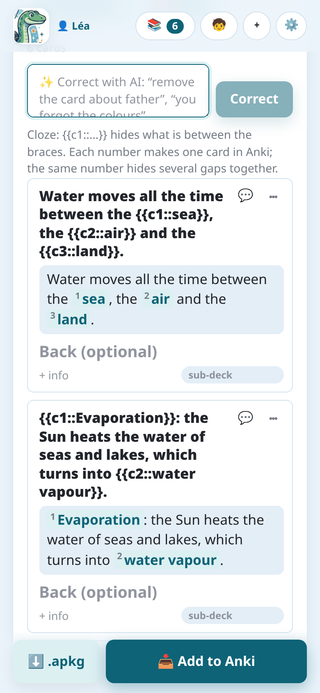
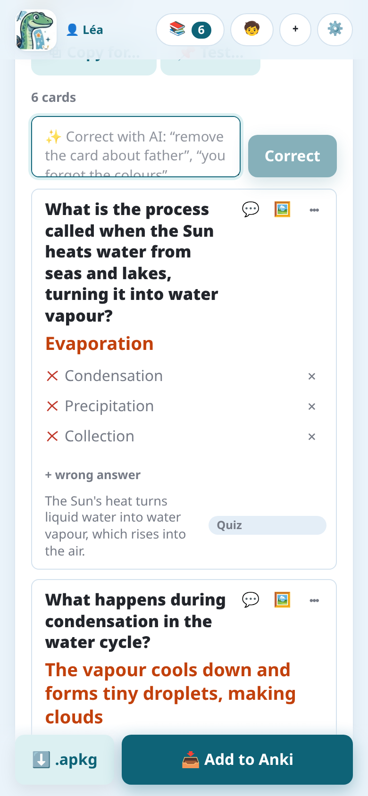
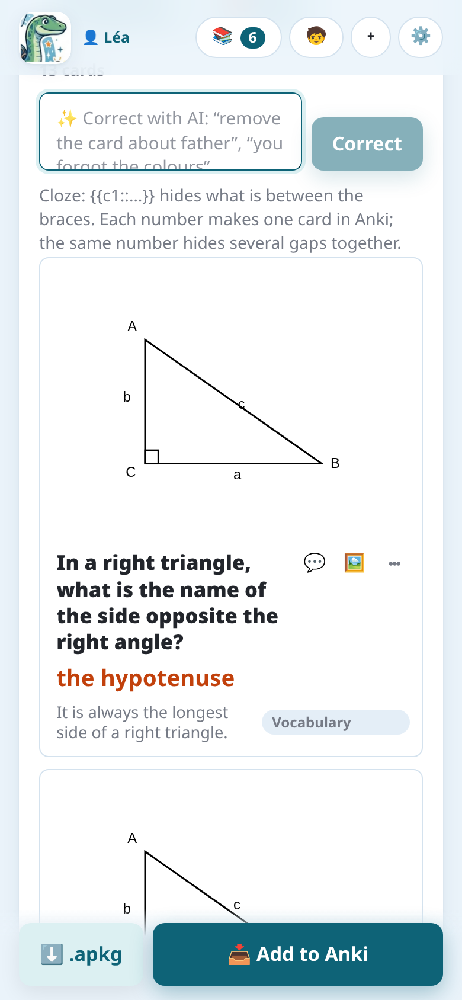
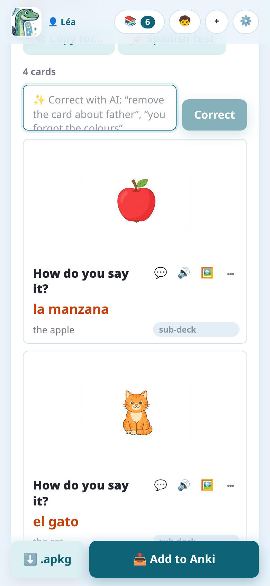
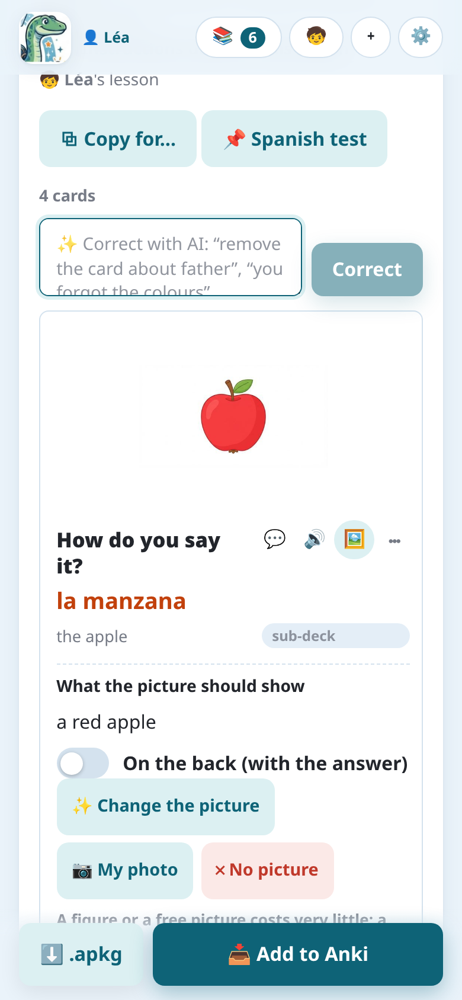

import { Tabs, TabItem } from '@astrojs/starlight/components';

Le istruzioni decidono che tipo di carte fa l'IA (vedi [Istruzioni](../instructions/)). Ogni tipo
diventa un proprio **tipo di nota** in Anki, il cui nome inizia con "Notosaurus".

## Domanda e risposta

La carta classica: un **fronte** (la domanda, una parola nella tua lingua) e un **retro** (la
risposta, la parola nella lingua studiata), con delle **info** facoltative sotto la risposta. È
ciò che fanno le istruzioni di lessico, frasi e domande.

Quando le istruzioni lo chiedono, Anki aggiunge la **carta inversa** (retro → fronte), fa
**scrivere** la risposta (confrontata lettera per lettera) o fa un **dettato** (ascoltare il
retro, scriverlo). Vedi [Istruzioni](../instructions/).

## Testo da completare

Le istruzioni **Testo da completare** fanno frasi con spazi vuoti:

> Il Sole scalda l'acqua dei mari e dei laghi: è l'`{{c1::evaporazione}}`.

Ciò che sta tra `{{c1::` e `}}` viene nascosto. **Ogni numero crea una carta** in Anki; lo stesso
numero usato due volte nasconde due spazi insieme. Nella revisione, gli spazi sono mostrati
numerati: puoi cambiarne il testo, aggiungerne o toglierne modificando le parentesi graffe.

## Scelta multipla e vero o falso

Le carte a **scelta multipla** hanno una domanda, la **risposta giusta** e delle **risposte
sbagliate** (tre plausibili): cambiale nella revisione, o aggiungine una con **+ risposta
sbagliata**. **Vero / falso** fa affermazioni, metà false con un errore preciso.

In Anki, la domanda mostra le opzioni (A, B, C…, sempre nello stesso ordine) e la risposta segna
quella giusta. È HTML semplice: appare uguale in ogni app di Anki.

## Schemi

Con le istruzioni **Schema o carta da completare**, l'IA trova ogni nome di uno schema e lo
nasconde dietro un numero. Ogni carta chiede "Che cos'è (2)?" e mostra la risposta sullo schema.

Nella revisione:

- trascina una **maschera rossa** per spostarla, e il suo **angolo rotondo** per ridimensionarla,
  così che nasconda tutto il nome;
- la **cornice tratteggiata** è la parte della foto che mostra Anki: trascina i suoi angoli blu
  per ritagliarla.

Gemini e GPT posizionano le maschere con più precisione. Con Claude, controlla che le maschere
nascondano tutto il nome sulla scrittura a mano.

## Formule

Le formule sono scritte in **MathJax**, che Anki visualizza: `\( \frac{a+b}{2} \)`, `\( x^2 \)`.
La revisione le mostra disegnate sotto il testo. I calcoli semplici restano testo.

## Figure

Per la geometria e le figure semplici con nomi (un triangolo rettangolo con la sua ipotenusa, un
cerchio con il suo raggio, un rettangolo con le sue misure), l'IA **disegna una figura esatta**
sulla carta, invece di un modello di immagini che disegnerebbe male testo e misure. La figura non
mostra mai la risposta. In ogni materia, anche una nozione che una figura rende più chiara ne
riceve una, soprattutto quando la pagina della lezione mostra una figura per essa (insiemi con
l'intersezione tratteggiata, una retta numerica, un grafico…): ridisegnata pulita sulla carta.

Il pulsante **Immagine** (🖼️) di una carta apre la sua figura: cambiane la descrizione e
ridisegnala, o spostala sul retro quando fa parte della risposta. Le istruzioni **Geometria (con
figure)** fanno questo tipo di carte, come **Automatico** e le istruzioni di formule quando
aiuta.

Le figure sono disegnate con [Typst](https://typst.app), ogni tipo con un pacchetto fatto apposta
(geometria, grafici di funzioni, insiemi, diagrammi, circuiti elettrici, chimica, linee del
tempo): una curva è calcolata dalla sua funzione, un segno sta sul suo segmento. Sotto la figura,
una riga dice cosa l'ha disegnata ("📐 Disegnata da gemini-… con Typst + ctz-euclide", ciascuno con
un link alla sua pagina). Una figura che ti lascia un dubbio: **🔍 Verifica la figura** la fa
guardare all'IA; se trova qualcosa di sbagliato, dice cosa, e scegli **Tienila** o
**📐 Ridisegnala** (poi, se serve, **📐 Ridisegnala con cura**).

## Immagini

Le istruzioni **Lingua: lessico per immagini** mettono un'immagine di ogni parola sul fronte,
trovata libera o disegnata da un modello di immagini.

<Tabs syncKey="mode">
<TabItem label="App Android">

Il servizio Notosaurus disegna le immagini: niente da scegliere. Un disegno costa crediti,
indicati prima di farlo.

</TabItem>
<TabItem label="Computer">

Un disegno costa da meno di un centesimo a qualche centesimo. Le immagini sono disegnate dal
servizio di IA delle carte quando sa disegnare (Gemini, OpenAI, OpenRouter), altrimenti da un
altro scelto in **Impostazioni → Immagini sulle carte** (Claude e i modelli locali non disegnano).
Quella sezione sceglie anche il modello di immagini, o **Nessuna immagine**:

- **Consigliati, secondo i nostri test** elenca i modelli di immagini che consigliamo per il
  servizio, con il costo di un'immagine; quello con ⭐ è il predefinito. Abbiamo confrontato i
  loro disegni a occhio: con OpenAI, GPT Image 2 (circa 0,6 centesimi di dollaro a immagine); con
  Gemini o OpenRouter, Gemini 3.1 Flash-Lite Image (circa 3 centesimi di dollaro).
- Il campo propone anche **tutti i modelli di immagini del servizio**, i nuovi compresi: scrivi
  per filtrarli.
- **🖼️ Prova: disegna una giraffa** disegna una vera immagine con il servizio e il modello scelti,
  e la mostra come farebbe una carta, con il tempo e il costo.

</TabItem>
</Tabs>

Il pulsante **Immagine** (🖼️) di una carta apre il suo pannello **Immagine**:

- **Cosa deve mostrare l'immagine**, nella tua lingua: vuoto, l'IA decide in base alla carta;
  oppure scrivi ciò che vuoi ("due insiemi che si intersecano, la loro unione tratteggiata", "una
  mela rossa");
- **✨ Immagine** (o **✨ Cambia l'immagine**) la fa, la soluzione più economica prima: una figura
  viene disegnata subito; per un'immagine si cercano immagini libere (se una va bene, va sulla
  carta; se ce ne sono diverse, tocchi quella giusta, quella con ⭐ è la scelta dell'IA); se
  nessuna va bene, Notosaurus chiede se farne disegnare una all'IA (**🎨 Disegna**): costa crediti
  nell'app, da meno di un centesimo a qualche centesimo di dollaro sul computer;
- **📷 La mia foto**: metti invece la tua foto, gratis;
- **✕ Nessuna immagine**: la toglie;
- **Sul retro (con la risposta)**: quando l'immagine svela la risposta.

### Immagini libere, trovate invece che disegnate

Per una cosa reale (una persona, un luogo, un monumento, un'opera d'arte, un animale, un cibo),
l'IA scrive, con la carta, qualche parola in inglese per cercarla ("Storming of the Bastille
painting", "dog"). Notosaurus cerca allora un'**immagine libera** prima di disegnarne una: una
foto o un dipinto di pubblico dominio o sotto CC0 (**Wikimedia Commons**, **Openverse**; nell'app
Android anche **Pixabay**), così non c'è niente da citare sulle carte. L'IA delle carte guarda le
immagini trovate e tiene quella giusta; se nessuna va bene, l'immagine viene disegnata. È gratis
(costa solo la scelta dell'IA: molto meno di un centesimo) ed esatto: il vero dipinto della presa
della Bastiglia, il vero ritratto di un presidente.

Le immagini trovate sono filtrate per gli alunni (niente contenuti per adulti).

Ogni carta tiene da dove viene la sua immagine: il suo pannello lo dice ("Fonte: Wikimedia
Commons · Pubblico dominio", con un link alla pagina dell'immagine; "Disegnata dall'IA"; "La tua
foto"). Sul computer, anche la nota Anki lo tiene, in un campo nascosto **Source**: non compare su
nessuna carta, ma segue il mazzo se lo condividi. Per una figura, nomina anche il modello e i
pacchetti Typst che l'hanno disegnata.
