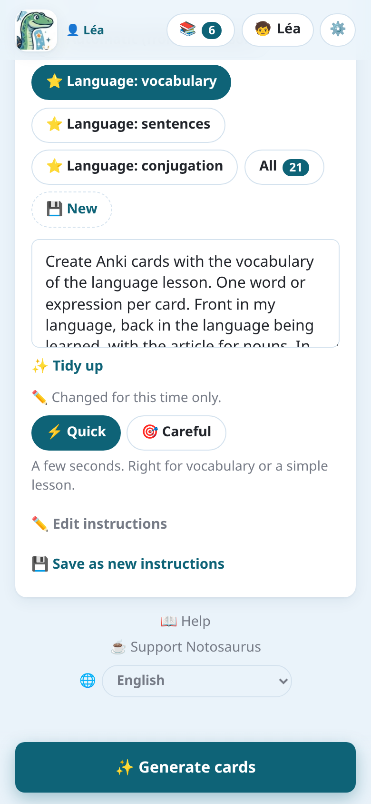

import { Tabs, TabItem } from '@astrojs/starlight/components';

Le **istruzioni** (o prompt) dicono all'IA cosa fare della lezione: quali carte, in che senso, in
quali lingue. La foto dice *cosa* imparare; le istruzioni dicono *come*.

## Scegliere le istruzioni

Sotto **Istruzioni**, le più recenti sono mostrate come pulsanti. **Tutte** apre l'elenco
completo, con una ricerca.

Il testo delle istruzioni scelte compare sotto i pulsanti. Puoi modificarlo **solo per questa
volta** ("Modificate solo per questa volta"), per esempio per aggiungere "solo i verbi": la tua
modifica resta con la lezione, le istruzioni salvate non cambiano. Nell'app, il pulsante
**Detta** (🎤) accanto al testo lo detta: di' ciò che vuoi, l'IA lo scrive.

**✨ Metti in ordine**, sotto il testo, fa riscrivere all'IA istruzioni scritte di fretta o
dettate: chiare e brevi, nella loro lingua, con ogni intenzione mantenuta (quante carte, quali
lingue e senso, che tipo di carte) e niente di aggiunto. **↩ Annulla** riporta il tuo testo,
finché non hai modificato quello riordinato. Non è proposto per le istruzioni di Notosaurus così
come sono: sono già in ordine.

## Veloce o accurato

**Creazione delle carte**, sotto le istruzioni, decide quanto ragiona l'IA:

- **⚡ Veloce** (predefinito): pochi secondi. Ideale per il vocabolario o una lezione semplice.
- **🎯 Accurato**: più lungo (fino a 30 s), più ragionato: per una lezione ricca (uno schema,
  matematica).

La scelta resta sul dispositivo. Una lezione fatta in modalità veloce lo dice nella revisione
("Create in modalità veloce."), con **🎯 Rifai in modalità accurata**.

## Le istruzioni di Notosaurus

Le istruzioni segnate con ⭐ arrivano con Notosaurus e migliorano a ogni versione. Non si possono
modificare, ma si possono **duplicare** per farne una tua versione.

| Istruzioni | Cosa fanno |
|---|---|
| Automatico (secondo la lezione) | L'IA guarda la lezione e sceglie le carte più utili. |
| Lingua: lessico | Una carta per parola o espressione, con articolo, genere e plurale nelle info; senza foto, da un elenco o da un argomento. |
| Lingua: frasi | Una carta per frase, nella tua lingua e nella lingua studiata. |
| Lingua: coniugazione | Un verbo, un tempo e una persona per carta; la forma coniugata sul retro. |
| Tabella da imparare | Una tabella da sapere a memoria (declinazione, verbi irregolari…): una carta per casella, o per riga quando ogni riga è una parola; la risposta scritta. |
| Domande / risposte | Domande brevi sul contenuto: date, definizioni, idee chiave. |
| Date e tappe | Una carta per data da ricordare (una linea del tempo, un riquadro): l'evento sul fronte, la data sul retro, il secolo nelle info; con la carta inversa, per impararla nei due sensi. |
| Definizioni e proprietà | Una carta per parola chiave da definire; per una proprietà o un teorema, il suo nome → l'enunciato completo ("Se …, allora …") e le ipotesi → la conclusione, l'inverso a parte, a cosa serve nelle info. |
| Riconoscere da un esempio | Una carta per esempio della lezione (una figura retorica, una parte del discorso…): l'esempio sul fronte, la nozione sul retro, la sua definizione nelle info. Mai un esempio inventato. |
| Testo da completare | Frasi con spazi vuoti (cloze): una carta per numero di spazio. |
| Quiz a risposta multipla | Una domanda, la risposta giusta e tre sbagliate plausibili. |
| Vero / falso | Affermazioni, metà false con un errore preciso. |
| Metodi (passaggi) | Una carta per abilità: "Come si …?", i passaggi sul retro. |
| Formule (matematica, fisica…) | Una carta per formula, con ciò che rappresenta ogni lettera. |
| Geometria (con figure) | Figure, proprietà e vocabolario, con una figura esatta disegnata sulle carte. |
| Schema o carta da completare | I nomi di uno schema o di una carta geografica nascosti dietro numeri: una carta per nome. |
| Lingua: lessico per immagini | L'immagine di ogni parola sul fronte (trovata o disegnata); la parola nella lingua studiata sul retro. |
| Parole da completare | Una carta per parola da scrivere: una frase senza la parola sul fronte, la parola sul retro (scritta), un consiglio di ortografia. |
| Dettato | Solo carte di dettato: le parole di cui imparare l'ortografia, e il testo del dettato frase per frase, ascoltato e poi scritto. |
| Dettato a buchi | Le parole più difficili del testo del dettato, una per carta: la sua frase con lo spazio vuoto, ascoltata, la parola scritta. |
| A memoria (poesia, recita) | Il testo copiato esattamente, letto ad alta voce: una carta titolo → primo verso, poi una carta per verso (sul fronte il titolo, il suo numero e i due versi precedenti, l'inizio di una strofa indicato). |

## Le tue istruzioni

**Nuove** crea istruzioni che userai di nuovo, per esempio per una lingua che tuo figlio studia
ogni settimana. **Duplica** parte da istruzioni di Notosaurus.

- **Nome**: ciò che mostra il pulsante.
- **Istruzioni**: ciò che l'IA deve fare, con parole semplici ("una carta per data, sul fronte
  l'evento, sul retro la data").
- **Nome del mazzo proposto**: il mazzo di Anki, con `::` per i sotto-mazzi. Le parti tra
  parentesi graffe vengono riempite dalla lezione: `Inglese::Lezione {n}` diventa
  `Inglese::Lezione 5`.

Anche come vengono chieste e ascoltate le carte si dice nel testo, e l'IA lo legge lì: "con la
risposta scritta" (Anki confronta lettera per lettera), "nei due sensi" (la carta inversa),
"letto ad alta voce", "con un dettato" (ascoltare il retro, scriverlo) o "solo dettato". I retro
in una lingua studiata vengono comunque letti ad alta voce, con la voce scelta per quella lingua
(vedi [Voci e audio](../voices/)).

**✏️ Libere** scrive istruzioni solo per questa volta: restano con la lezione ma non vengono
aggiunte al tuo elenco. **Salva come nuove istruzioni** le tiene se hanno funzionato bene.

## "Lo sapevi?"

L'IA aggiunge un fatto breve e noto alle carte dove si adatta (al massimo una su tre). Compare sul
retro in Anki.

## Aiuti sul retro

L'IA aggiunge, **solo sulle carte dove aiutano davvero**:

- **una spiegazione**: perché la risposta è la risposta, quando capire aiuta a ricordare (una
  causa in storia, una regola, una formula); mai per una parola semplice o una data isolata;
- **un modo per ricordarlo**: l'origine o la famiglia della parola (*ippopotamo*: "il cavallo di
  fiume"), un'immagine semplice, una filastrocca scolastica nota, una vera regola di ortografia.
  Mai uno inventato.

Così una lezione di storia riceve soprattutto spiegazioni, una di vocabolario qualche trucco per
ricordare e nessuna spiegazione. Compaiono sul retro in Anki, sotto le info (💬 e 🧠), e si possono
modificare o cancellare nella revisione. Sul computer aggiungono da 1 a 3 centesimi di dollaro a
una lezione con Claude Sonnet.

Entrambi sono attivi all'inizio, per ogni lezione: per toglierli, vedi
[Disattivarli](#disattivarli). Solo per certe istruzioni, dillo nel loro testo: "niente
curiosità", "niente aiuti".

## Immagini

L'IA aggiunge un'immagine alle carte dove aiuta davvero a ricordare, qualunque siano le
istruzioni: un'opera d'arte, una persona, un luogo, un monumento, un animale. Mai per una nozione
astratta, né su tutte le carte. Prima si cerca un'immagine libera; farne disegnare una all'IA viene
sempre chiesto. È attivo all'inizio (vedi [Disattivarli](#disattivarli)). Solo per certe
istruzioni, dillo nel loro testo: "niente immagini".

## Disattivarli

<Tabs syncKey="mode">
<TabItem label="App Android">

**Impostazioni** (⚙️) **→ 📝 Istruzioni per l'IA → 💬 Aiuti sul retro delle carte** disattiva gli
aiuti. I "Lo sapevi?" e le immagini non hanno un interruttore nell'app: dillo nel testo delle
istruzioni, o nelle istruzioni permanenti qui sotto.

</TabItem>
<TabItem label="Computer">

**Impostazioni → 📝 Istruzioni per l'IA** ha un interruttore per ciascuno: **💡 «Lo sapevi?» sulle
carte**, **💬 Aiuti sul retro delle carte** e **🖼️ Immagini sulle carte**.

</TabItem>
</Tabs>

## Istruzioni permanenti

Alcune istruzioni valgono per ogni lezione: "inglese britannico", "sempre l'articolo con i nomi".
Scrivile una volta nelle impostazioni: **Impostazioni** (⚙️) **→ 📝 Istruzioni per l'IA**
nell'app, **Impostazioni → 📝 Istruzioni per l'IA → Per tutti i bambini** sul computer. Quelle di
ogni figlio (la sua classe, "legge ancora lentamente") sono nella sua scheda, dal pulsante
**Figli** (🧒) della pagina principale: vedi
[Più figli](../several-children/#le-schede-dei-figli).
