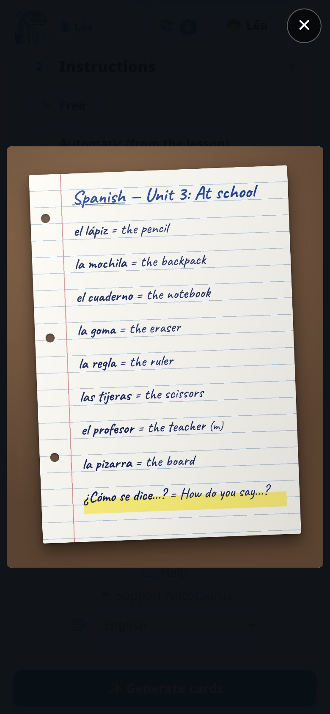
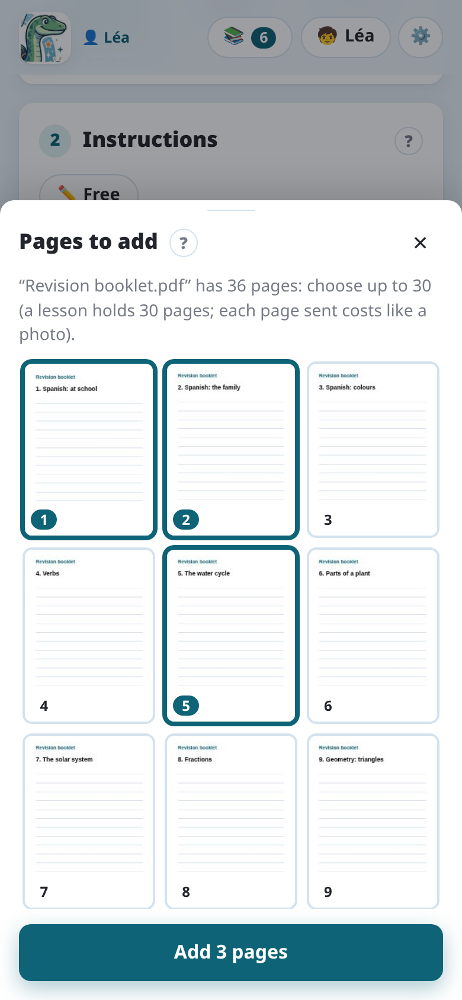

import { Tabs, TabItem } from '@astrojs/starlight/components';

L'IA legge ciò che vede: una foto nitida dà carte migliori, e meno correzioni.

## Consigli

- **Buona luce, niente ombre.** La luce del giorno vicino a una finestra è la migliore. Evita
  l'ombra del telefono e della mano sulla pagina.
- **La pagina piatta, che riempie la foto.** Tieni il telefono sopra la pagina, parallelo. Una
  leggera inclinazione va bene; una forte sfoca il lato lontano.
- **Una pagina per foto.** Per una doppia pagina, scatta due foto.
- **Nitida.** Tocca lo schermo per mettere a fuoco prima dello scatto, e resta fermo.
- **Solo la lezione.** Lascia fuori altre pagine, i disegni a margine e le correzioni che non
  fanno parte di ciò che va imparato, oppure di' all'IA cosa ignorare nelle istruzioni.

La scrittura a mano viene letta bene quando un adulto riesce a leggerla. Sul computer, dove
scegli l'IA, Claude la legge meglio; Gemini è una buona scelta, più economica.

## Più pagine

Una lezione può avere **fino a 30 pagine**. Dopo la prima foto, **Pagina successiva** ne aggiunge
un'altra; **Galleria** sceglie foto già scattate (JPEG, PNG, WebP o GIF). Su un computer puoi
anche trascinare foto o PDF da una cartella e rilasciarli su **Galleria** o **PDF**.

Nell'app Android, la fotocamera è uno **scanner di documenti** (quello di Google, dei servizi
Google Play): fotografa più pagine una dopo l'altra, poi tienile tutte in una volta. Ogni pagina
viene trovata nella foto, raddrizzata e ritagliata ai suoi bordi, con le ombre attenuate. L'app
non ha bisogno dell'autorizzazione per la fotocamera e riceve solo le pagine tenute. Su un telefono
senza servizi Google Play, o finché lo scanner non è pronto (si scarica in background dopo
l'installazione dell'app), la foto la scatta la fotocamera del telefono, una pagina alla volta.

Oltre 10 pagine, l'IA le legge 10 alla volta: le prime fanno la lezione, le successive la
completano, una dopo l'altra ("Pagine da 11 a 20 di 30…").

Su ogni foto, il suo numero e **Togli** (×): la foto esce dalla lezione (🖍️ sopra: una parte è
nascosta). Un tocco la mostra a schermo intero: scorri da una pagina all'altra, tocca di nuovo per
vederla a grandezza reale; da lì:

- **Ruota** (↻): di un quarto di giro;
- **Togli** (🗑️);
- **Ritaglia** (✂️): tiene solo la parte utile della pagina (vedi sotto);
- **Annerisci** (🖍️): nasconde una parte della pagina, un nome, prima dell'invio (vedi sotto).

Quando la lezione ha più pagine di quante ne stiano accanto ai pulsanti (due file), l'ultimo posto
mostra la pagina successiva velata con **+N**, il numero di pagine non mostrate: toccala per vedere
**Tutte le pagine**.
Lì, toccare una pagina la mostra in grande; **Seleziona** (o una pressione lunga su una pagina) permette
di scegliere delle pagine, poi **Togli** le toglie tutte dalla lezione in una volta.

Una pagina fotografata di lato (il telefono piatto sopra il tavolo) viene letta lo stesso e
conservata così com'è: **Ruota** (↻) la raddrizza, con le sue parti nascoste e la cornice dello
schema.

## Aggiungere una pagina più tardi

Il resto della lezione arriva qualche giorno dopo? Riapri la lezione dal pulsante **Lezioni**
(📚), aggiungi la foto della nuova pagina con **Pagina successiva**, poi tocca **➕ Aggiungi le
carte della nuova pagina**. L'IA legge solo le pagine nuove, sapendo quali carte esistono già: non
le rifà. Le nuove carte arrivano dopo le altre, segnate come "nuova" perché tu le controlli; le
altre non si spostano, e **🔄 Aggiorna in Anki** aggiunge solo le nuove (le altre conservano la
cronologia di ripasso). **✨ Genera di nuovo**, accanto, rifà tutta la lezione.

## PDF

**📄 PDF**, accanto alla fotocamera e alla galleria, aggiunge le pagine di un PDF: una scheda
mandata dall'insegnante, una pagina di un libro digitale, un fascicolo… Ogni pagina diventa una
foto della lezione, quindi tutto funziona come con le foto: schemi, correzioni, ogni servizio di
IA.

- **Un PDF creato al computer** (non una scansione) contiene anche il suo testo esatto:
  Notosaurus lo manda all'IA con la sua pagina, così nessuna parola, accento, data o numero viene
  letto male.
- **Più pagine di quante ne stiano nella lezione** (10 in tutto): Notosaurus le mostra tutte, e
  tocchi quelle da aggiungere.
- **Ogni pagina inviata costa come una foto**: scegli solo le pagine della lezione.
- **Un PDF protetto da password** va prima salvato senza password.

## Ritagliare, nascondere un nome

I due pulsanti, su una foto non ancora inviata, aprono lo stesso editor, **Prepara la foto**, nella
modalità che nominano: **Ritaglia** (✂️), **Annerisci** (⬛) e **Scopri** (◻️) passano dall'una
all'altra. **Fatto** tiene la foto così preparata: solo quella viene inviata e salvata. Finché la
foto non è inviata, puoi tornarci e cambiare tutto.

**Ritaglia** (✂️) tiene solo la parte utile della pagina: trascina gli angoli della cornice
(all'inizio copre tutta la foto), **Tieni tutto** la rimette su tutta la foto. Il resto non viene
inviato all'IA né conservato nella lezione. Ruotare la foto ruota la cornice con lei.

Una pagina di quaderno mostra spesso il nome del bambino, la classe, la scuola. Con **Annerisci**
(🖍️), il dito copre ciò che l'IA non deve vedere, nella parte tenuta; **Scopri** lo fa tornare.

Una pagina di PDF ritagliata o con una parte nascosta parte senza il suo testo (contiene anche ciò
che è lasciato fuori): l'IA legge la pagina come un'immagine.

## Cosa succede alle foto

<Tabs syncKey="mode">
<TabItem label="App Android">

- Le foto passano dal **servizio Notosaurus** a Gemini di Google, per leggerle, trattate
  sui server di Google (anche fuori dall'Unione europea) e lì non conservate. Vedi l'[informativa sulla privacy dell'app](../app-privacy/).
- Sono **salvate con la lezione** sul telefono, nella memoria privata dell'app.

</TabItem>
<TabItem label="Computer">

- Le foto sono inviate al **servizio di IA scelto nelle impostazioni**, per leggerle, e a
  nessun altro. Vedi [Privacy e sicurezza sul computer](../privacy/).
- Sono **salvate con la lezione** sul tuo computer.

</TabItem>
</Tabs>

- Salvate con la lezione, ti permettono di riaprirla, correggerla o rigenerarla più tardi.
  Eliminando la lezione, vengono eliminate.
- Le carte di uno schema tengono una **copia ritagliata** dello schema, con i nomi nascosti: è
  ciò che mostra Anki.

## Nessuna foto?

Senza foto, il pulsante grande in basso diventa **Genera solo dalle istruzioni** appena le
istruzioni dicono cosa imparare; le istruzioni di Notosaurus richiedono qualche parola tua.
Mettici le parole ("i 20 verbi irregolari: essere, avere, andare…"), oppure chiedi un argomento ("i pianeti
del sistema solare"). Controlla bene queste carte: non vengono dalla tua lezione.
