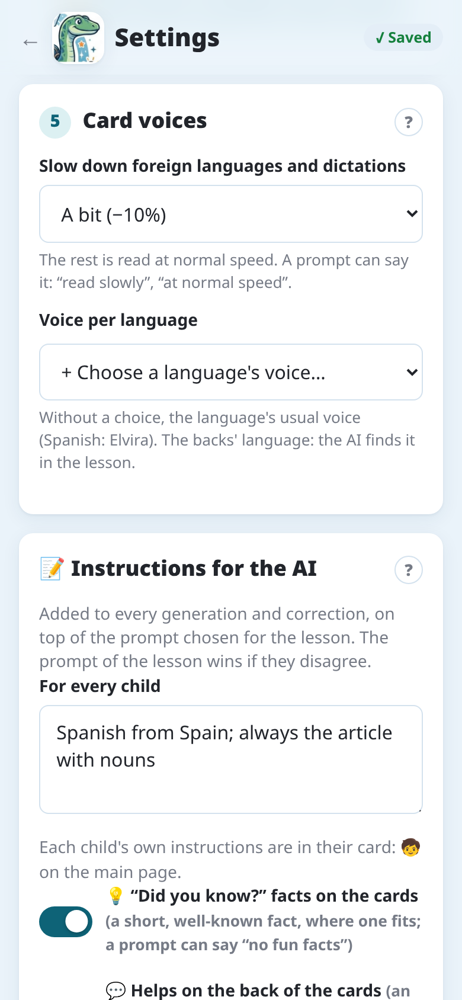

import { Tabs, TabItem } from '@astrojs/starlight/components';

Notosaurus può leggere ad alta voce il retro di ogni carta: utile per le lingue, per sentire la
pronuncia giusta. L'audio è **incluso nel mazzo**, quindi si sente in Anki ovunque, sul computer e
sul telefono, anche offline.

## Quali carte vengono lette ad alta voce

Notosaurus legge ad alta voce i retro **in una lingua studiata**: l'IA riconosce quella lingua
nella lezione (spagnolo di Spagna, inglese britannico…). Una lezione nella lingua dell'alunno
(storia, grammatica…) non ha audio, a meno che le sue carte servano a scrivere ciò che si sente
(una risposta scritta, un dettato) o che le sue istruzioni lo chiedano ("letto ad alta voce", come
fa **A memoria**). Le istruzioni di Notosaurus per domande, quiz, formule o schemi non hanno audio.

In fondo a una lezione, una riga dice quale voce legge i suoi retro.

## Scegliere la voce

Senza scelta, ogni lingua ha la sua voce abituale (sul computer: spagnolo → Elvira, inglese
britannico → Sonia…). Per preferirne un'altra: **Impostazioni → Voci delle carte → Voce per
lingua**, poi **+ Scegli la voce di una lingua…**: scegli la lingua, poi una delle sue voci,
femminile o maschile, e **Ascolta**. La scelta vale per le prossime lezioni in quella lingua. Le
impostazioni dell'app hanno la stessa sezione, con le sue voci.

## Ascoltare

Nella revisione, il pulsante **Ascolta il retro** (🔊) di una carta ne riproduce il retro con la
voce della lezione: controlla la pronuncia prima di inviare le carte.

## Velocità

Una lezione viene rallentata dove aiuta: i retro in una lingua studiata, e i dettati (il tempo di
scrivere). Una lezione nella lingua dell'alunno (storia, italiano…) viene letta a velocità
normale.

**Impostazioni → Voci delle carte → Rallentare le lingue straniere e i dettati**: **Molto
(−25%)**, **Un po' (−10%)** (predefinito) o **No**. Anche delle istruzioni possono dirlo, per le
loro lezioni: "leggi lentamente", "a velocità normale".

La velocità viene scelta quando la lezione è creata e resta con lei: i suoi suoni restano uguali,
anche se l'impostazione cambia dopo.

## Dettato

In una carta di dettato il retro si ascolta, poi si scrive. Le istruzioni **Dettato** e **Dettato
a buchi** fanno solo carte di questo tipo; per altre, dillo nel loro testo: "con un dettato" o
"solo dettato". **Automatico** fa carte di dettato quando la pagina è un dettato da preparare.
Vedi [Istruzioni](../instructions/).

## Carte senza audio

Creare l'audio richiede Internet:

<Tabs syncKey="mode">
<TabItem label="App Android">

Le voci sono quelle di Google, tramite il servizio Notosaurus. Vedi
l'[informativa sulla privacy dell'app](../app-privacy/) per ciò che viene inviato.

</TabItem>
<TabItem label="Computer">

Le voci vengono dal servizio di sintesi vocale di Microsoft, tramite
[edge-tts](https://github.com/rany2/edge-tts), uno strumento non ufficiale. Vedi
[Privacy e sicurezza sul computer](../privacy/) per ciò che viene inviato.

</TabItem>
</Tabs>

Se le voci non rispondono, le carte vengono inviate senza audio e il messaggio dice quante. Invia
di nuovo la lezione più tardi: l'audio mancante viene aggiunto.
