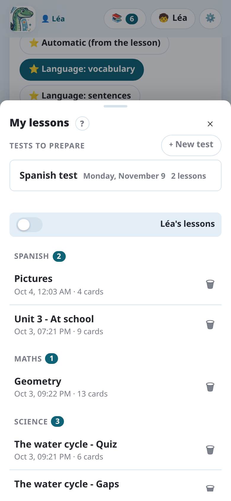

Each generation creates a **lesson**: its photos, its instructions and its cards, saved on the
computer. You can come back to it at any time to correct it, generate it again or send it to Anki
again.

## The list of lessons

**📚** at the top of the page opens **My lessons**: the lessons of the **Anki profile open**, the
most recent first.

- The lessons are **grouped by subject**: the first part of the deck name (`Spanish`,
  `Science`…), the subject worked on last first.
- **exported** marks a lesson already sent to Anki or downloaded; **shared**, a lesson shared
  with the other profiles.
- With many lessons (more than 8), a **search** appears (case and accents don't matter), the 3
  most recent lessons are shown first, and the subjects are folded, except the open lesson's. A
  subject opened or closed by hand stays so on that device.

Tap a lesson to reopen it: its photos and cards come back, ready to be corrected or sent again.
**+ New** starts a new lesson.

## Lessons and profiles

A lesson belongs to the profile open in Anki when it was made, and can be shared with the other
profiles. See [Several children](../several-children/).

## Tests to prepare

A test on Monday covers three lessons? **📌 Test…** in a lesson's review adds it to a test to
prepare (a name, a date), whole or **some of its cards only** (a tick on each card). The tests
are listed at the top of **Lessons**.

Every card of a test gets a tag in Anki, `Exam::<name>`, put on its notes right away when
they are in Anki, or with them when the lesson is sent. Anki's **custom study** then gathers
them, whatever their lessons: the test's sheet says how, on the computer and in AnkiDroid
(open the deck holding the lessons, **Custom study → Study by card state or tag**, tick the tag).
Once revised, the cards go back to their decks. Deleting a test takes the tag off; the cards stay.

On the computer with Anki open, **Revise now in Anki** does it in one click: a filtered deck
"Test: …" with the test's cards, opened in Anki, made again each time and deleted with the test.

In the app, **Open in AnkiDroid** opens the test's cards in AnkiDroid's browser, whatever their
decks; then **⋮ → Create filtered deck → Build** (over 100 cards, raise **Limit to** first).
AnkiDroid lets no other app make a filtered deck.

## Deleting a lesson

**🗑** next to a lesson deletes it, with its photos. If its cards are in Anki, Notosaurus looks
for them and offers to **delete them too**: their review history is then lost. Otherwise, the
cards already sent stay in Anki.

The lessons can also be managed from the computer, in **Settings → Lessons**: who each one
belongs to, whether it is shared, what it cost, and deleting it.
