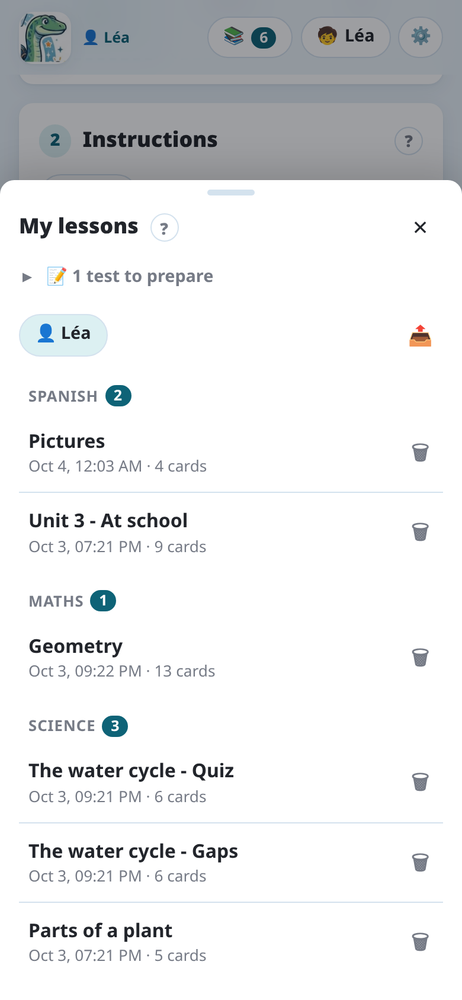

import { Tabs, TabItem } from '@astrojs/starlight/components';

Each generation creates a **lesson**: its photos, its instructions and its cards, saved where
Notosaurus runs (on the phone in the app, on the computer with the add-on). You can come back to it at any time to correct it, generate it again or send it to Anki
again.

## The list of lessons

The **Lessons** button (📚), at the top of the page, opens **My lessons** (up to the top of the
screen when there are many): the lessons of the **child chosen** (and, on the computer, of the
**Anki profile open**), the most recent first. One line of tools above them: the search, with
more than one child **👤 Paul** (tap it for **👥 All**: every child's lessons), and **📤** to
share lessons.

- The lessons are **grouped by subject**: the first part of the deck name (`Spanish`,
  `Science`…), the subject worked on last first.
- **exported** marks a lesson already sent to Anki or downloaded.
- With many lessons (more than 8), a **search** appears (case and accents don't matter), the 3
  most recent lessons are shown first, and the subjects are folded, except the open lesson's. A
  subject opened or closed by hand stays so on that device.

Tap a lesson to reopen it: its photos and cards come back, ready to be corrected or sent again.
**+ New** starts a new lesson.

## Lessons and children

A lesson is for the child chosen when it was made (the **Children** button, 🧒, at the top of the page) and, on the
computer, belongs to the profile open in Anki then. **⧉ Copy for…**, in its review, makes a copy
for another child, free. See [Several children](../several-children/).

## Tests to prepare

A test covers several lessons? Gather them, or some of their cards, and revise them together:
see [Preparing a test](../tests/). At the top of **My lessons**, a folded line tells of them
("📝 2 tests to prepare"): tapped, it shows them, with **＋ New test**.

## Sharing cards with another family

Another family has the same lesson (a classmate, a cousin)? Send them the cards in a file, which
they open with Anki or AnkiDroid:

- **several lessons**: in **My lessons**, **📤** (Share lessons), then tick the lessons, one by one
  or a whole subject, and **📤 Share**;
- **a test**: in its sheet, **📤 Share the test's cards** (see
  [Preparing a test](../tests/));
- **the open lesson**: **📤 Share**, next to **📥 Add to Anki**.

Neither your child's name nor their review history goes with the cards. The lessons' photos and
diagrams do go with them: check they can be shared.

<Tabs syncKey="mode">
<TabItem label="Android app">

**📤 Make the file** opens Android's share menu: send it by message, by email or to a drive.

</TabItem>
<TabItem label="Computer">

**📤 Make the file** downloads an `.apkg` file: send it by email or messaging.

</TabItem>
</Tabs>

## Deleting a lesson

The **Delete lesson** button (🗑), next to a lesson, deletes it, with its photos. If its cards are in Anki, Notosaurus looks
for them and offers to **delete them too**: their review history is then lost. Otherwise, the
cards already sent stay in Anki.

<Tabs syncKey="mode">
<TabItem label="Android app">

**Settings** (⚙️) → **🗂️ Lessons on this phone** says how many lessons the phone keeps and their size, and
**Delete all the lessons** deletes them all, with their sound. The cards already in AnkiDroid
stay, with their sound.

</TabItem>
<TabItem label="Computer">

The lessons can also be managed in **Settings → Lessons**: which Anki profile each one belongs
to (it can be changed there), what it cost, and deleting it.

</TabItem>
</Tabs>
