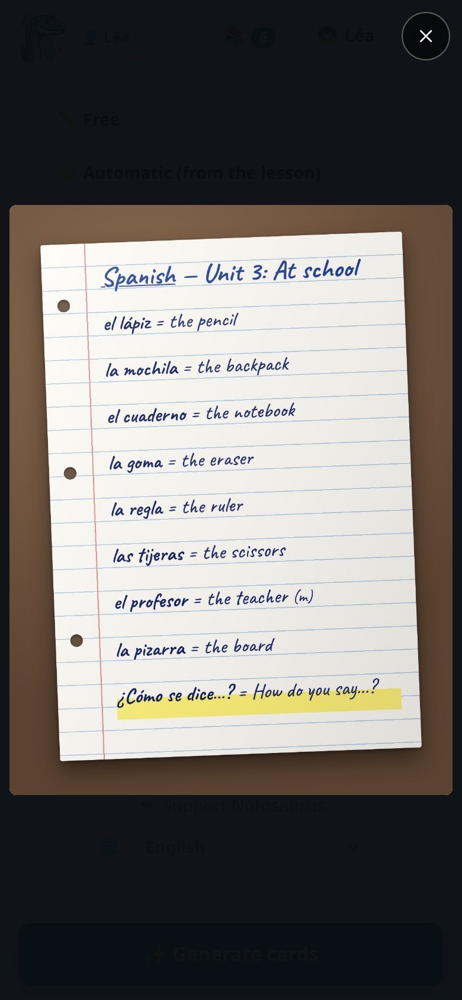
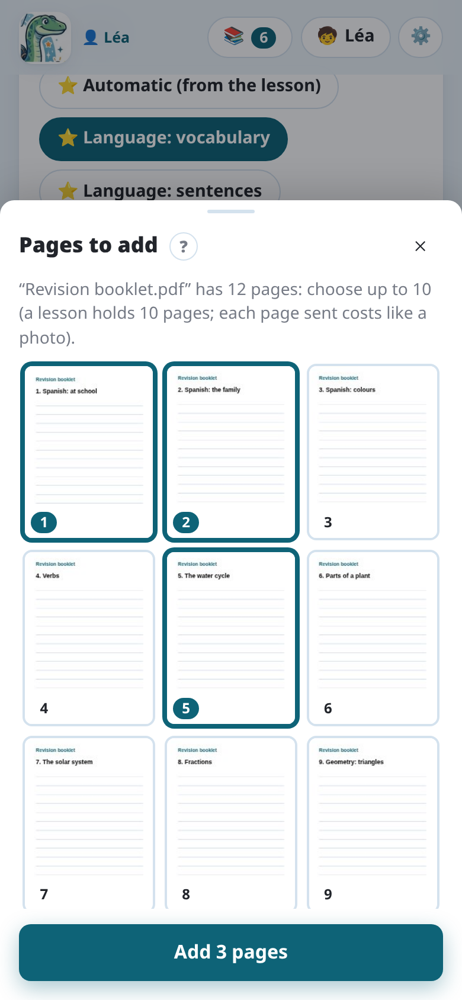

import { Tabs, TabItem } from '@astrojs/starlight/components';

The AI reads what it sees: a clear photo gives better cards, and fewer corrections.

## Tips

- **Good light, no shadow.** Daylight near a window is best. Avoid the shadow of the phone
  and of your hand on the page.
- **The page flat, filling the photo.** Hold the phone above the page, parallel to it. A
  slight angle is fine; a strong one blurs the far side.
- **One page per photo.** For a double page, take two photos.
- **Sharp.** Tap the screen to focus before taking the photo, and keep still.
- **Only the lesson.** Leave out other pages, drawings in the margin and corrections that
  aren't part of what must be learnt, or tell the AI what to ignore in the instructions.

Handwriting is read well when it is legible to an adult. On the computer, where you choose the
AI, Claude reads it best; Gemini is a good and cheaper choice.

## Several pages

A lesson can have **up to 10 pages**. After the first photo, **Next page** adds another one;
**Gallery** picks photos already taken (JPEG, PNG, WebP or GIF). On a computer, you can also drag
photos or PDFs from a folder and drop them on **Gallery** or **PDF**.

On each photo:

- **Turn** (↻): a quarter turn;
- **Remove** (×): the photo leaves the lesson;
- **Hide** (🖍️): hides part of the page before it is sent (see below);
- a tap shows it full screen: swipe between pages, tap again to see it at its real size.

You don't need to turn sideways photos yourself: Notosaurus finds how each page is turned
when it reads it, and saves it upright.

## Adding a page later

The rest of the lesson comes a few days later? Reopen the lesson from the **Lessons** button (📚), add the new page's photo
with **Next page**, then tap **➕ Add the new page's cards**. The AI reads only the new pages,
knowing which cards exist already: it doesn't make them again. The new cards come after the
others, marked "new" for you to check; the others don't move, and **🔄 Update in Anki** adds only
the new ones (the others keep their review history). **✨ Generate again**, next to it, remakes
the whole lesson.

## PDFs

**📄 PDF**, next to the camera and the gallery, adds the pages of a PDF: a worksheet sent by the
teacher, a page of a digital textbook, a booklet… Each page becomes a photo of the lesson, so
everything works as with photos: diagrams, corrections, every AI service.

- **A PDF made on a computer** (not a scan) also holds its exact text: Notosaurus sends it to the
  AI with its page, so no word, accent, date or number is misread.
- **More pages than the lesson has room for** (10 pages in all): Notosaurus shows them all, and
  you tap the ones to add.
- **Each page sent costs like a photo**: choose only the pages of the lesson.
- **A password-protected PDF** must first be saved without its password.

## Hiding a name or a school

A notebook page often shows the child's name, class, school. The **Hide** button (🖍️), on a photo not sent yet,
opens it in full: with your finger, **Black out** covers what the AI shouldn't see, **Un-black**
brings it back. **Done** keeps the blacked-out photo: it alone is sent and saved. Until the photo
is sent, you can come back to it and change what is hidden.

On a PDF page with a hidden part, its text isn't sent (it holds what is hidden too): the AI
reads the page as a picture.

## What happens to the photos

<Tabs syncKey="mode">
<TabItem label="Android app">

- The photos go through the **Notosaurus service** to Google's Gemini, to read them, processed in
  the European Union and not kept there. See the [app's privacy policy](../app-privacy/).
- They are **saved with the lesson** on the phone, in the app's private storage.

</TabItem>
<TabItem label="Computer">

- The photos are sent to the **AI service chosen in the settings**, to read them, and to
  nobody else. See [Privacy and security](../privacy/).
- They are **saved with the lesson** on your computer.

</TabItem>
</Tabs>

- Saved with the lesson, they let you reopen it, correct it or generate it again later. Deleting
  the lesson deletes them.
- Diagram cards keep a **cropped copy** of the diagram, with its labels hidden: that's what
  Anki shows.

## No photo?

Without a photo, **Generate from the prompt alone** creates the cards from the instructions:
put the words in them (“the 20 irregular verbs: be, have, go…”), or ask for a topic (“the
planets of the solar system”). Check those cards carefully: they don't come from your
lesson.
