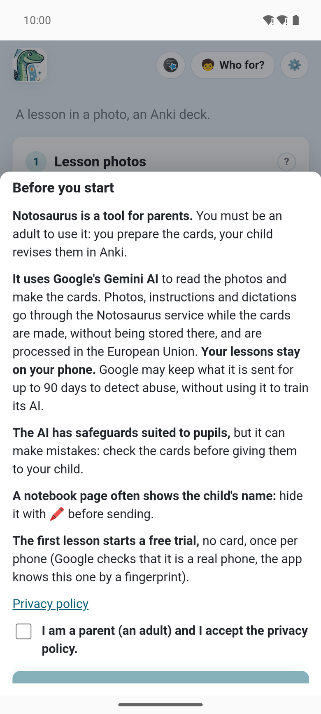
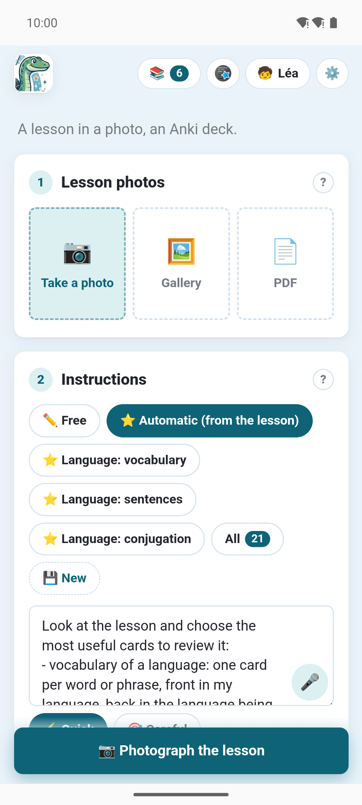
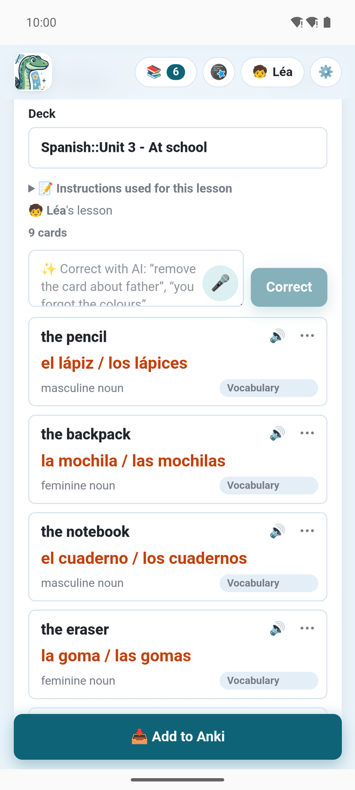

O **app Notosaurus para Android** faz os cartões no próprio celular: fotografe a lição, confira os
cartões, e eles vão direto para o **AnkiDroid**. Sem computador, sem chave de IA para conseguir.
Ele chega em breve ao Google Play.

É o mesmo Notosaurus do computador: a mesma página, instruções, tipos de cartão, revisão, filhos e
provas a preparar. Tudo o que está em [Fotos e PDFs](../photos/), [Instruções](../instructions/) e
[Revisar os cartões](../review/) funciona também no app.

## Do que você precisa

- **Um celular Android**, com o app instalado pelo **Google Play**.
- **O AnkiDroid**, o app gratuito do Anki para Android, para onde vão os cartões. Abra-o uma vez
  depois de instalar, para que ele crie a sua coleção (veja
  [O app e o AnkiDroid](../app-ankidroid/)).
- **Uma assinatura**, depois de um teste grátis que começa com a sua primeira lição (veja
  [A assinatura](../app-subscription/)). Com o complemento do Anki no seu computador, o app é
  gratuito (veja [Com o seu computador](../app-with-computer/)).

## Antes de começar

Na primeira abertura, o app diz em poucas linhas o que ele é e para onde vão as lições, depois
pede que você aceite a sua [política de privacidade](../app-privacy/):

- O Notosaurus é uma **ferramenta para pais**: você prepara os cartões, seu filho os revisa no
  Anki.
- Ele usa a **IA Gemini do Google**. As fotos, as instruções e os ditados passam pelo serviço
  Notosaurus enquanto os cartões são feitos, sem ficarem guardados lá, e são processados na União
  Europeia. Suas lições ficam no seu celular.
- A IA tem proteções adequadas para alunos, mas pode errar: confira os cartões antes de dá-los ao
  seu filho.
- Uma página de caderno muitas vezes mostra o nome da criança: oculte-o com o botão **Ocultar**
  (🖍️) antes de enviar (veja [Fotos e PDFs](../photos/)).

## Sua primeira lição

1. **🧒** no alto da página: adicione a ficha do seu filho (nome, série), para que os cartões
   combinem com o nível dele. Veja [Vários filhos](../several-children/).
2. Em **Fotos da lição**, tire uma foto da página (ou de várias páginas), ou adicione um PDF.
3. Em **Instruções**, escolha o que fazer, ou mantenha **Automático (conforme a lição)**: veja
   [Instruções](../instructions/). O botão **Ditar** (🎤) ao lado do campo deixa você falar em vez
   de digitar.
4. Toque em **✨ Gerar os cartões**. A primeira lição inicia o teste grátis.
5. Confira os cartões, corrija-os ou peça à IA com suas palavras: veja
   [Revisar os cartões](../review/). Um cartão que não está certo: **⋯ → ⚑ Denunciar** nele, cada
   relato é lido.
6. Toque em **📥 Adicionar ao Anki**: os cartões vão para o AnkiDroid. Na primeira vez, o
   AnkiDroid pergunta se o Notosaurus pode adicionar cartões a ele.

A lição fica no celular: reabra-a pelo botão **Lições** (📚) para corrigi-la e enviá-la de novo. Os
cartões dela são atualizados no AnkiDroid, não duplicados.

## Onde ele trabalha

O serviço Notosaurus faz o que precisa de uma IA: ler as fotos, fazer e corrigir os cartões,
explicar um, ler os versos em voz alta, desenhar uma imagem ou encontrar uma livre (Wikimedia
Commons, Openverse e Pixabay). Todo o resto acontece no celular: as lições ficam no armazenamento
privado do app, os cartões são escritos no AnkiDroid.

Nas configurações, **📍 Onde o Notosaurus trabalha?** escolhe **📱 Neste celular** (o padrão) ou
**💻 No meu computador**, com o complemento do Anki: veja
[Com o seu computador](../app-with-computer/).

## O que é só do app

Quase todo o Notosaurus é igual ao do computador. O que só o app tem, ou não tem:

- **🎤 Ditar**: falar uma instrução ou uma correção em vez de digitá-la. O app pede o microfone na
  primeira vez.
- **⚑ Denunciar**, em um cartão, diz ao Notosaurus o que deu errado: uma palavra mal lida, uma
  resposta errada, uma figura torta, uma imagem inadequada. Cada relato é lido e ajuda a corrigir
  o Notosaurus (veja [Relatar um problema](../review/#relatar-um-problema)).
- **As vozes** são as do Google, pelo serviço Notosaurus; as
  [configurações de voz](../voices/) são as mesmas.
- **Sem `.apkg`** e sem Ko-fi: os cartões vão direto para o AnkiDroid, e a assinatura paga o
  Notosaurus.
- **As atualizações** chegam pelo Google Play. Quando há uma versão nova, o app diz **Uma nova
  versão do Notosaurus está disponível.**, com um botão **Atualizar**.

Veja também [As configurações do app](../app-settings/) e, quando algo dá errado,
[Solução de problemas do app](../app-troubleshooting/).
