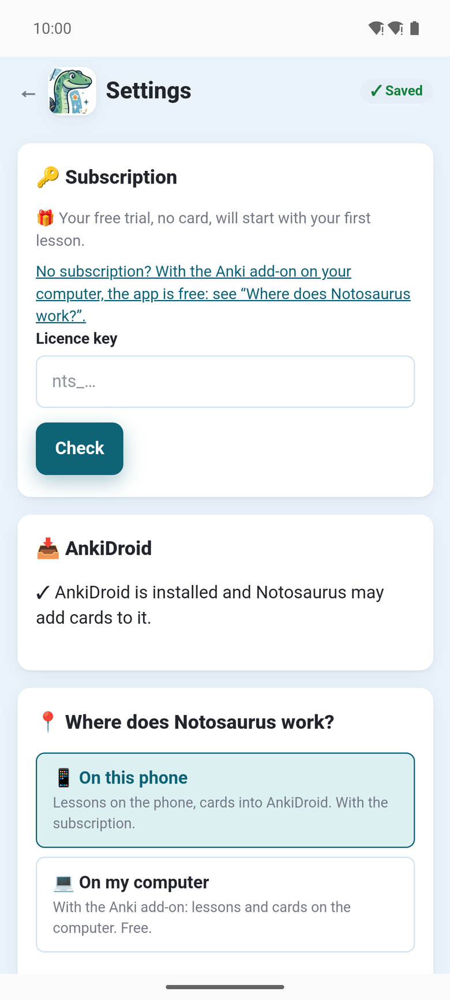

Neste celular (**📱 Neste celular**), o app funciona com uma assinatura, **mensal ou anual**, paga
pelo Google Play. Ela paga o que o serviço Notosaurus faz: a IA e as vozes. Os preços aparecem no
app, como o Google Play os informa.

Sem assinatura, o app é gratuito com o complemento do Anki no seu computador: veja
[Com o seu computador](../app-with-computer/).

## O teste grátis

**🎁 O teu teste grátis, sem cartão, começará com a tua primeira lição.** Nada para tocar: a
primeira lição que você faz o inicia. Ele dura **14 dias** e dá **300 créditos** (no máximo 150 por
dia): o bastante para experimentar o Notosaurus em várias lições (veja [Créditos](#créditos)).
Quando ele começa, o app diz quantos créditos dá e até quando.

- **Nenhum cartão** para informar, e nada para cancelar: no fim, o app pede que você assine para
  continuar.
- **Uma vez por celular.** O Google verifica que é o app instalado pelo Google Play, em um celular
  de verdade (Play Integrity), e o app reconhece este celular por uma impressão digital, nunca pelo
  identificador dele. Em um emulador, o teste não é oferecido.

## Assinar

Nas configurações, **🔑 Assinatura** oferece a assinatura mensal e a anual, com o preço. O Google
Play faz a cobrança; depois disso, o app diz **✓ Subscrito: boas revisões!**

**🔑 Assinatura** mostra então o plano, até quando está pago e quando é renovado.

## Créditos

A assinatura dá **3.000 créditos por mês** (no máximo 500 por dia); a anual, os créditos de um mês
no mesmo dia de cada mês. **🔑 Assinatura** mostra quantos restam neste mês e hoje, e quando são
renovados.

O que o serviço faz por você os consome: fazer e corrigir os cartões, explicar um, as vozes, as
imagens. Um crédito é um décimo de centavo de dólar do que a IA custa de verdade:

- uma lição de uma página com o Gemini: cerca de **10 créditos**, mais alguns para as vozes;
- uma correção ou uma explicação: alguns créditos;
- uma imagem desenhada: mais. Antes de desenhar uma, o app diz mais ou menos quantos créditos ela
  vai custar.

Quando não restam mais, eles voltam na próxima renovação. Esses números são os do serviço hoje; o
app sempre mostra os atuais.

## Em um celular novo, ou para alterá-la

- **Já tenho uma subscrição** a encontra na sua conta do Google, por exemplo em um celular novo:
  **✓ A tua subscrição foi encontrada nesta conta Google.** O celular precisa usar a conta do
  Google com a qual a assinatura foi feita.
- **Gerir a subscrição (Google Play)** abre a página do Google Play, para mudar o plano ou
  cancelá-la.
- **Chave de licença**: se o Notosaurus deu uma chave a você (`nts_…`), cole-a ali e toque em
  **Verificar**.

## Pagamento pendente

Quando o Google Play não conseguiu renovar a assinatura (um cartão vencido, por exemplo), o app diz
**Pagamento pendente**: atualize o seu método de pagamento no Google Play (**Gerir a
subscrição**). Assim que o Google Play o receber, a assinatura volta a ficar ativa: abra as
configurações de novo.

O que o serviço guarda sobre a sua assinatura: veja a [política de privacidade](../app-privacy/).
