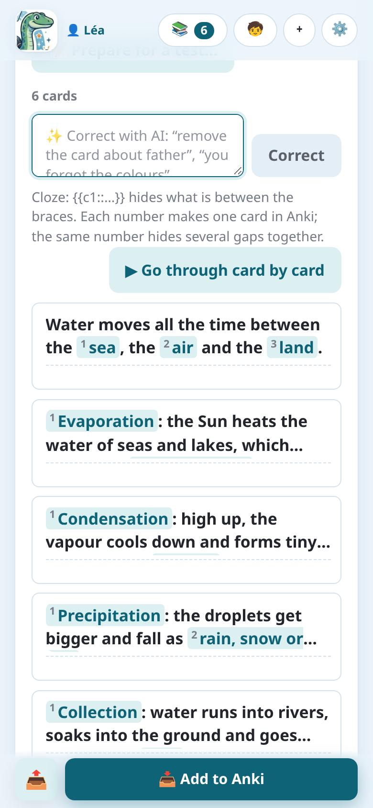
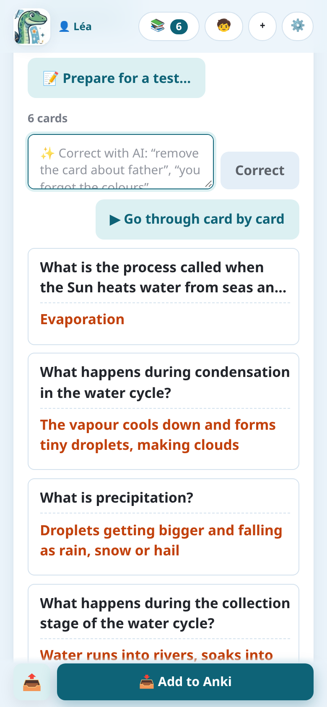
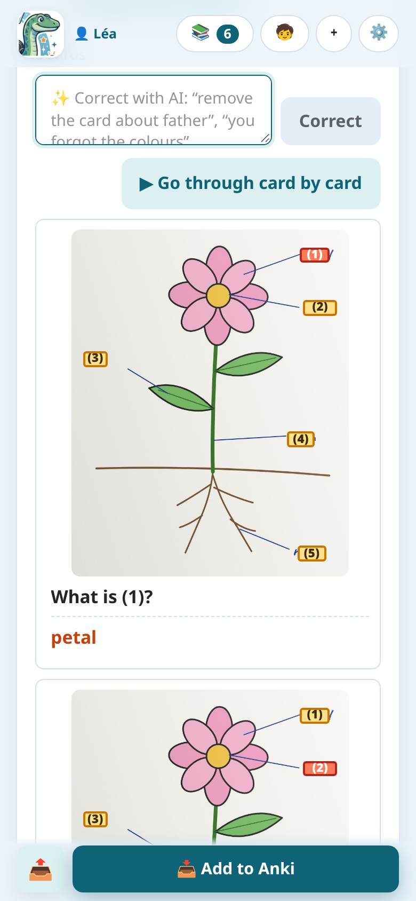
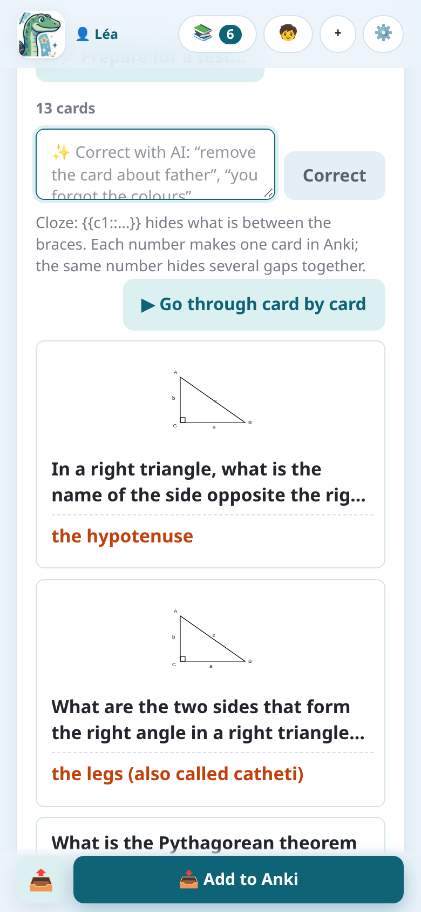
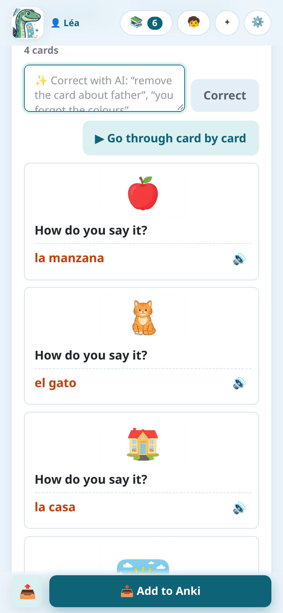
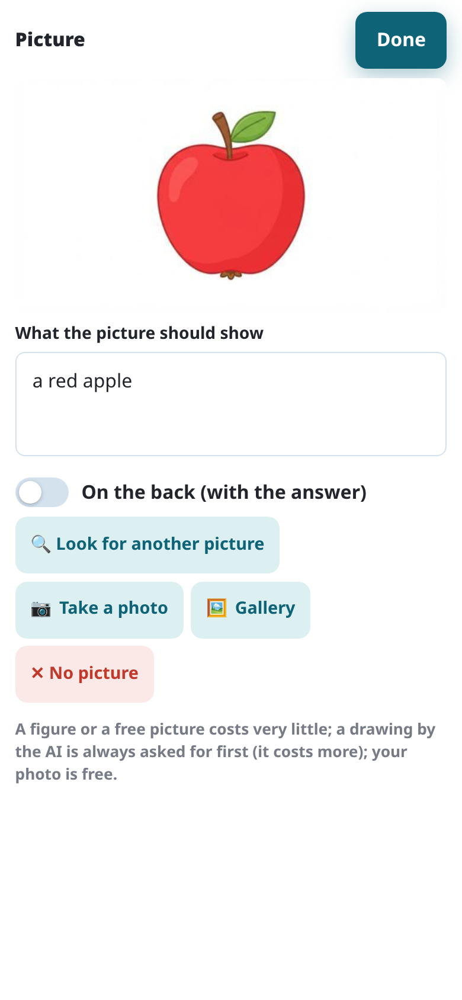

import { Tabs, TabItem } from '@astrojs/starlight/components';

As instruções decidem que tipo de cartões a IA faz (veja [Instruções](../instructions/)). Cada
tipo vira o seu próprio **tipo de nota** no Anki, cujo nome começa com "Notosaurus".

## Pergunta e resposta

O cartão clássico: uma **frente** (a pergunta, uma palavra no seu idioma) e um **verso** (a
resposta, a palavra no idioma estudado), com uma **info** opcional abaixo da resposta. É o que as
instruções de vocabulário, frases e perguntas fazem.

Quando as instruções pedem, o Anki acrescenta o **cartão invertido** (verso → frente), faz
**digitar** a resposta (comparada letra por letra) ou faz um **ditado** (ouvir o verso,
escrevê-lo). Veja [Instruções](../instructions/).

## Lacunas

As instruções **Complete as lacunas** fazem frases com lacunas:

> O Sol aquece a água dos mares e dos lagos: é a `{{c1::evaporação}}`.

O que está entre `{{c1::` e `}}` fica escondido. **Cada número cria um cartão** no Anki; o mesmo
número usado duas vezes esconde duas lacunas juntas. Na revisão, as lacunas aparecem numeradas:
você pode mudar o texto delas, acrescentar ou tirar lacunas editando as chaves.

## Múltipla escolha e verdadeiro ou falso

Os cartões de **múltipla escolha** têm uma pergunta, a **resposta certa** e **respostas erradas**
(três plausíveis): mude-as na revisão, ou acrescente uma com **+ resposta errada**.
**Verdadeiro / falso** faz afirmações, metade delas falsas com um erro preciso.

No Anki, a pergunta mostra as opções (A, B, C…, sempre na mesma ordem) e a resposta marca a
certa. É HTML simples: fica igual em todos os apps do Anki.

## Esquemas

Com as instruções **Esquema ou mapa para completar**, a IA encontra cada legenda de um esquema e
a esconde atrás de um número. Cada cartão pergunta "O que é (2)?" e mostra a resposta no esquema.

Na revisão:

- arraste uma **máscara vermelha** para movê-la, e o **canto redondo** dela para redimensioná-la,
  de modo que esconda a legenda inteira;
- a **moldura tracejada** é a parte da foto que o Anki mostra: arraste os cantos azuis dela para
  recortá-la.

O Gemini e o GPT posicionam as máscaras com mais precisão. Com o Claude, confira se as máscaras
escondem a legenda inteira na letra manuscrita.

## Fórmulas

As fórmulas são escritas em **MathJax**, que o Anki exibe: `\( \frac{a+b}{2} \)`, `\( x^2 \)`. As
fórmulas e as equações químicas são escritas como em química: `\( \ce{2H2 + O2 -> 2H2O} \)`.
Cálculos simples ficam como texto.

A revisão desenha as fórmulas abaixo do texto exatamente como o Anki e o AnkiDroid vão exibi-las
(o mesmo MathJax): o que o Anki não sabe exibir aparece em vermelho, aqui também.

## Figuras

Para uma figura com legendas, medidas ou valores (um triângulo retângulo com a hipotenusa, uma
curva, um circuito, uma molécula, um mapa), a IA **desenha uma figura exata** no cartão, em vez
de um modelo de imagens que desenharia mal o texto e as medidas. A figura nunca mostra a
resposta. Em qualquer matéria, uma noção que uma figura deixa mais clara também ganha uma,
sobretudo quando a página da lição mostra uma figura para ela (conjuntos com a interseção
hachurada, uma reta numérica, um gráfico…): redesenhada limpa no cartão.

Toque na figura de um cartão aberto e a página **Imagem** dele se abre: mude a descrição e
desenhe de novo, ou passe-a para o verso quando ela faz parte da resposta. As instruções **Geometria (com figuras)**
fazem esse tipo de cartão, assim como **Automático** e as instruções de fórmulas quando ajuda.

As figuras são desenhadas com o [Typst](https://typst.app), cada tipo com um pacote feito para
ele:

- **matemática**: geometria (e suas sombras, os eclipses), gráficos de funções e pontos em um
  plano cartesiano, retas numéricas, frações em uma forma, conjuntos e diagramas de Venn, árvores
  de probabilidade e grafos, sólidos em perspectiva, tabelas de valores, relógios;
- **física e química**: circuitos elétricos, moléculas (fórmulas estruturais, estruturas de
  Lewis, polaridade), cristais, refração e lentes, forças e cronofotografias, linhas de campo de
  um ímã ou de cargas;
- **biologia**: sequências de DNA e de proteínas comparadas, árvores filogenéticas;
- **história e geografia**: linhas do tempo, mapas (veja mais abaixo);
- **e também**: gráficos estatísticos (barras, pizza, curvas de medições, histogramas, nuvens de
  pontos com a sua reta de ajuste, boxplots, pirâmides etárias), diagramas de caixas e flechas,
  scripts do Scratch.

O que pode ser calculado é calculado, nunca posicionado a olho: uma curva a partir da sua função,
uma marca no seu segmento, os ponteiros de um relógio a partir da hora, um raio refratado a
partir dos índices.
Abaixo da figura, uma linha diz o que a desenhou ("📐 Desenhada por gemini-… com Typst +
ctz-euclide", cada um com um link para a sua página). Ficou em dúvida sobre uma figura?
**🔍 Verificar a figura** faz a IA olhar para ela; se encontrar algo errado, ela diz o quê, e você
escolhe **Manter** ou **📐 Redesenhar** (depois, se preciso, **📐 Redesenhar com cuidado**).

### Os mapas de geografia e história

Os mapas vêm de um atlas feito para o Notosaurus: a IA só fornece os nomes, nunca um contorno nem
uma posição. Eles mostram:

- **países, cidades, regiões**, rios, relevos, mares, estreitos e canais, nomeados no idioma da
  lição;
- **países ou regiões coloridos por grupo**, com uma legenda: as alianças de 1914, as ampliações
  da União Europeia, os blocos da Guerra Fria;
- **trajetos e fluxos**: as viagens de Colombo ou de Magalhães, uma rota marítima por Suez e
  Malaca, migrações em flechas, traçados pelo mar contornando as terras;
- **as fronteiras de um ano passado**, de 1815 a 1991: a Europa do Congresso de Viena, a
  Áustria-Hungria, a Europa de 1942, a URSS e as duas Alemanhas, um império colonial inteiro com
  as suas colônias (fronteiras do [OpenHistoricalMap](https://www.openhistoricalmap.org/),
  completadas pelo [historical-basemaps](https://github.com/aourednik/historical-basemaps));
- **as regiões polares vistas de cima do polo**: o Ártico e suas rotas marítimas, a Antártica.

## Imagens

As instruções **Idioma: vocabulário em imagens** põem uma imagem de cada palavra na frente,
encontrada livre ou desenhada por um modelo de imagens.

<Tabs syncKey="mode">
<TabItem label="App Android">

O serviço Notosaurus desenha as imagens: nada a escolher. Um desenho custa créditos, informados
antes de ser feito.

</TabItem>
<TabItem label="Computador">

Um desenho custa de menos de um centavo a alguns centavos. As imagens são desenhadas pelo serviço
de IA dos cartões quando ele sabe desenhar (Gemini, OpenAI, OpenRouter); senão, por outro
escolhido em **Configurações → Imagens nos cartões** (o Claude e os modelos locais não desenham).
Essa seção também escolhe o modelo de imagem, ou **Sem imagens**:

- **Recomendados, segundo nossos testes** lista os modelos de imagem que aconselhamos para o
  serviço, com o custo de uma imagem; o de ⭐ é o padrão. Comparamos os desenhos deles a olho:
  com a OpenAI, GPT Image 2 (cerca de 0,6 centavo de dólar por imagem); com o Gemini ou o
  OpenRouter, Gemini 3.1 Flash-Lite Image (cerca de 3 centavos de dólar).
- O campo também oferece **todos os modelos de imagem do serviço**, inclusive os novos: digite
  para filtrá-los.
- **🖼️ Testar: desenhar uma girafa** desenha uma imagem de verdade com o serviço e o modelo
  escolhidos, e a mostra como um cartão faria, com o tempo e o custo.

</TabItem>
</Tabs>

Toque na imagem de um cartão aberto e a página **Imagem** dele se abre em tela cheia (um cartão
sem imagem: ⋯ → **🖼️ Adicionar uma imagem**); **Concluído** volta ao cartão:

- **O que a imagem deve mostrar**, no seu idioma: vazio, a IA decide pelo cartão; ou escreva o que
  você quer ("dois conjuntos que se cruzam, a união hachurada", "uma maçã vermelha");
- **✨ Imagem** (ou **✨ Trocar a imagem**) a faz, o mais barato primeiro: uma figura é desenhada
  na hora; para uma imagem, procuram-se imagens livres (se uma serve, vai para o cartão; se há
  várias, você toca na certa, a de ⭐ é a escolha da IA); se nenhuma serve, o Notosaurus pergunta se
  a IA deve desenhar uma (**🎨 Desenhar**): custa créditos no app, de menos de um centavo a
  alguns centavos de dólar no computador;
- **📷 Tirar uma foto** ou **🖼️ Galeria**: põe a sua própria foto no lugar, tirada na hora ou escolhida, de graça;
- **✕ Sem imagem**: a retira;
- **No verso (com a resposta)**: quando a imagem entrega a resposta.

### Imagens livres, encontradas em vez de desenhadas

Para uma coisa real (uma pessoa, um lugar, um monumento, uma obra de arte, um animal, um
alimento), a IA escreve, com o cartão, algumas palavras em inglês para procurá-la ("Storming of
the Bastille painting", "dog"). O Notosaurus procura então uma **imagem livre** antes de desenhar
uma: uma foto ou uma pintura em domínio público ou sob CC0 (**Wikimedia Commons**,
**Openverse**; no app Android, também o **Pixabay**), então não há nada a creditar nos cartões. A
IA dos cartões olha as imagens encontradas e fica com a que serve; se nenhuma serve, a imagem é
desenhada. É grátis (só a escolha da IA custa: bem menos de um centavo) e exato: a pintura real da
tomada da Bastilha, o retrato real de um presidente.

As imagens encontradas vêm filtradas para alunos (sem conteúdo adulto).

Cada cartão guarda de onde vem a sua imagem: o painel dele diz ("Fonte: Wikimedia Commons ·
Domínio público", com um link para a página da imagem; "Desenhada pela IA"; "Sua foto"). No
computador, a nota do Anki também guarda isso, em um campo oculto **Source**: ele não aparece em
nenhum cartão, mas vai junto com o baralho se você o compartilhar. Para uma figura, ele também
nomeia o modelo e os pacotes do Typst que a desenharam.
