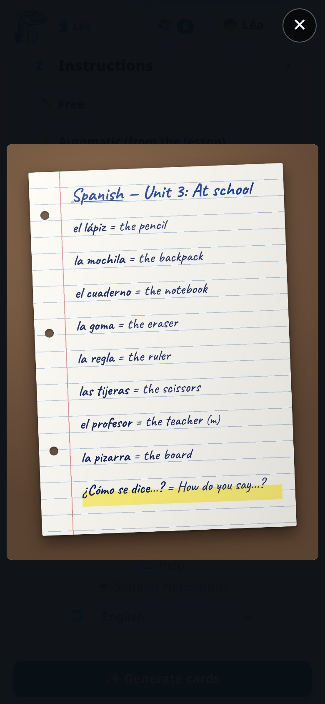
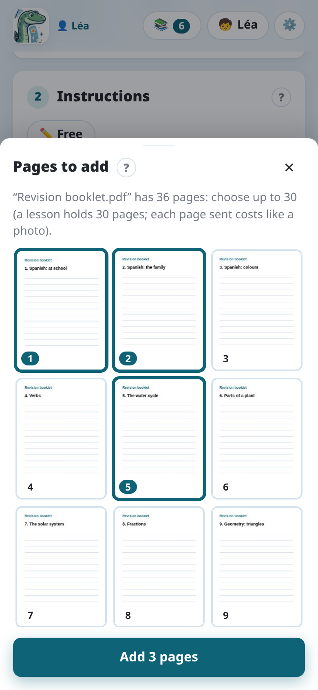

import { Tabs, TabItem } from '@astrojs/starlight/components';

A IA lê o que vê: uma foto nítida dá cartões melhores, e menos correções.

## Dicas

- **Boa luz, sem sombra.** A luz do dia perto de uma janela é a melhor. Evite a sombra do
  celular e da sua mão sobre a página.
- **A página plana, ocupando a foto.** Segure o celular acima da página, paralelo a ela. Um leve
  ângulo não tem problema; um forte desfoca o lado de longe.
- **Uma página por foto.** Para uma página dupla, tire duas fotos.
- **Nítida.** Toque na tela para focar antes de tirar a foto, e não se mexa.
- **Só a lição.** Deixe de fora outras páginas, desenhos na margem e correções que não fazem
  parte do que deve ser aprendido, ou diga à IA o que ignorar nas instruções.

A letra manuscrita é bem lida quando um adulto consegue lê-la. No computador, onde você escolhe
a IA, o Claude a lê melhor; o Gemini é uma boa escolha, mais barata.

## Várias páginas

Uma lição pode ter **até 30 páginas**. Depois da primeira foto, **Próxima página** adiciona
outra; **Galeria** escolhe fotos já tiradas (JPEG, PNG, WebP ou GIF). Em um computador, você
também pode arrastar fotos ou PDFs de uma pasta e soltá-los em **Galeria** ou **PDF**.

No app Android, a câmera é um **scanner de documentos** (o do Google, dos serviços do Google
Play): fotografe várias páginas uma depois da outra e depois mantenha todas de uma vez. Cada página
é encontrada na foto, endireitada e recortada nas bordas, com as sombras suavizadas. O app não
precisa da permissão da câmera e recebe só as páginas mantidas. Em um celular sem os serviços do
Google Play, ou enquanto o scanner não está pronto (ele é baixado em segundo plano depois que o app
é instalado), a câmera do celular tira a foto, uma página por vez.

No app Android, você também pode partir de outro app (a galeria, os arquivos, uma mensagem, um
e-mail): **Compartilhar → Notosaurus** em fotos, um PDF ou um texto faz delas as páginas de uma
lição, prontas para **✨ Gerar os cartões**. O endereço de uma página da web, por si só, não
basta: compartilhe uma captura de tela, ou a página salva em PDF pelo Chrome. (Quando o app
trabalha [com o seu computador](../app-with-computer/), adicione o arquivo pela página, em vez
disso.)

Além de 10 páginas, a IA as lê de 10 em 10: as primeiras fazem a lição, as seguintes a
completam, uma após a outra ("Páginas 11 a 20 de 30…").

Em cada foto, seu número e **Remover** (×): a foto sai da lição (🖍️ sobre ela: uma parte está
oculta). Um toque a mostra em tela cheia: deslize para passar de uma página a outra; afaste dois
dedos para dar zoom, mova-a com um dedo, ou toque nela para dar zoom no ponto tocado; dali:

- **Girar** (↻): um quarto de volta;
- **Remover** (🗑️);
- **Recortar** (o ícone de recorte, dois esquadros): mantém só a parte útil da página (veja
  abaixo);
- **Tapar** (🖍️): oculta parte da página, um nome, antes de ela ser enviada (veja abaixo).

Depois que a página é recortada, um ponto avisa isso no canto de **Recortar**; depois que uma
parte é ocultada, no canto de **Tapar**.

Quando a lição tem mais páginas do que cabem ao lado dos botões (duas fileiras), o último lugar
mostra a página seguinte velada com **+N**, o número de páginas não mostradas: toque nela para ver
**Todas as páginas**.
Ali, tocar numa página a mostra em tamanho grande; **Selecionar** (ou um toque longo numa página)
permite escolher páginas, e **Remover** tira todas da lição de uma vez.

Uma página fotografada de lado (o celular deitado sobre a mesa) é lida mesmo assim e guardada como
foi tirada: **Girar** (↻) a coloca em pé, com suas partes ocultas e a moldura do esquema.

## Adicionar uma página depois

O resto da lição chega alguns dias depois? Reabra a lição pelo botão **Lições** (📚), adicione a
foto da nova página com **Próxima página** e toque em **➕ Adicionar os cartões da nova página**.
A IA lê só as páginas novas, sabendo quais cartões já existem: ela não os faz de novo. Os cartões
novos vêm depois dos outros, marcados como "novo" para você conferir; os outros não mudam de
lugar, e **🔄 Atualizar no Anki** adiciona só os novos (os outros mantêm o histórico de revisão).
**✨ Gerar de novo**, ao lado, refaz a lição inteira.

## PDFs

**📄 PDF**, ao lado da câmera e da galeria, adiciona as páginas de um PDF: uma folha de
exercícios enviada pelo professor, uma página de um livro digital, uma apostila… Cada página vira
uma foto da lição, então tudo funciona como com as fotos: esquemas, correções, qualquer serviço
de IA.

- **Um PDF feito em um computador** (não digitalizado) também traz o texto exato: o Notosaurus o
  envia à IA com a página, para que nenhuma palavra, acento, data ou número seja lido errado.
- **Mais páginas do que cabem na lição** (10 no total): o Notosaurus mostra todas, e você toca nas
  que quer adicionar.
- **Cada página enviada custa como uma foto**: escolha só as páginas da lição.
- **Um PDF protegido por senha** precisa antes ser salvo sem a senha.

## Recortar, ocultar um nome

Os dois botões, em uma foto ainda não enviada, abrem o mesmo editor, **Preparar a foto**, no modo
que nomeiam: **Recortar**, **Tapar** (⬛) e **Destapar** (◻️) passam de um para o outro.
**Concluído** fica com a foto assim preparada: só ela é enviada e salva. Até a foto ser enviada,
você pode voltar a ela e mudar tudo.

**Recortar** mantém só a parte útil da página: arraste os cantos da moldura (no início ela
cobre a foto inteira), **Manter tudo** a coloca de novo sobre a foto inteira. O resto não é enviado
à IA nem guardado na lição. Girar a foto gira a moldura junto.

Uma página de caderno muitas vezes mostra o nome da criança, a série, a escola. Com **Tapar** (🖍️),
o dedo cobre o que a IA não deve ver, dentro da parte mantida; **Destapar** traz de volta.

Uma página de PDF recortada ou com uma parte oculta vai sem o texto dela (ele contém também o que
fica de fora): a IA lê a página como uma imagem.

## O que acontece com as fotos

<Tabs syncKey="mode">
<TabItem label="App Android">

- As fotos passam pelo **serviço Notosaurus** até o Gemini do Google, para serem lidas,
  processadas nos servidores do Google (fora da União Europeia também) e não guardadas lá. Veja a
  [política de privacidade do app](../app-privacy/).
- Elas são **salvas com a lição** no celular, no armazenamento privado do app.

</TabItem>
<TabItem label="Computador">

- As fotos são enviadas ao **serviço de IA escolhido nas configurações**, para serem lidas, e a
  mais ninguém. Veja [Privacidade e segurança no computador](../privacy/).
- Elas são **salvas com a lição** no seu computador.

</TabItem>
</Tabs>

- Salvas com a lição, elas permitem reabri-la, corrigi-la ou gerá-la de novo mais tarde. Excluir
  a lição as exclui.
- Os cartões de esquema guardam uma **cópia recortada** do esquema, com as legendas ocultas: é o
  que o Anki mostra.

## Sem foto?

Sem foto, o botão grande de baixo vira **Gerar só com as instruções** assim que as instruções
dizem o que aprender; as instruções do Notosaurus precisam de algumas palavras suas. Coloque as
palavras nelas ("os 20 verbos irregulares: ser, ter, ir…"), ou peça um tema ("os planetas do
sistema solar"). Confira bem esses cartões: eles não vêm da sua lição.
