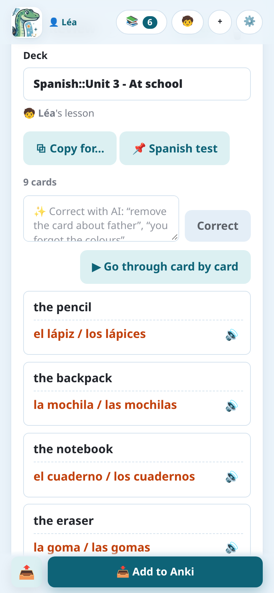
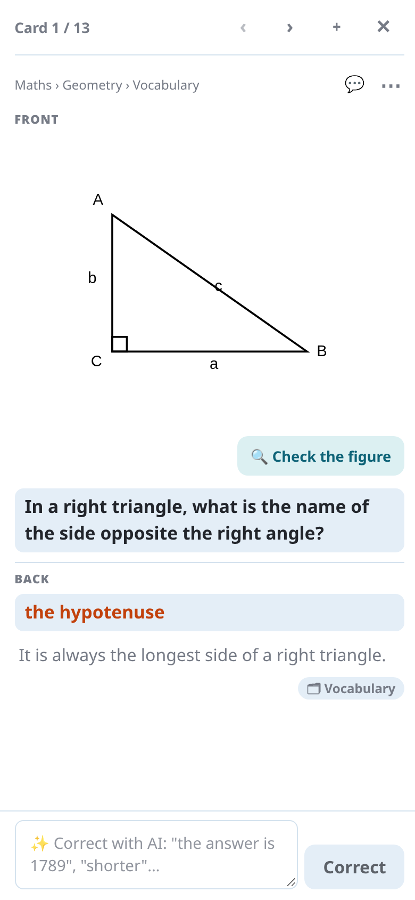
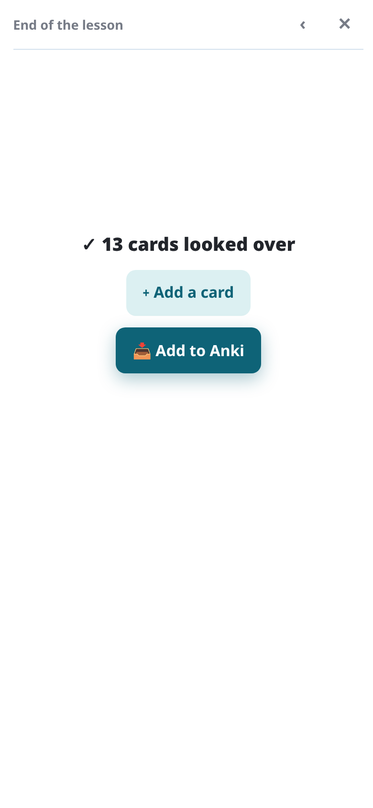
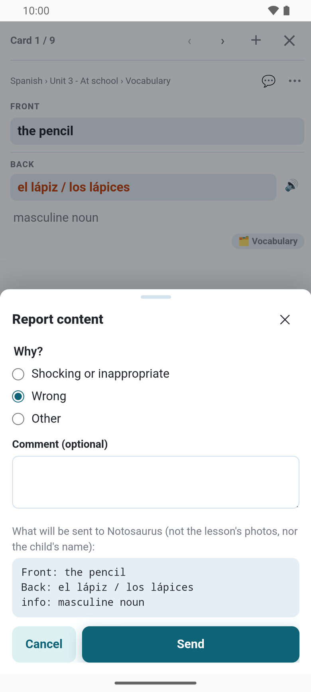
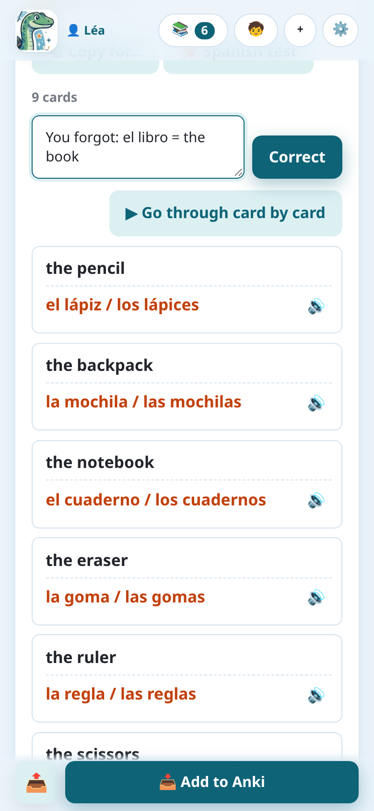

Até a melhor IA lê uma palavra errado de vez em quando: **confira sempre os cartões** antes de
enviá-los. Tudo o que você altera é salvo na hora ("✓ Salva").

:::tip[Algo errado? Relate]
No app Android, um cartão que não está certo (uma palavra mal lida, uma resposta errada, uma
figura torta, uma imagem inadequada, um cartão sem sentido): **⋯ → ⚑ Relatar** nele. Cada
relato é lido, e é o melhor jeito de fazer o Notosaurus ser corrigido. Veja
[Relatar um problema](#relatar-um-problema).
:::

## O baralho e os cartões

- **Baralho**: o nome do baralho do Anki. `::` cria subbaralhos: `Inglês::Unit 3 - At school`.
- **Voz**: o idioma em que os cartões são lidos em voz alta. Uma lição feita sem voz (nenhuma
  encontrada na época para seu idioma, ou nenhuma pedida) recebe uma aqui: escolha o idioma, e ela
  usa a voz escolhida para esse idioma nas configurações. **Sem voz**: nada é lido. Cartões a ler em
  uma lição sem voz: indicado em vermelho.
- Cada cartão tem uma **frente** (a pergunta) e um **verso** (a resposta).

### A lista

A lista é compacta, como uma prévia: a frente, o verso abaixo de uma linha pontilhada, uma imagem
pequena acima da pergunta ou depois da resposta, como no Anki, e só **🔊** para ouvir o cartão.
**Toque em um cartão para abri-lo**; **▶ Revisar cartão por cartão** abre o primeiro.

### Um cartão aberto

O cartão abre em tela cheia (uma janela no computador), com fórmulas e figuras desenhadas, como o
Anki vai mostrá-lo:

- no alto, em letra pequena, **o baralho dele** no Anki ("Paul › 6º ano › Inglês › … › Exercícios")
  e os botões dele: **📄 p. 3**, a página da lição de onde o cartão vem (tocado, as páginas da
  lição abrem em tamanho grande nessa página, **‹ ›** para as outras; nenhum para um cartão cuja
  página não se sabe), **💬 Explicar este cartão** e **Mais ações** (⋯);
- **FRENTE**: a pergunta, com a imagem dela quando ela vai na frente; uma linha, depois **VERSO**:
  a resposta e o **🔊** dela, a imagem quando ela vai no verso, depois a info e as ajudas;
- bem embaixo, o campo **✨ Corrigir com a IA**, com **Corrigir** ao lado (veja
  [Corrigir com a IA](#corrigir-com-a-ia)).

Toque em um texto para editá-lo. **Deslize o dedo** em qualquer lugar do cartão, ou toque em
**‹ ›**, para passar ao cartão anterior ou ao seguinte. Depois do último vem o **fim da lição**:
quantos cartões foram revisados ("✓ 12 cartões revisados"), **＋ Adicionar um cartão** e o botão
para enviar a lição ao Anki. **✕**, Esc ou o botão voltar do celular fecham o cartão, salvo.

Toque na imagem de um cartão para trocá-la: a página dela abre em tela cheia (veja
[Imagens](../card-types/#imagens)). Um cartão sem imagem: ⋯ → **🖼️ Adicionar uma imagem**.

- **+ info** acrescenta uma nota mostrada abaixo da resposta: gênero, plural, um exemplo…
- **+ subbaralho** coloca o cartão em um subbaralho da lição ("Vocabulário", "Verbos"); um cartão
  colocado em um mostra o nome do subbaralho. Tocado, ele abre uma lista: **Nenhum: no baralho da
  lição**, os subbaralhos da lição com o número de cartões de cada um, ou **Novo subbaralho…**.
- **🔊**, ao lado da resposta, toca-a com a voz da lição. Cada cartão diz quais faces são
  lidas: a resposta de um cartão de vocabulário, um texto com lacunas dos dois lados, inteiro (a
  frente como um ditado: escrevem-se nas lacunas as palavras ouvidas). O menu ⋯ do cartão: **Ler a
  frente em voz alta**, **Parar de ler o verso**…
- **Mais ações** (⋯) também exclui o cartão.

### Adicionar um cartão

**＋** no alto de um cartão aberto adiciona um logo depois dele; **＋ Adicionar um cartão**, embaixo
da lista ou no fim da lição, adiciona um no fim. O novo cartão abre, vazio; deixado vazio, ele some
ao ser fechado.

O mais simples, muitas vezes, é **deixar a IA escrevê-lo**: em **O que este cartão deve
perguntar?**, embaixo, diga o que ele deve perguntar ("o pretérito de ir", "a data da tomada da
Bastilha") e toque em **Escrever**. No celular nenhum teclado se abre: toque em **🎤** para ditar,
ou no campo para digitar. Você também pode preencher a frente e o verso você mesmo.

**📝 Instruções usadas nesta lição**, acima dos cartões, lembra o que foi pedido à IA.

## Uma lição que parece errada

Quando a própria lição parece ter um erro (anotações de um aluno, um erro de cópia: uma data, um
nome, um número ou uma fórmula errados), o cartão mantém o que a lição diz, com uma nota (⚠️)
explicando por que parece errado e a correção proposta. **Corrigir** a aplica; **Manter a lição**
dispensa a nota. Só erros claros e verificáveis são apontados, nunca uma convenção ou uma
simplificação, e a nota nunca vai para o Anki.

## Relatar um problema

No app Android, **⋯ → ⚑ Relatar**, no canto superior direito de um cartão, diz ao Notosaurus o
que deu errado: uma palavra mal lida, uma resposta errada, uma figura com uma marca no lugar
errado, uma imagem inadequada, um cartão sem sentido. Não hesite: **cada relato é lido**, e é
assim que esses erros são corrigidos no Notosaurus, para todas as lições futuras.

- Diga por quê (**Errado**, **Chocante ou inapropriado**, **Outro**) e, se quiser, acrescente um
  comentário: o que você esperava é o que mais ajuda.
- O que é enviado é o cartão inteiro como você o vê (os textos, a explicação quando mostrada, a
  imagem ou figura, a não ser que seja uma foto tirada por você); a janela mostra exatamente o
  quê, nunca as fotos da lição nem o nome da criança. Veja [Privacidade](../app-privacy/).
- Depois, você pode excluir o cartão ou retirar a imagem dele.

## Corrigir com a IA

Em vez de alterar os cartões um por um, peça com suas palavras, no campo acima dos cartões:

- "tire o cartão sobre o pai"
- "você esqueceu as cores no fim da página"
- "coloque o plural no verso, assim: the child / the children"
- "perguntas mais curtas"

Toque em **Corrigir**. A IA revê as fotos (com mais de 10 páginas, só os cartões: ela diz então o que não
pôde fazer sem as páginas) e muda só o que você pediu: os cartões alterados são
marcados como **alterado**, os novos como **novo**, e uma frase resume o que ela fez, com quantos
cartões foram adicionados, alterados e removidos. Embaixo dela:

- **↩ Desfazer** deixa os cartões como estavam;
- **🎯 Refazer com cuidado**, depois de uma correção rápida, faz de novo com a reflexão do modelo;
- **✓ Manter** a mantém: ela não pode mais ser desfeita.

A correção pode ser desfeita até você mantê-la ou começar a editar um cartão.

**Um só cartão** é corrigido a partir do cartão aberto, no campo **✨ Corrigir com a IA** embaixo
("a resposta é 1789", "mais curto"), depois **Corrigir**. Os mesmos **↩ Desfazer**,
**🎯 Refazer com cuidado** e **✓ Manter** aparecem; fechar o cartão, ou passar ao seguinte, também
mantém a correção.

No app, **🎤** ao lado do campo dita a correção. Não precisa parar o ditado antes: toque em
**Corrigir** direto, e o que você disse é escrito e depois enviado.

Mudou de ideia enquanto a IA corrige (a lição ou um só cartão)? **Cancelar** a interrompe na
hora: os cartões continuam como estavam.

## Explicar um cartão

**Explicar este cartão** (💬) pede à IA que o explique: o que ele quer dizer, e por que a resposta
é a resposta, em duas a quatro frases, no nível de um aluno, no idioma da página. Útil para uma
matéria que você esqueceu, ou um cartão que o aluno não entende.

Abaixo da explicação, a IA oferece só o que ajudaria com **esse** cartão:

- **Um exemplo**: uma frase com a palavra, um cálculo resolvido com a fórmula;
- **Um truque para lembrar**: quando existe um natural;
- **Por que está certo?**: quando não é óbvio, e para um cartão de múltipla escolha ou
  verdadeiro/falso (por que as outras opções estão erradas).

**Guardar em “Info”** acrescenta o que foi explicado à info do cartão: você o encontra no verso
no Anki. Cada explicação é uma chamada curta à IA: créditos no app; no computador, uma fração de
centavo com o Gemini Flash, cerca de um centavo com o Claude Sonnet, contados nos custos da lição.

## Gerar de novo

**✨ Gerar de novo**, abaixo das instruções, refaz os cartões da lição aberta, por exemplo com
outras instruções ou depois de adicionar uma página. Substitui os cartões; **↩ Desfazer** os traz
de volta, a não ser que as fotos tenham mudado. Se a lição já foi enviada ao Anki, os cartões
enviados ficam lá, e os novos são adicionados no próximo envio.

## Opções dos cartões

No fim da lição, uma linha diz como os cartões são perguntados: **↔ Nos dois sentidos** (o Anki
pergunta também verso → frente), **⌨️ Resposta escrita** (o Anki compara letra por letra), **🎧 Com
um ditado** (ouvir o verso, escrevê-lo) ou **🎧 Só ditado**.

Essas opções vêm das [instruções](../instructions/): a IA as lê no texto delas. Para mudá-las,
diga isso na correção, por exemplo "num sentido só" ou "com a resposta digitada": os cartões
continuam iguais, só muda como o Anki os pergunta.

A linha de baixo diz qual voz lê os versos. Ela vai incluída no baralho, então toca em qualquer
lugar, até offline.

## De quem é a lição

Acima dos cartões, uma linha diz para quem é a lição: **🧒 Lição de Paul**. No computador, se o
Anki estiver aberto no perfil de outro filho, ele avisa antes de você enviar os cartões.

**⧉ Copiar para…**, quando há outro filho, faz uma cópia da lição para ele: os baralhos dele, os
próprios cartões dele no Anki. É grátis: nada é pedido à IA.

No computador, uma lição compartilhada com todos os perfis por uma versão anterior abre em
**somente leitura** nos outros perfis: você ainda pode adicioná-la ao seu próprio Anki, ou
copiá-la, mas só pelo perfil do dono ela pode ser alterada. Veja [Vários filhos](../several-children/).
