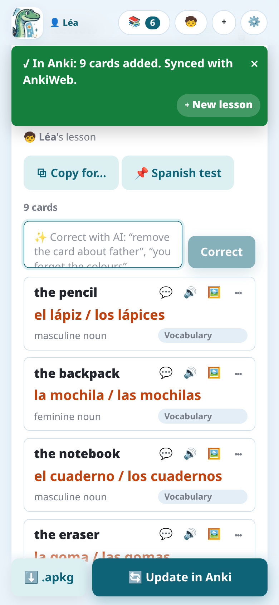

Com o complemento (ou no modo autônomo), depois de conferidos, os cartões vão para o Anki no
computador com um toque, ou como arquivo. No app Android, eles vão direto para o AnkiDroid: veja
[O app e o AnkiDroid](../app-ankidroid/).

## Adicionar ao Anki

**📥 Adicionar ao Anki** escreve os cartões direto no **perfil aberto no Anki**, no baralho da
lição, com o áudio e as imagens. Uma mensagem diz o que foi feito, por exemplo "✓ No Anki: 9
cartões adicionados. Sincronizado com o AnkiWeb." Se as imagens e figuras ainda estiverem sendo
desenhadas, o botão espera por elas e diz quantas estão prontas ("⏳ Imagens e figuras: 2 / 5
prontas…").

- Com o **complemento**, o próprio Notosaurus escreve no Anki: nada mais a instalar.
- O Notosaurus **autônomo** (sem o complemento) precisa do Anki aberto no computador com o
  complemento [AnkiConnect](https://ankiweb.net/shared/info/2055492159).
- Se a lição é de outro filho que não o do perfil aberto no Anki, o Notosaurus pergunta antes de
  escrevê-la na coleção errada (veja [Vários filhos](../several-children/)).

## Enviar uma lição de novo

Depois que a lição é enviada, e enquanto nada mudar, o botão diz **✓ Atualizado no Anki** (ele
ainda envia a lição de novo se preciso). Assim que algo que o Anki recebe muda (um cartão, a
imagem dele, o baralho, a voz, as opções), ele vira **🔄 Atualizar no Anki**: uma lição corrigida e
enviada de novo atualiza os cartões dela no Anki, com o histórico, em vez de duplicá-los. Veja
[Os cartões no Anki](../cards-in-anki/).

## O arquivo .apkg

**⬇️ .apkg** baixa o baralho como arquivo, com o áudio e as imagens, sem precisar do Anki aberto:

- **em um computador**, clique duas vezes nele: o Anki o importa;
- **no Android**, abra o arquivo baixado e escolha **AnkiDroid**. Se o AnkiDroid não aparecer,
  compartilhe o arquivo com o AnkiDroid, ou use **Importar** no menu do AnkiDroid;
- **em um iPhone**, abra-o com o **AnkiMobile** pelo menu de compartilhar.

Importar um `.apkg` mais recente da mesma lição também atualiza os cartões dela em vez de
duplicá-los.

Com o **complemento Notosaurus**, uma lição enviada com **📥 Adicionar ao Anki** e o `.apkg` dela
fazem os mesmos cartões: você pode misturar os dois, no computador e no celular. Com o
**AnkiConnect**, escolha um só caminho por perfil do Anki: um `.apkg` importado onde a lição já
foi enviada diretamente (ou em um perfil sincronizado com ele) adicionaria cada cartão uma segunda
vez.

## Fazer os cartões chegarem ao celular

Depois de **Adicionar ao Anki**, o Notosaurus **sincroniza o perfil com o AnkiWeb** (a opção
**Sincronizar com o AnkiWeb depois do envio**, nas configurações). Os cartões chegam então ao
AnkiDroid ou ao AnkiMobile na próxima sincronização deles. Se o perfil não estiver conectado ao
AnkiWeb, os cartões são adicionados ao Anki no computador, e a mensagem diz que não houve
sincronização.

Sem uma conta do AnkiWeb, o arquivo `.apkg` aberto no celular põe o baralho direto no AnkiDroid,
mas as revisões ficam então só naquele celular.
