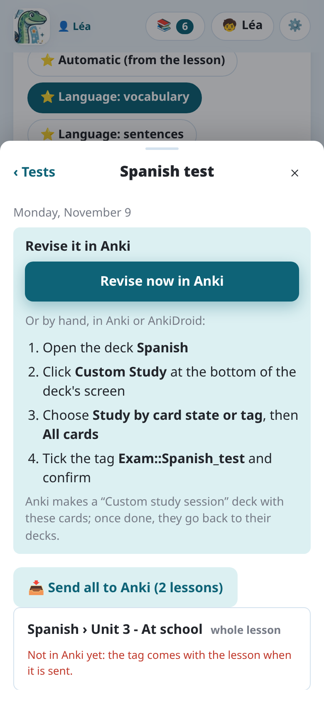

import { Tabs, TabItem } from '@astrojs/starlight/components';

Uma prova na segunda cobre três lições? Uma **prova a preparar** as junta, inteiras ou só alguns
dos cartões delas, para que a criança as revise juntas, seja qual for o baralho. Depois de
revisados, os cartões voltam aos seus baralhos.

## Criar uma prova

- A partir de uma lição: **📝 Preparar uma prova…**, na revisão dela, a adiciona a uma prova (um
  nome, uma data), inteira ou **só alguns dos cartões** (uma marca em cada cartão). Quando a lição
  está em uma prova, o botão mostra o nome da prova (**📌 …**).
- A partir da lista: as provas ficam no alto de **Minhas lições**, onde **＋ Nova prova** cria
  uma. A janela dela então adiciona lições (**＋ Adicionar lições**, inteiras) e envia ao Anki as
  que ainda não estão lá.

## No Anki: uma etiqueta

Cada cartão de uma prova recebe uma etiqueta no Anki, `Exam::<nome>`. Ela é posta nas notas na
hora, se já estiverem no Anki, ou junto com elas quando a lição é enviada.

Excluir uma prova (**Excluir a prova**, na janela dela) tira a etiqueta. Os cartões ficam no Anki,
com o histórico de revisão.

## Revisá-la

A janela da prova explica como, passo a passo. Com o **estudo personalizado** do Anki, à mão:

1. Abra o baralho que contém as lições.
2. **Estudo Personalizado** → **Estudar pelo status do cartão ou etiqueta**, e depois **Todos os
   cartões em ordem aleatória**.
3. Marque a etiqueta `Exam::<nome>` e confirme.

O Anki cria uma sessão com esses cartões; no fim, eles voltam aos seus baralhos. Quando as lições
estão em baralhos diferentes, a janela dá uma busca para colar em **Criar Baralho Filtrado**, com
um botão **Copiar**.

Um baralho filtrado os junta mais rápido:

<Tabs syncKey="mode">
<TabItem label="App Android">

1. Na janela da prova, **Abrir no AnkiDroid**: o navegador de cartões do AnkiDroid abre com os
   cartões da prova, seja qual for o baralho.
2. Toque em **⋮** e depois em **Criar baralho com filtros**, mesmo que a lista pareça vazia.
3. Toque em **Criar**. Com mais de 100 cartões, aumente antes **Limitar a**.

O AnkiDroid não deixa outro app criar sozinho um baralho filtrado: esses três toques são
necessários. Veja [O app e o AnkiDroid](../app-ankidroid/).

</TabItem>
<TabItem label="Computador">

Com o Anki aberto, **Revisar agora no Anki** faz isso em um clique: um baralho filtrado
"Prova: …" com os cartões da prova, aberto no Anki. Ele é recriado a cada vez, e excluído com a
prova.

</TabItem>
</Tabs>

Com vários filhos, uma prova é feita com as lições do filho escolhido: veja
[Vários filhos](../several-children/).
