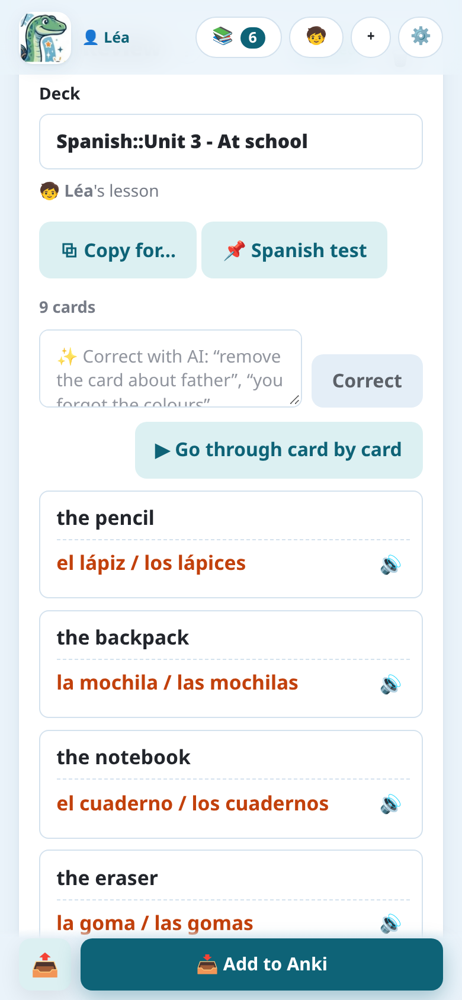
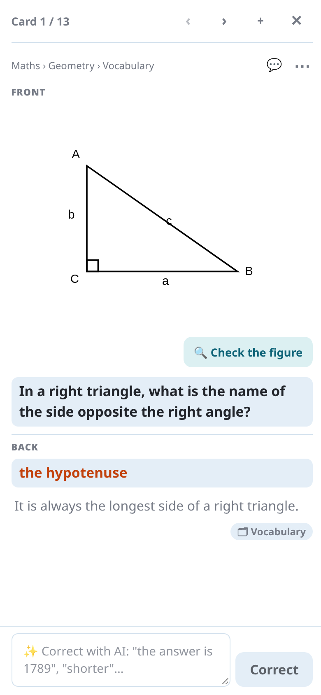
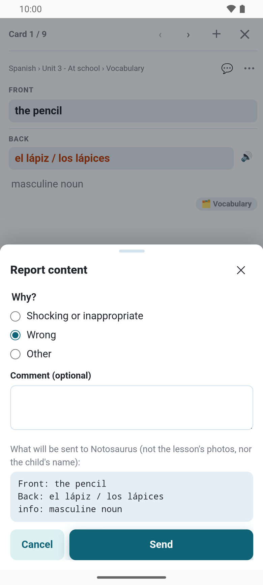
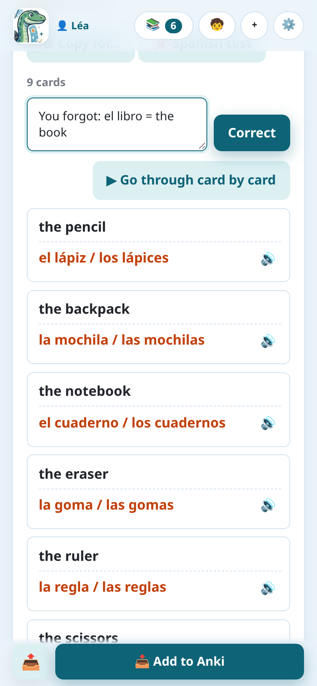

Even the best AI misreads a word now and then: **always look through the cards** before
sending them. Everything you change is saved as you go (“✓ Saved”).

:::tip[Something wrong? Report it]
In the Android app, a card that isn't right (a word misread, a wrong answer, a figure off, an
unsuitable picture, a card that makes no sense): **⋯ → ⚑ Report** on it. Every report is read,
and it's the best way to get Notosaurus fixed. See [Reporting a problem](#reporting-a-problem).
:::

## The deck and the cards

- **Deck**: the name of the Anki deck. `::` makes sub-decks: `Spanish::Unit 3 - At school`.
- Each card has a **front** (the question) and a **back** (the answer).

### The list

The list is compact, like a preview: the front, the back under a dotted line, a small picture
above the question or after the answer, as in Anki, and only **🔊** to hear the card. **Tap a
card to open it**; **▶ Go through card by card** opens the first.

### A card open

The card opens full screen (a window on a computer), formulas and figures drawn, as Anki will
show it:

- at the top, small, **its deck** in Anki ("Paul › Year 7 › English › … › Exercises") and its
  buttons: **💬 Explain this card** and **More actions** (⋯);
- **FRONT**: the question, with its picture when it goes on the front; a line, then **BACK**:
  the answer and its **🔊**, the picture when it goes on the back, then the info and the helps;
- at the very bottom, the field **✨ Correct with AI**, with **Correct** beside it (see
  [Correcting with the AI](#correcting-with-the-ai)).

Tap a text to edit it. **Swipe** anywhere on the card, or tap **‹ ›**, to go to the previous or
next card. After the last comes the **lesson's end**: how many cards were looked over ("✓ 12
cards looked over"), **＋ Add a card**, and the button to send the lesson to Anki. **✕**, Escape
or the phone's back button close the card, saved.

Touch a card's picture to change it: its page opens full screen (see
[Pictures](../card-types/#pictures)). A card without one: ⋯ → **🖼️ Add a picture**.

- **+ info** adds a note shown under the answer: gender, plural, an example…
- **+ sub-deck** puts the card in a sub-deck of the lesson ("Vocabulary", "Verbs"); a card put
  in one shows its sub-deck's name. Tapped, it opens a list: **None: in the lesson's deck**, the
  lesson's sub-decks with their number of cards, or **New sub-deck…**.
- **🔊**, beside the answer, plays it with the lesson's voice. A card says which sides are
  read: a vocabulary card's answer, a text with gaps on both sides, whole (its front as a dictation: the words heard, written in its gaps). The
  card's ⋯: **Read the front aloud**, **Stop reading the back**…
- **More actions** (⋯) also deletes the card.

### Adding a card

**＋** at the top of a card open adds one just after it; **＋ Add a card**, under the list or at
the lesson's end, adds one at the end. The new card opens, empty; left empty, it goes when
closed.

The simplest is often to have **the AI write it**: in **What should this card ask?**, at the
bottom, say what it should ask ("the past tense of go", "the date of the storming of the
Bastille"), then tap **Write**. On a phone no keyboard opens: tap **🎤** to dictate it, or the
field to type it. You can also fill in the front and the back yourself.

**📝 Instructions used for this lesson**, above the cards, reminds what the AI was asked.

## A lesson that looks wrong

When the lesson itself seems to contain a mistake (a pupil's notes, a copy error: a wrong date,
name, number or formula), the card keeps what the lesson says, with a note (⚠️) saying why it
looks wrong and the suggested correction. **Correct** takes it; **Keep the lesson** dismisses the
note. Only clear, verifiable mistakes are flagged, never a convention or a simplification, and
the note never goes to Anki.

## Reporting a problem

In the Android app, **⋯ → ⚑ Report**, at the top right of a card, tells Notosaurus what went wrong:
a word misread, a wrong answer, a figure with a mark in the wrong place, an unsuitable picture,
a card that makes no sense. Don't hesitate: **every report is read**, and it's how such mistakes
get fixed in Notosaurus, for every lesson to come.

- Say why (**Wrong**, **Shocking or inappropriate**, **Other**) and, if you like, add a comment:
  what you expected helps most.
- What is sent is the whole card as you see it (its texts, its explanation when shown, its
  picture or figure, unless it's a photo you took yourself); the sheet shows exactly what, never
  the lesson's photos nor the child's name. See [Privacy](../app-privacy/).
- Then you can delete the card or remove its picture.

## Correcting with the AI

Instead of changing the cards one by one, ask in plain words, in the field above the cards:

- “remove the card about the father”
- “you forgot the colours at the bottom of the page”
- “add the plural on the back, like: la regla / las reglas”
- “shorter questions”

Tap **Correct**. The AI sees the photos again and changes only what you asked: changed cards
are marked **changed**, new ones **new**, and a sentence sums up what it did, with how many cards
were added, changed and removed. Under it:

- **↩ Undo** brings the cards back as they were;
- **🎯 Again, carefully**, after a quick correction, makes it again with the model's thinking;
- **✓ Keep** keeps it: it can no longer be undone.

The correction can be undone until you keep it or start editing a card.

**A single card** is corrected from the card open, in the field **✨ Correct with AI** at the
bottom ("the answer is 1789", "shorter"), then **Correct**. The same **↩ Undo**,
**🎯 Again, carefully** and **✓ Keep** show; closing the card, or going to the next, keeps the
correction too.

In the app, **🎤** beside the field dictates the correction. No need to stop the dictation
first: tap **Correct** straight away, and what you said is written, then sent.

Change your mind while the AI is correcting (the lesson or a single card)? **Cancel** stops it
right away: the cards stay as they were.

## Explaining a card

**Explain this card** (💬) asks the AI to explain it: what it means, and why its answer is the answer, in
two to four sentences, at a pupil's level, in the page's language. Handy for a subject you've
forgotten, or a card the pupil doesn't understand.

Under the explanation, the AI offers only what would help with **that** card:

- **An example**: a sentence using the word, a worked calculation with the formula;
- **A way to remember it**: when a natural one exists;
- **Why is it right?**: when it isn't obvious, and for a multiple choice or a true/false card
  (why the other options are wrong too).

**Keep in “Info”** adds what was explained to the card's info: you'll find it on the back in
Anki. Each explanation is a short AI call: credits in the app; on the computer, a fraction
of a cent with Gemini Flash, about a cent with Claude Sonnet, counted with the lesson's costs.

## Generating again

**✨ Generate again**, under the instructions, makes the cards of the open lesson again, for
instance with other instructions or after adding a page. It replaces the cards; **↩ Undo**
brings them back, unless the photos changed. If the lesson was already sent to Anki, the cards sent stay there, and the new ones
are added at the next send.

## Card options

At the bottom of the lesson, a line says how the cards are asked: **↔ Both ways** (Anki also
asks back → front), **⌨️ Typed answer** (Anki compares letter by letter), **🎧 With a
dictation** (hear the back, write it), or **🎧 Dictation only**.

These options come from the [instructions](../instructions/): the AI reads them in their text.
To change them, say so in the correction, e.g. "one way only" or "with the answer typed": the
cards stay the same, only how Anki asks them changes.

The line below says which voice reads the backs. It is included in the deck, so it plays
everywhere, even offline.

## Whose lesson it is

Above the cards, a line says whom the lesson is for: **🧒 Paul's lesson**. On the computer, if
Anki is open on another child's profile, it says so before you send the cards.

**⧉ Copy for…**, when there is another child, makes a copy of the lesson for them: their decks,
their own cards in Anki. It's free: nothing is asked of the AI.

On the computer, a lesson shared with every profile by an older version opens **read only** in the other
profiles: you can still add it to your own Anki, or copy it, but only from its owner's profile
can it be changed. See [Several children](../several-children/).
