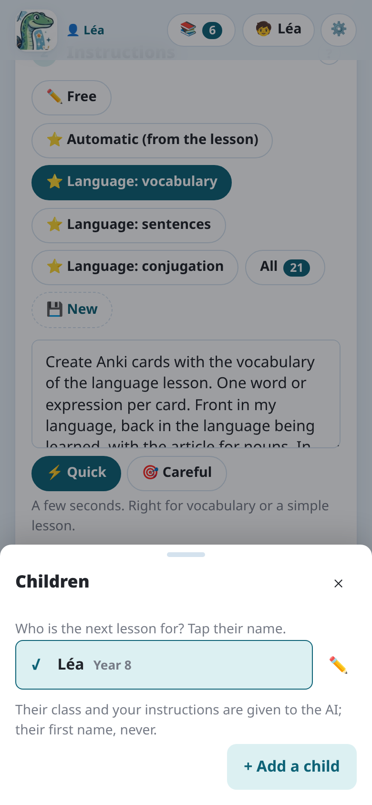
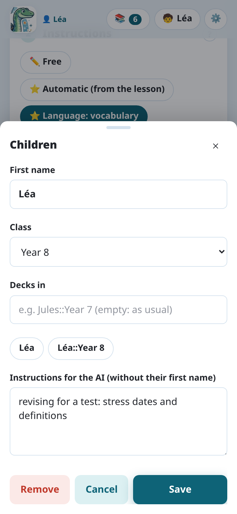
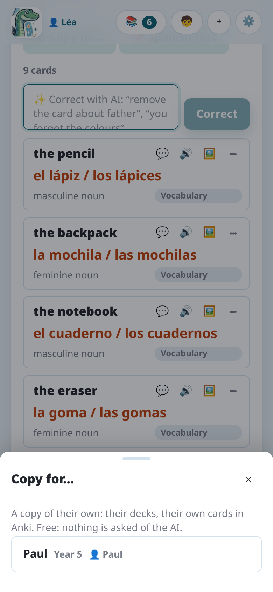

import { Tabs, TabItem } from '@astrojs/starlight/components';

Each child gets a **card** in Notosaurus: their first name, their class, the decks their lessons
go in, and your instructions for them. Each lesson is for one child. Where their cards go in
Anki depends on where Notosaurus runs: see [Where each child's cards go](#where-each-childs-cards-go).

## The children's cards

**🧒** at the top of the page opens **Children**. **+ Add a child** makes a card:

- **First name**: to tell them apart. It is **never sent to the AI**.
- **Class**: told to the AI, so that the cards fit the pupil's level.
- **Decks in**: where their lessons go in Anki, empty at first (the lesson's deck as usual).
  Under it, one tap on a suggestion fills it in: their first name (`Jules`), or their first name
  and class (`Jules::Year 7`), which follows when the class changes. The lesson's deck then
  comes after it: `Jules::Year 7::Spanish::Unit 3`. Typed by hand, `{class}` also becomes their
  class.
- **Instructions for the AI (without their first name)**: added to every lesson of that child
  (“still reads slowly: short sentences”, “revising for a test: stress dates and definitions”).

**Who is the next lesson for? Tap their name**: the child chosen is shown next to 🧒, and the
next lessons are for them. ✏️ next to a name edits their card.

Instructions for every child (“Spanish from Spain”) are in the settings: see [Instructions](../instructions/#standing-instructions).

## Lessons belong to a child

- A lesson is for the child chosen when it is made. Its review says whose it is: **🧒 Paul's
  lesson**.
- **📚 My lessons** shows the chosen child's lessons. With more than one child, the switch above
  the list shows **Every child's lessons**.
- On the computer, if Anki is open on another child's profile, the lesson says so before you send it: ⚠️ *Anki is
  open for Léa: open Paul's profile in Anki to send them their cards.*

### The same lesson for two children

Two children have the same lesson? **⧉ Copy for…**, in the lesson's review, makes a copy for
another child: their decks, their own cards in Anki, their own review history. It's free: nothing
is asked of the AI. The copy opens if that child is in the open profile; otherwise it waits in
their lessons.

On the computer, lessons shared with every profile by an older version stay visible to every profile, read only
except from their owner's profile: **⧉ Copy for…** gives each child their own.

## Where each child's cards go

<Tabs syncKey="mode">
<TabItem label="Android app">

The app writes into **AnkiDroid**, which has no profiles: one collection on the phone, logged in
to one AnkiWeb account. Each child's lessons go into their own decks: fill in their **Decks in**
with one tap on its suggestion (`Léa::Year 5`, `Paul::Year 8`), and each child opens **their own**
deck to review (Léa, Paul): AnkiDroid then only takes their cards. Not the button that reviews
everything.

Notosaurus keeps the children apart in that collection: the list of lessons shows the chosen
child's, grouped by subject (their name and class left out), and the decks suggested are theirs,
never another child's. Each child sees the other children's decks in AnkiDroid, though, and its
statistics are shared.

</TabItem>
<TabItem label="Computer">

**One profile per child.** Cards go into the profile open in Anki. For each child to have their
own cards and progress, give each one a profile:

1. In Anki, **File → Switch Profile → Add**, and create a profile per child (Léa, Paul…).
2. For each profile, create an **AnkiWeb account** and log in to it in that profile
   (**Tools → Preferences → Syncing**). One AnkiWeb account holds one collection, so each
   child needs their own.
3. On each child's phone, log in to **AnkiDroid** or **AnkiMobile** with that child's
   AnkiWeb account.
4. Open each child's profile in Anki, then **🧒** in Notosaurus, and make their card.

:::tip[No mailbox per child]
Many e-mail services accept aliases with a `+`: `parent+lea@example.com` and
`parent+paul@example.com` arrive in your own mailbox, but count as two addresses.
:::

A child's card belongs to the **Anki profile open when it was made**. Notosaurus only offers the
cards of the profile open in Anki: open Paul's profile, and Paul is chosen.

After **Add to Anki**, Notosaurus syncs the open profile with AnkiWeb. The cards reach the
child's phone at its next sync.

**One tablet for several children.** **AnkiDroid has no profiles**: an installation holds one
collection, logged in to one AnkiWeb account. AnkiMobile doesn't switch accounts without logging
out either. If the children share a phone or a tablet, the simplest is **a single Anki profile,
with one deck per child**:

1. Keep a single profile in Anki, logged in to a single AnkiWeb account, and log AnkiDroid in
   to that account.
2. Make a card for each child, and fill in their **Decks in** with one tap on its suggestion
   (`Léa::Year 5`, `Paul::Year 8`). Their lessons then go into their own decks, without typing
   their name again.
3. To review, each child opens **their own** deck (Léa, Paul): Anki then only takes their
   cards. Not the button that reviews everything.

Notosaurus then keeps the children apart in the same profile: the list of lessons shows the
chosen child's, grouped by subject (their name and class left out), and the decks suggested
are theirs, never another child's.

What you lose compared with one profile per child: each child sees the other children's decks
in Anki, and Anki's statistics are shared.

If each child has their own device, prefer **one profile per child**. For the tech-savvy:
AnkiDroid can be installed several times on the same device, one per child, each with their own
AnkiWeb account (the “parallel builds”, see the
[AnkiDroid FAQ](https://github.com/ankidroid/Anki-Android/wiki/FAQ)).

</TabItem>
</Tabs>
